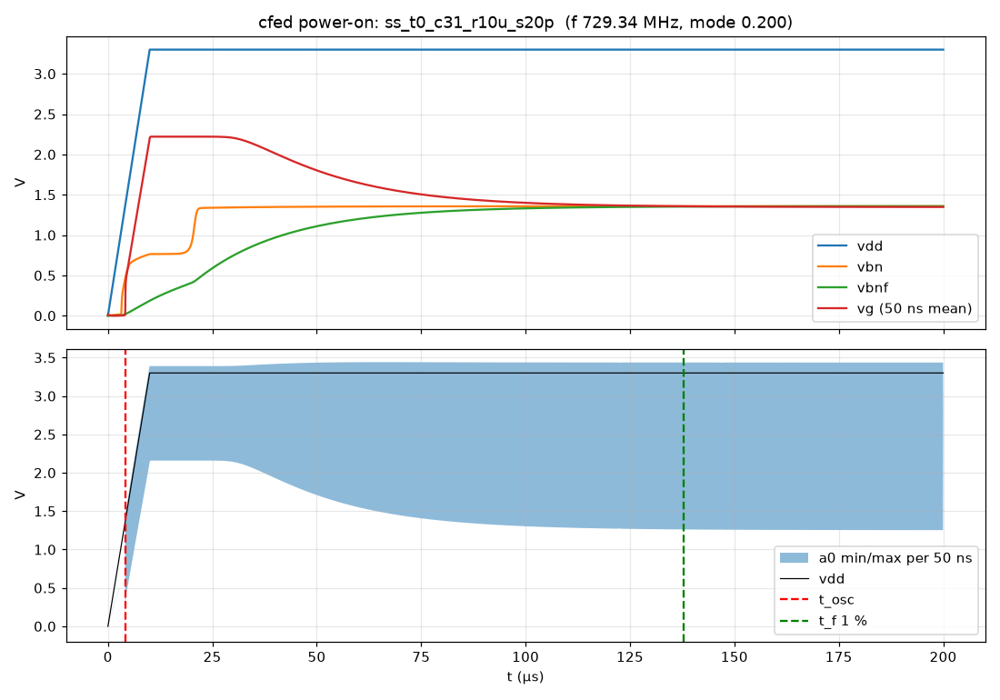

# Current-fed ring: power-on start-up (36 runs)

Brief: `docs/handoff_cfed_startup_mc.md`. Driver: `sim/pn/cfed_startup_run.sh`. Runs and analysis:
`sim/pn/cfed_startup.py`. Files: `sim/results/2026-11-08/startup/`. Image iic-osic-tools 2026.09, ngspice-47,
gf180mcuD, schematic.

## Result
**The ring starts at every point.** At all 36 points (5 corners × 27 °C plus ss/ff × 0/70 °C; codes 0 and 31;
VDD ramp 10 µs and 1 µs), it comes up from VDD = 0 into a clean fundamental-mode oscillation:

| check | result |
|---|---|
| mode (a0 → a2 phase) | 0.200 in every run |
| higher modes | none |
| stuck runs | none |
| vg above VDD | at most 19 mV |
| reference (vbn) | always reaches its DC value |

**Start-up time.** The worst case is 138 µs: ss 0 °C, code 31, 10 µs ramp, until f is within 1 % of its final
value. The vbnf RC filter (1 MΩ × 20 pF) sets this time, not the ring. The ring itself oscillates 0.3–4.2 µs after
the ramp starts.

**One flag, which comes from the map, not the circuit.** The settled f is 0.8–1.7 % below `map.csv` at every point,
and 30 of the 36 runs miss the brief's 1 % check. The cause is that `map.csv` measured f over 100–200 ns after a DC
start, before vg has settled behind its 3 pF decap. That window reads +0.6–0.7 % high on its own (see "f against the
map" below).

**Action for the map users.** For settled operation, take `map.csv` f as about 1.3 % high (0.8–1.7 %). The
433.92 MHz code is therefore slightly higher than the map says. Range still holds: code 31 at vctrl 1.65 is 719 MHz
at ss 70 °C.

## Method
- **Circuit:** the full cfed circuit (reference, RC filter, DAC, 3 pF vg decap, ring), with
  `winner_sets + lnw=5.023 ka=16 wfu=0.30 wff=0.30 rf=1e6 cf=20e-12`. That is the brief's design, and no values
  were changed.
- **Stimulus:** `tran … uic` with every node at 0 V and no `.ic`. VDD is a PWL ramp from 0 to 3.3 V in 10 µs or
  1 µs. The bit/bitb lines that are high follow the same PWL. vctrl is fixed at 1.65 V.
- **Output:** each run saves only vdd, vbn, vbnf, vg, a0 and a2 to a binary raw. Python analyses it and keeps a
  50 ns-binned `wave.npz`.
- **DC values:** a `.op` at VDD 3.3 V (same corner, temperature and code) gives the DC value of vbn and vbnf.
- **Measures:**

  | measure | definition |
  |---|---|
  | t_vbn, t_vbnf | last time more than 1 % from DC |
  | t_vg | last time the 50 ns mean of vg is more than 2 % from its final value |
  | t_osc | first a0 rise after which no gap between rises exceeds 100 ns |
  | t_f 1 % | time after which the 100-period mean f stays within 1 % of final |
  | f, mode, swing | measured over the last 2 µs |
  | mode | mean phase from an a0 rise to the next a2 rise, divided by the period; fundamental is 0.2 ± 0.07 |
  | max(vg − VDD) | over the whole run |
  | f drift | change over the last 10 µs |

- **Pass rules:** a run passes if it is not stuck, its mode is in range, |f − map| ≤ 1 %, vg − VDD ≤ 50 mV, vbn is
  at DC, and everything is settled 20 µs before the end.
- **Parallelism:** one ngspice thread per process, with 20 processes in parallel.

### Calibration (step size and run length)
- **Steady-state step check first:** tt 27 °C, DC start, 3 µs, with f compared against a 2 ps step.

  | max step | code 0 | code 31 |
  |---|---|---|
  | 5 ps | +0.0003 % | −0.0056 % |
  | 10 ps | +0.0023 % | −0.026 % |
  | 20 ps | +0.0155 % | −0.058 % |
  | 40 ps | +0.074 % | −0.28 % |

- **Then the brief's calibration:** tt 27 °C, code 0, 10 µs ramp, 220 µs, at 10 ps and 20 ps.
  - **Step:** the final f was 222.175 MHz at 10 ps and 222.202 MHz at 20 ps (Δ 0.012 %), so 20 ps was chosen.
  - **Run length:** f settled to 0.1 % at 171 µs, so the run length is ceil(171 + 20 µs) = 200 µs.
  - **Wall time:** 38.4 min at 10 ps and 19.3 min at 20 ps, on one CPU each.
  - **Estimate for the 36 runs:** 46 min. The actual time was 48 min.
- **Accuracy:** f over the last 10 µs drifts by at most 0.037 % (all runs). Against a 2 ps step, the 20 ps error at
  code 31 is −0.06 %.

## Results (36 runs)
From `summary.md`. Times are from the start of the VDD ramp. Swing is a0 min–max over the last 2 µs.

| corner | T °C | code | ramp µs | vbn DC V | t_vbn µs | t_vbnf µs | t_vg µs | vg V | t_osc µs | t_f 1 % µs | f MHz | vs map % | mode | swing V | vg−VDD mV | verdict |
|---|---|---|---|---|---|---|---|---|---|---|---|---|---|---|---|---|
| typical | 27 | 0 | 10 | 1.2320 | 27.8 | 103.1 | 64.7 | 2.106 | 3.2 | 125.1 | 222.16 | −1.23 | 0.200 | 2.04–3.41 | 16 | f vs map |
| typical | 27 | 0 | 1 | 1.2320 | 22.3 | 97.6 | 59.2 | 2.106 | 0.4 | 119.7 | 222.17 | −1.23 | 0.200 | 2.04–3.41 | 16 | f vs map |
| typical | 27 | 31 | 10 | 1.2320 | 28.1 | 106.0 | 99.3 | 1.520 | 3.2 | 125.8 | 794.62 | −1.32 | 0.200 | 1.44–3.42 | 16 | f vs map |
| typical | 27 | 31 | 1 | 1.2320 | 22.5 | 100.4 | 93.8 | 1.520 | 0.4 | 120.5 | 794.80 | −1.30 | 0.200 | 1.44–3.42 | 16 | f vs map |
| ss | 27 | 0 | 10 | 1.3841 | 32.2 | 106.9 | 73.7 | 1.967 | 3.9 | 130.4 | 199.97 | −1.46 | 0.200 | 1.88–3.42 | 13 | f vs map |
| ss | 27 | 0 | 1 | 1.3841 | 28.4 | 103.1 | 69.9 | 1.967 | 0.5 | 126.7 | 199.98 | −1.45 | 0.200 | 1.88–3.42 | 13 | f vs map |
| ss | 27 | 31 | 10 | 1.3841 | 32.5 | 109.8 | 109.8 | 1.303 | 3.9 | 130.5 | 731.88 | −1.26 | 0.200 | 1.21–3.43 | 13 | f vs map |
| ss | 27 | 31 | 1 | 1.3841 | 28.7 | 106.0 | 105.6 | 1.303 | 0.5 | 126.8 | 731.93 | −1.25 | 0.200 | 1.21–3.43 | 13 | f vs map |
| ff | 27 | 0 | 10 | 1.0828 | 26.1 | 102.0 | 58.2 | 2.242 | 2.6 | 122.0 | 250.91 | −0.98 | 0.200 | 2.19–3.40 | 18 | ok |
| ff | 27 | 0 | 1 | 1.0828 | 20.5 | 96.4 | 52.7 | 2.242 | 0.3 | 116.5 | 250.92 | −0.98 | 0.200 | 2.19–3.40 | 18 | ok |
| ff | 27 | 31 | 10 | 1.0828 | 26.3 | 105.0 | 91.8 | 1.723 | 2.6 | 123.3 | 868.12 | −1.38 | 0.200 | 1.66–3.40 | 18 | f vs map |
| ff | 27 | 31 | 1 | 1.0828 | 20.8 | 99.4 | 86.3 | 1.723 | 0.3 | 117.9 | 868.05 | −1.38 | 0.200 | 1.66–3.40 | 18 | f vs map |
| sf | 27 | 0 | 10 | 1.3372 | 28.2 | 103.2 | 64.4 | 2.061 | 3.2 | 126.9 | 216.17 | −0.82 | 0.200 | 2.00–3.41 | 14 | ok |
| sf | 27 | 0 | 1 | 1.3372 | 23.2 | 98.2 | 59.4 | 2.061 | 0.4 | 122.0 | 216.19 | −0.82 | 0.200 | 2.00–3.41 | 14 | ok |
| sf | 27 | 31 | 10 | 1.3372 | 28.5 | 106.1 | 101.0 | 1.485 | 3.2 | 126.1 | 805.00 | −1.29 | 0.200 | 1.41–3.42 | 14 | f vs map |
| sf | 27 | 31 | 1 | 1.3372 | 23.4 | 101.0 | 96.0 | 1.485 | 0.4 | 121.4 | 805.06 | −1.28 | 0.200 | 1.41–3.42 | 14 | f vs map |
| fs | 27 | 0 | 10 | 1.1283 | 27.5 | 103.1 | 64.7 | 2.116 | 3.3 | 123.3 | 222.83 | −1.57 | 0.200 | 2.04–3.40 | 17 | f vs map |
| fs | 27 | 0 | 1 | 1.1283 | 21.7 | 97.4 | 58.9 | 2.116 | 0.4 | 117.7 | 222.85 | −1.56 | 0.200 | 2.04–3.40 | 17 | f vs map |
| fs | 27 | 31 | 10 | 1.1283 | 27.7 | 106.0 | 97.7 | 1.533 | 3.3 | 124.4 | 776.94 | −1.37 | 0.200 | 1.45–3.41 | 17 | f vs map |
| fs | 27 | 31 | 1 | 1.1283 | 22.0 | 100.3 | 92.0 | 1.533 | 0.4 | 118.4 | 776.89 | −1.37 | 0.200 | 1.45–3.41 | 17 | f vs map |
| ss | 0 | 0 | 10 | 1.3579 | 31.7 | 111.9 | 77.1 | 1.966 | 4.2 | 137.7 | 196.46 | −1.29 | 0.200 | 1.88–3.42 | 13 | f vs map |
| ss | 0 | 0 | 1 | 1.3579 | 27.9 | 108.1 | 73.3 | 1.966 | 0.5 | 134.1 | 196.48 | −1.28 | 0.200 | 1.88–3.42 | 13 | f vs map |
| ss | 0 | 31 | 10 | 1.3579 | 32.0 | 114.9 | 114.4 | 1.348 | 4.2 | **137.9** | 729.34 | −1.31 | 0.200 | 1.25–3.44 | 13 | f vs map |
| ss | 0 | 31 | 1 | 1.3579 | 28.1 | 111.1 | 110.5 | 1.348 | 0.5 | 134.4 | 729.42 | −1.30 | 0.200 | 1.25–3.44 | 13 | f vs map |
| ss | 70 | 0 | 10 | 1.4148 | 33.0 | 100.1 | 68.7 | 1.975 | 3.5 | 120.5 | 200.43 | −1.73 | 0.200 | 1.90–3.42 | 14 | f vs map |
| ss | 70 | 0 | 1 | 1.4148 | 29.2 | 96.4 | 65.0 | 1.975 | 0.4 | 116.8 | 200.43 | −1.72 | 0.200 | 1.90–3.42 | 14 | f vs map |
| ss | 70 | 31 | 10 | 1.4148 | 33.4 | 102.8 | 103.2 | 1.255 | 3.5 | 120.3 | 718.98 | −1.21 | 0.200 | 1.17–3.42 | 14 | f vs map |
| ss | 70 | 31 | 1 | 1.4148 | 29.6 | 99.1 | 99.2 | 1.255 | 0.4 | 116.2 | 718.82 | −1.23 | 0.200 | 1.17–3.42 | 14 | f vs map |
| ff | 0 | 0 | 10 | 1.0658 | 24.5 | 106.1 | 60.2 | 2.235 | 2.8 | 128.1 | 249.07 | −0.86 | 0.200 | 2.18–3.40 | 18 | ok |
| ff | 0 | 0 | 1 | 1.0658 | 19.0 | 100.6 | 54.7 | 2.235 | 0.3 | 122.8 | 249.09 | −0.85 | 0.200 | 2.18–3.40 | 18 | ok |
| ff | 0 | 31 | 10 | 1.0658 | 24.7 | 109.1 | 95.3 | 1.752 | 2.8 | 130.5 | 869.05 | −1.35 | 0.200 | 1.68–3.41 | 18 | f vs map |
| ff | 0 | 31 | 1 | 1.0658 | 19.2 | 103.7 | 90.0 | 1.752 | 0.3 | 124.8 | 868.81 | −1.38 | 0.200 | 1.68–3.41 | 18 | f vs map |
| ff | 70 | 0 | 10 | 1.1005 | 28.3 | 96.5 | 55.2 | 2.258 | 2.2 | 113.5 | 248.99 | −1.21 | 0.200 | 2.21–3.39 | 19 | f vs map |
| ff | 70 | 0 | 1 | 1.1005 | 22.6 | 90.8 | 49.5 | 2.258 | 0.3 | 107.9 | 248.99 | −1.20 | 0.200 | 2.21–3.39 | 19 | f vs map |
| ff | 70 | 31 | 10 | 1.1005 | 28.7 | 99.4 | 86.8 | 1.696 | 2.2 | 114.4 | 849.28 | −1.36 | 0.200 | 1.64–3.39 | 19 | f vs map |
| ff | 70 | 31 | 1 | 1.1005 | 23.0 | 93.7 | 81.1 | 1.696 | 0.3 | 108.7 | 849.33 | −1.35 | 0.200 | 1.64–3.39 | 18 | f vs map |

**Conclusions**
- **The ring starts early.** It runs once VDD reaches about 1.4 V: t_osc is 2.2–4.2 µs into a 10 µs ramp, or
  0.3–0.5 µs into a 1 µs ramp. It is in the fundamental mode at every point, and there is no stuck or higher-mode
  case. vg follows VDD during the ramp and overshoots it by at most 19 mV.
- **The reference starts in two stages.** In the worst-case plot, vbn sits near 0.77 V for about 10 µs after the
  ramp, then steps to its DC value. It is within 1 % of DC by 19–33 µs at every point.
- **The settling time comes from vbnf.** The RC filter has τ = 20 µs, so vbnf is within 1 % only at 91–115 µs. vg
  follows it: within 2 % at 49–114 µs, and at code 31 the slower of the two. f is then within 1 % at 108–138 µs.
- **Worst case:** ss 0 °C, code 31, 10 µs ramp, **137.9 µs**. A 1 µs ramp is 3–6 µs faster on every measure. If a
  shorter start-up is ever needed, rf × cf is the knob. That is a design change, so it is not made here.
- **Swing:** a0 overshoots VDD by up to 0.14 V on edges (max 3.44 V). This matches `map.csv` amax (3.41 V at tt),
  so it is not a start-up effect.

`startup_fail0.png` in the same folder plots the run furthest from the map: ss 70 °C, code 0, −1.73 %. It is the
same picture.

### f against the map
The brief compares the final f with `map.csv`. Every run is low (−0.82 to −1.73 %, mean −1.3 %), and 30 of the 36
runs miss the 1 % check. The f drift over the last 10 µs is ≤ 0.037 %, so the runs are settled, and the difference
is the map's.

`map.csv` comes from `topo_cmp.deck`: DC op plus ring `.ic`, then a 200 ns transient, with f taken from 10 periods
in 100–200 ns. I ran that same deck longer (`sim/pn/cfed_mapref.py`, tt 27 °C, `mapref.json`):

| code | map.csv | same deck, 100–200 ns, 5 ps | same deck, last 2 µs of 20 µs | start-up run, settled (200 µs) |
|---|---|---|---|---|
| 0 | 224.93 | 223.84 | 222.44 (vg 2.1044 → 2.1059 V) | 222.16 |
| 31 | 805.24 | 805.12 | 798.97 (vg 1.5088 → 1.5151 V) | 794.62 |

- **The 100–200 ns window reads high.** vg is still moving behind its 3 pF decap, so the map's f is 0.6–0.7 % high
  over 20 µs and about 1.3 % high once fully settled.
- **The rest is slow settling.** The 20 µs run is not fully settled either: vg and vbnf settle in about 100 µs, which
  accounts for the remaining 0.1–0.5 %.
- **Code 0 has an extra 0.5 % that I haven't traced.** The single-point deck gives 223.84 MHz against the map's
  224.93. The map runs many points in sequence in one deck, and that is the likely cause.
- **Effect on the map's uses.**
  - The map remains right for relative use: steps, fine range and monotonicity.
  - Absolute f sits about 1.3 % lower once settled. At 434 MHz that is about 5.6 MHz, about a third of a coarse step
    (≈ 18 MHz). The code for 433.92 MHz can therefore be one higher than `map.csv` gives; calibration finds it
    anyway.
- **Range is still met** with the settled values. In the brief's runs at vctrl 1.65 V, code 0 is ≤ 250.9 MHz and
  code 31 is ≥ 719 MHz. The range limits themselves are specified at vctrl 0 and 3.3 V, which this brief did not run.

I did not loosen the check. The verdict column keeps the brief's 1 % rule, and the flag is explained here.

## Run times
Times are from `status.txt`, on 20 CPUs throughout.

| step | start | end | min |
|---|---|---|---|
| 1 calibration (10 ps and 20 ps runs in parallel) | 13:12:35 | 13:51:02 | 38.5 |
| 2 the 36 runs (19.5–28.7 min each, 2 waves) | 13:51:02 | 14:39:27 | 48.4 |
| 3 summary | 14:39:27 | 14:39:30 | 0.1 |
| **driver total** | | | **86** |

- **Estimates:** 40 min for calibration and 46 min for the runs, against 38.5 and 48.4 actual.
- **Map check:** run after the driver, or within the 20-CPU budget while its pool was at ≤ 18. The 20 µs cases took
  2–3 min each.

## Script fixes and additions
- **New:** `sim/pn/cfed_startup.py` (calib/run/summary/one) and `sim/pn/cfed_startup_run.sh` (the driver, which reads
  the corner config block from the handoff).
- **New:** `sim/pn/cfed_mapref.py`, the map-window check.
- **Fixed before launch:** the raw-header parser. `split("Variables:")` matched "No. Variables:", so it now splits on
  "Variables:\n".
- **Changed before launch:** the vg overshoot flag threshold is now 50 mV. A 16 mV excursion during the ramp is
  normal, and every run still reports its value.
- **Not touched:** `sim/vco/`, `sim/mc/`, `layout/` and `mag/`. All default netlists are unchanged.

## Autonomy test
| rule | worked? |
|---|---|
| single driver, launched with `run_in_background` (no nohup) | yes |
| step chain: calibration → runs (read `calib.json`, `eta_min.txt`) → summary | yes, no gaps |
| deliberate failure (`CSU_FAILTEST=1`, before launch) | yes: `FAILED` with the log tail, exit 1, no push |
| per-step `Running … ETA` lines pushed | yes: f6312fa 13:12, 3d0d419 13:51, 85b68a6 14:39, b915d91 14:39 |
| per-step ETA accuracy | step 1 13:52 against 13:51; step 2 14:37 against 14:39 |
| heartbeat (ScheduleWakeup ≤ 60 min, re-armed) | yes: fired at 14:12 and was re-armed for 14:59; not needed at the end |
| woke on driver exit and went straight to the write-up | yes: woke at 14:39:34, 4 s after `DONE` |
| CPU budget ≤ 20 | yes. The extra map-check runs waited until the pool was at ≤ 18 |
| last sim to results push | see the commit time of this file against 14:39:27 (target < 30 min) |
