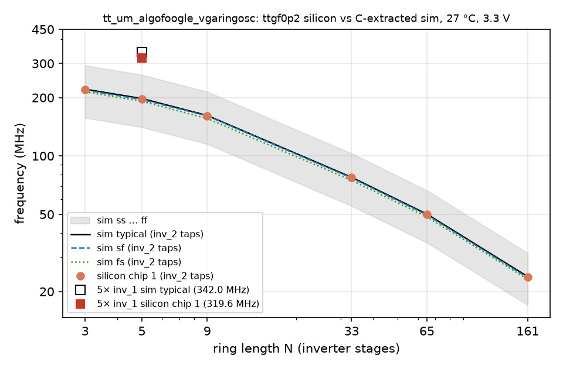

# GF180 silicon factor: ttgf0p2 ring oscillators vs extracted simulation

**Problem.** Our voltage-controlled oscillator (VCO) is designed from the extracted layout, but until now nothing told
us how far GF180MCU silicon sits from those simulations. On sky130 the silicon ran at about ×0.866 of the extracted
sim, so the tuning range had to cover ×0.7 … ×1.4 until the GlobalFoundries (GF) factor was known. This page compares
the ring oscillators in `tt_um_algofoogle_vgaringosc`, measured on the ttgf0p2 shuttle on 2026-11-09
(`bench/2026-11-09/`), with a simulation of the same tile extracted from the shuttle layout. Brief:
`docs/handoff_gf_silicon_factor.md`.

**Method.** Scripts and data are in `sim/silicon_factor/`.
- Layout: the shuttle OASIS file at TinyTapeout/tinytapeout-gf-0p2 commit 4150e96. The whole 1×1 tile, standard cells
  included, was flattened and extracted with magic 8.3.642 (capacitance only, `ext2spice lvs`, `cthresh 0`):
  11,899 transistors, 68,661 capacitors, 12.7 pF in total.
- Simulation: ngspice-47 with the KLU solver, 27 °C, 3.3 V, 10 ps transient step, the five process corners.
- Frequency: from the rising VDD/2 crossings of `uio_out[4]` (linear interpolation). Every period after 15 ns plus one
  edge is averaged, 7-28 periods per run. The period spread is at most 0.07 % at typical (0.25 % for inv4x5). The
  `tb.py` docstring says the first 30 % is discarded; the code does not do that, and this is what was run.
- 42 runs, all finished, with no "singular" or "Transient op started" messages in any log.

## Result

Frequencies in MHz; factor = silicon (chip 1) / sim typical.

| ring | stages | silicon chip 1 | chip 2 | sim typical | sim ss | sim ff | sim sf | sim fs | **factor** |
|---|---|---|---|---|---|---|---|---|---|
| 5× inv_1 (inv1x5) | 5 | 319.6 | 311.6 | 342.0 | 243.0 | 454.9 | 337.1 | 332.4 | **0.935** |
| 5× inv_4 (inv4x5) | 5 | not measured | not measured | 362.7 | 256.2 | 482.6 | 349.1 | 359.8 | - |
| inv_2 tap t3 | 3 | 220.5 | 216.0 | 220.9 | 157.1 | 292.9 | 218.5 | 214.0 | **0.998** |
| inv_2 tap t5 | 5 | 196.2 | - | 197.7 | 140.7 | 261.8 | 195.4 | 191.5 | **0.993** |
| inv_2 tap t9 | 9 | 160.7 | - | 161.8 | 115.3 | 214.3 | 161.0 | 155.9 | **0.993** |
| inv_2 tap t33 | 33 | 77.7 | - | 77.6 | 55.2 | 103.0 | 77.0 | 74.9 | **1.001** |
| inv_2 tap t65 | 65 | 49.9 | - | 50.1 | 35.7 | 66.4 | 49.7 | 48.5 | **0.995** |
| inv_2 tap t161 | 161 | 23.7 | - | 23.9 | 17.0 | 31.6 | 23.6 | 23.1 | **0.994** |

Fig. 1. Ring frequency against ring length, silicon chip 1 against the C-extracted simulation. The six inv_2 taps
(23.7-220.5 MHz) sit on the typical and sf lines, at 0.993-1.001 of typical. The fixed 5× inv_1 ring measured
319.6 MHz against 342.0 MHz simulated (0.935).

- **The inv_2 taps match typical to within 0.7 %** (0.993-1.001) over 3-161 stages. Every silicon point lies
  between the sf and typical corners, or within 0.2 % of that interval (t9 is 0.2 % below sf, t33 0.1 % above
  typical). fs is the slowest of the middle corners for this cell. The ss … ff range spans about ×0.71 … ×1.33 of
  typical (t3: 157.1 and 292.9 MHz against 220.9 MHz), so this wafer is close to typical and a factor of about 1.0
  is a check of the models, not a lucky wafer.
- **The 5× inv_1 ring, the closest to our 5-stage ring, gives 0.935.** It lies inside ss … ff, but below sf
  (337.1 MHz) and fs (332.4 MHz), while the inv_2 taps sit on sf and typical. The two results disagree. The bench
  notes call inv1x5 the least certain point: a 1.3 % restart spread, and the ÷8 counter runs at a 3.1 ns clock
  period, which may be marginal. It should be measured again, with a scope directly on `uio_out[4]` or a faster
  counter, before 0.935 is used as a design number.
- **The 5× inv_4 ring was not measured.** `uio[1]` was held low on the carrier, so clksel2 = 2 behaved as 0 and the
  206.5 MHz reading was an inv_2 tap, not the inv_4 ring (`bench/2026-11-09/raw/notes_div8.txt`).
- **Chip 2** ran about 2 % slower than chip 1 (t3 216.0 MHz, inv1x5 311.6 MHz).
- **Wire resistance does not matter here.** A resistance-capacitance (RC) extraction at typical gives inv1x5
  342.0 → 341.9 MHz and t3 220.9 → 220.8 MHz (−0.03 % and −0.04 %), so the C-only result stands.

### Gate delay and overhead
A straight line T = a·N + b, with T = 1/f in ns and N the number of stages, separates the delay per stage (a) from
the fixed overhead of the tap multiplexer and output path (b). Fitted on the same six taps:

| | silicon chip 1 | typical | ss | ff | sf | fs |
|---|---|---|---|---|---|---|
| a (ns/stage) | 0.2374 | 0.2359 | 0.3302 | 0.1784 | 0.2389 | 0.2431 |
| b (ns) | 4.238 | 4.234 | 5.966 | 3.185 | 4.254 | 4.400 |
| silicon / typical | - | a 1.006, b 1.001 | | | | |

Both parts match typical to within 0.6 %: silicon carries the small difference in the gate delay, not in the
overhead. The bench report's fit (a = 0.240 ns/stage, b = 4.19 ns) uses all 14 measured taps (3-161 stages) rather
than these six. The line is not a perfect fit (residuals up to +0.9 ns at 33 stages, in silicon and sim alike), so a
and b move slightly with the taps chosen; on the same six taps the bench data gives 0.2374 / 4.238.

### Magic version
Extracting the same tile with magic 8.3.684 gives 64,099 capacitors and 9.33 pF, against 68,661 and 12.72 pF with
8.3.642. By class:

| capacitor class | 8.3.642 | 8.3.684 |
|---|---|---|
| signal to signal | 49,851, 3.32 pF | 49,851, 1.99 pF |
| to VPWR | 9,408, 3.24 pF | 9,408, 2.60 pF |
| to VGND / substrate | 9,402, 6.15 pF | 4,840, 4.75 pF |

So 8.3.684 drops substrate capacitors and also reports smaller coupling values for the same capacitors. The cause has
not been investigated. The close silicon match with 8.3.642 supports keeping it for extraction.

## What it means for our VCO
Our ring uses the same device family (5 V nfet_05v0 / pfet_05v0 at 3.3 V). If the same factor applies, about 1.0
from the inv_2 taps or 0.935 at worst from inv1x5, the ×0.7 … ×1.4 margin carried since sky130 is far more than
needed, and the typical design point can be trusted. With 0.935 applied, the extracted range at vctrl 1.65 V,
193-851 MHz over the corners (`docs/remap_results.md`), becomes about 180-796 MHz and still covers 433.92 MHz.

## Limits
At the time of writing:
- one wafer and two chips were measured, and the lab temperature was not controlled;
- these are standard-cell rings with full logic swing, not our current-fed ring, so the factor transfers only through
  the shared device family;
- the extraction is C-only (the RC check above shows this does not matter for these rings);
- inv1x5 is the least certain silicon value, and inv4x5 was not measured.
