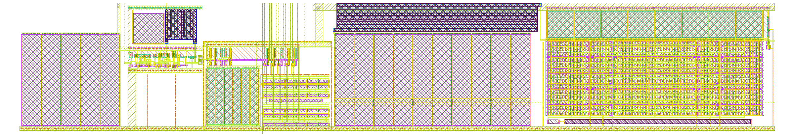

## How it works

> **Radio regulations.** This is an experimental, uncertified transmitter. The antenna driver is off unless ui_in[5] / ui_in[6] enable it. The coarse code alone puts the ring anywhere in about 193–851 MHz, and until the RP2350 has tuned it, it can be tens of MHz away from 433.92 MHz, outside the narrow 433.05–434.79 MHz licence-exempt band. That range includes frequencies used by aviation, emergency services and the 406 MHz distress beacons. The output is close to a square wave: in simulation the 3rd harmonic (1.3 GHz) is −14 dBc and the 5th −23 dBc at the dipole, well above the band's spurious-emission limits. Power is low (about +6 dBm, 4 mW, into the dipole), but transmitting over the air may need an amateur radio licence (the 70 cm band is 420–450 MHz in the US, 430–440 MHz in the UK and much of Europe), and outside the amateur band it may not be legal at all. Measure the frequency and harmonics with an SDR or spectrum analyser first, keep transmissions short, and prefer a cabled link with an attenuator. Receiving is fine. You are responsible for following your local rules.

This project is a tunable 433.92 MHz voltage-controlled oscillator (VCO) on GF180MCU, with no inductors and no
external components. It is the first part of an FM (frequency modulation) radio toolkit: the oscillator, dividers,
antenna driver and receiver front end on chip, with the digital work (tuning, demodulation, framing) done by the
RP2350 on the Tiny Tapeout board.

The oscillator is a current-fed ring: five plain inverters sit between VDD and a shared node, vg, and a current DAC
(digital-to-analog converter) sinks the ring current from vg to ground. The frequency follows that current.

- **Coarse tuning:** a 5-bit binary-weighted DAC (ui_in[4:0]) on top of a fixed base current. Each step is about
  4 % of the frequency.
- **Fine tuning:** one extra DAC leg driven by the analog pin vctrl (ua[0]). Over 0–3.3 V it covers more than one
  coarse step, so every frequency in the range can be reached, at every process corner.
- **Bias:** a constant-gm (beta-multiplier) reference with an n-well + n+ resistor, filtered by a 1 MΩ / 20 pF RC
  low-pass before it reaches the DAC. The filter keeps the reference noise off the ring; its output is vbnf, and the
  unfiltered bias vbn is brought out on ua[1] as a monitor.
- **Output:** the ring swings between vg and VDD, not rail to rail. An AC-coupled level shifter (2 fF metal-finger
  coupling capacitor and three inverters, with feedback that holds the duty cycle at about 50 %) restores full
  swing, and a true single-phase clock (TSPC) divide-by-4 brings it to about 108 MHz on uo_out[0].

Simulated on the extracted layout (27 °C, 3.3 V):

| | |
|---|---|
| Range, vctrl 1.65 V, all process corners | 193–851 MHz |
| Code for 433.92 MHz (tt / ss / ff / sf / fs) | 9 / 11 / 7 / 9 / 10, vctrl 1.75–2.25 V |
| Fine tuning gain at 433.92 MHz | 25–47 MHz/V |
| Power at 433.92 MHz | about 0.45 mW (ring + bias) + 0.6–0.9 mW (level shifter and divider) |
| Supply sensitivity | about −0.008 % per 10 mV |
| rms FM noise, 1–10 kHz (schematic) | about 8 kHz |

The frequency drifts by about +100 ppm/°C around room temperature in this version; the bias resistor length that
moves the drift null to 27 °C has been found but is not in this layout at the time of writing.

Design notes, simulations and the xschem schematics are in the project repository:
https://github.com/mattvenn/gf-433-oscillator

Made with [Claude Code](https://claude.com/claude-code).

## How to test

1. Power the board and select this project.
2. Set vctrl (ua[0]) to about 2 V, from a DAC or a potentiometer between 0 and 3.3 V.
3. Set the 5-bit code on ui_in[4:0] (ui_in[0] is the least significant bit) and measure the frequency on uo_out[0].
   It is the oscillator frequency divided by 4: 433.92 MHz gives 108.48 MHz. The RP2350 can count it with a PIO
   state machine.
4. To tune to a target, binary-search the code with vctrl at mid-range, then adjust vctrl for the fine setting.
   Around 433.92 MHz, ±50 kHz of FSK (frequency-shift keying) needs about ±1–2 mV of vctrl.
5. ua[1] shows the bias voltage vbn (about 1.1–1.4 V depending on the process corner); load it only with a
   high-impedance probe.

The silicon frequency may differ from simulation by tens of percent; the range is wide enough that a code near
433.92 MHz should still exist, but expect the code to differ from the table above.

## External hardware

- A voltage source for vctrl (ua[0]): the RP2350 with a filtered PWM (pulse-width modulation) output, or a
  potentiometer.
- A frequency counter or the RP2350 to measure uo_out[0].
