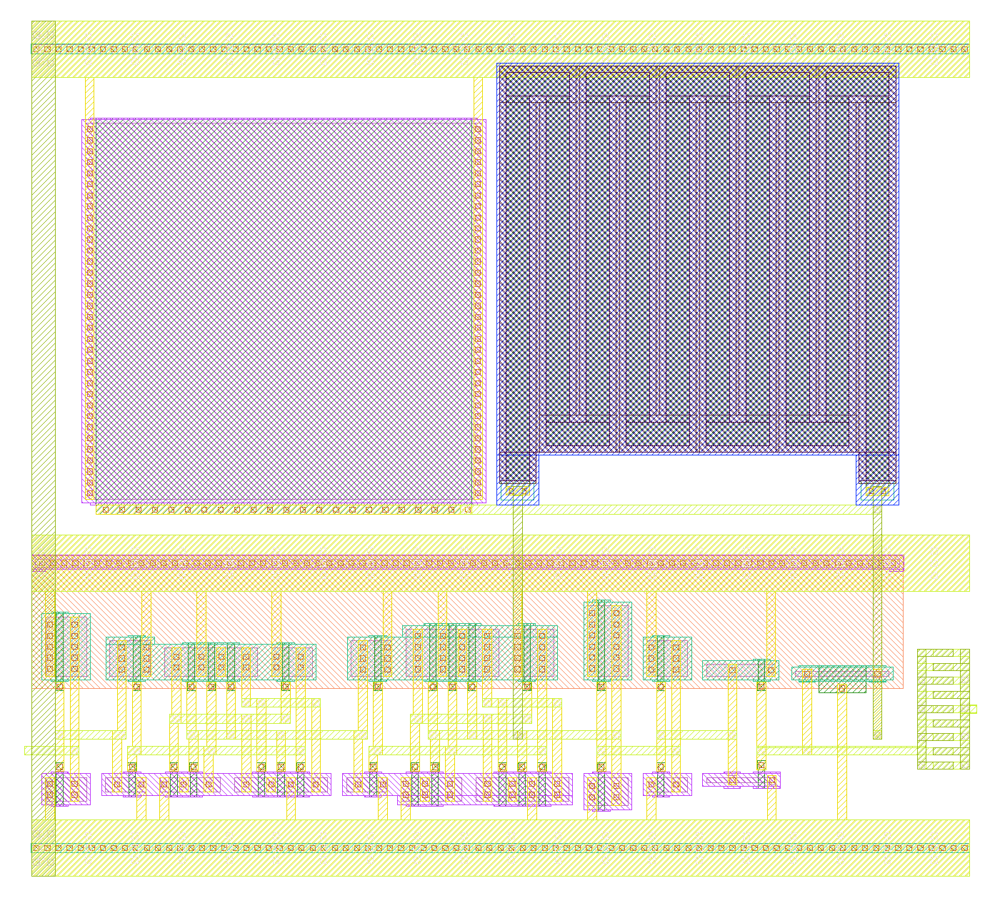

# Level shifter + TSPC ÷4 layout (lsdiv)

This page covers the layout of the a0 level shifter (LS), the true single-phase clock (TSPC) ÷4 and the clock buffer
for the Zero to ASIC Course 433 MHz oscillator. The circuit is `sim/lsdiv/lsdiv.py` `block()` (= `xschem/lsdiv.sch`,
design notes in `docs/lsdiv_design.md`). The layout comes from a generator, `layout/gen/lsdiv.py`, which writes
`layout/lsdiv.gds` (top cell `lsdiv`).

**Fig. 1.** The lsdiv layout, 40.5 × 37.0 µm. At the bottom right is the logic band, with Cc (1.99 fF extracted) at
the right edge. R1 (top right) and C1 (top left) sit above the VDD rail.

## Floorplan
- **Size:** bbox 0…40.49 × −2.70…34.31 µm (1498 µm²). It uses the same y origin as `layout/ring_core_v3.gds`, so
  the a0 pin (M2, right edge, y = 4.715 µm) lines up with the core's a0 tap. Place lsdiv with its right bbox edge on
  the core's left bbox edge, and the two a0 M2 shapes meet.
- **Logic band (bottom):**
  - from the bottom up: the VSS rail (M1 + M2, p+ tap strip under it), the N row, a 4-track M2 routing channel, the
    P row in the n-well, and the VDD rail (n+ well tap strip under it);
  - columns from left to right: B1, D2, D1, INV3, INV2, INV1, LRB, Cc;
  - every terminal reaches its track through an M1 stub and a via1. The generator picks each column's strip order
    and P-row offset by the shortest total track length.
- **Passive band (top):**
  - C1 (nfet_03v3 16 × 16 µm gate cap) and R1 (hi-res poly, 10-strip serpentine), under a second VSS rail;
  - the two VSS rails are joined by an M3 strap at the left edge;
  - ls and lf reach R1 and C1 on M3. R1's lf terminal sits straight above LRB, and its ls terminal above D1 / INV3.
- **Cc:** interdigitated M2 and M3 fingers, 9 per layer, 0.3 / 0.3 µm, 1.15 µm overlap. The a0 and lg fingers swap
  between the two layers. The a0 spine is at the right edge and the lg spine faces INV1 / LRB.
- **INV1:** flipped, so its output stub is on the far side from lg, and widened (2.2 µm drain region). This cut the
  lg–lo1 (Miller) coupling from 1.3 fF to 0.2 fF.
- **Pins:** VDD and VSS (M2 rails), a0 (M2, right edge) and ck (M2, left edge). No Metal4 or Metal5 is used.

## Checks (`layout/gen/check_lsdiv.sh`)
| Check | Result |
|---|---|
| magic DRC (full) | count 0 |
| KLayout DRC (feol + beol, 176 decks, 768 rules run) | count 0 |
| Antenna | 0 violations. One feedback entry: C1 has S = D = VSS ("device missing 1 terminal"), as for the core's decap |
| LVS vs the xschem `lsdiv` netlist | `Final result: Circuits match uniquely.`, no property errors |
| R1 size (netgen treats it as a black box) | layout r_width 1 µm, r_length 159.12 µm; source 1 × 159.125 µm: pass |
| Mutation: XL2n W 0.6 → 0.7 | LVS fails (property errors), as expected |
| Mutation: tspc_t1 Xn3 gate clk → net4 | LVS fails (netlists do not match), as expected |
| Mutation: XB1p W 2.5 → 2.0 | LVS fails (property errors), as expected |

The LVS source is a copy of the xschem netlist with the **Cc line removed**: Cc is drawn as metal fingers, which
extract as parasitic C, not as a device. Its value is checked by extraction instead (below).

**Hi-res poly is 1 kΩ/sq on this run** (Tiny Tapeout, 2026-11-06; `docs/platform.md`), which is also the only
device magic extracts. R1 was sized for 3 kΩ/sq (500 kΩ); as drawn (1 × 159 µm) it is about 164 kΩ, and the
schematic now says `ppolyf_u_1k` at the drawn length, so no rename is needed for LVS. With R1 at 1k the extracted
block gives the same f and duty as at 3k at every corner run (Table 2 note); the block power rises by 0.01 mW.

## Extraction (`layout/gen/pex_lsdiv.sh c`, magic 8.3.642)
| Quantity | Extracted | Target / model |
|---|---|---|
| Cc (a0–lg coupling) | **1.99 fF** | 2 fF ± 20 % |
| C(a0) to everything else | **0.63 fF** (VSS 0.59, VDD 0.03) | ≤ about 1 fF beyond Cc (Cpa 0.2 fF modelled) |
| C(lg) to everything else (wiring only, no gate C) | **2.22 fF** (VSS 1.44, VDD 0.34, lf 0.23, lo1 0.21) | Cpg 0.4 fF modelled |
| ls / q1 / q2 / ck wiring C | 7.7 / 5.7 / 3.1 / 2.0 fF | 0 (ideal wires in the schematic) |
| TSPC internal nodes | 3–5.5 fF each | 0 |

- **lg's 2.2 fF:** most of it is the fringe C of the lg fingers and the 6.8 µm lg track to the substrate. It cuts
  the lg swing by about a third against the schematic, but the duty stays inside 46–51 % (Table 2).
- **The RC flow disagrees on a0.** `pex_lsdiv.sh rc` (ext2sim + extresist) gives a0 → VSS 2.62 fF, against
  0.59 fF in the C flow. Every other node agrees.
  - The difference is exactly Cc. A hand estimate of the a0 plate (about 4 µm² of M2 plus about 11 µm of edge)
    gives about 0.6 fF.
  - So this looks like a double count in the RC flow. The simulations use `layout/pex/lsdiv_c.spice`; wire R is
    negligible in a block this small.
  - Worth checking whether the core's RC netlist has the same effect on its ports.

## Simulation: extracted lsdiv on the extracted v3 core
`python3 sim/lsdiv/lsdiv.py ring --runs one|cand --ls x [--r1 1k|3k]` (default 1k, the run's option)
- **The deck:** `--ls x` swaps in `layout/pex/lsdiv_c.spice`. It keeps the 20 fF ck wire and the standard-cell D
  flip-flop (DFF) as loads, and drops Cpa / Cpg, because the extraction has the real ones.
- **Settings:** 27 °C, VDD 3.3 V, 1.2 µs, f measured over the last 40 %.
- **Power:** one supply feeds the whole block, so the power is the LS + ÷4 + buffer total.
- **Logs:** "ngspice done", no "singular" or timestep errors.

**Table 1.** tt, code 9, R1 = ppolyf_u_3k.

| | No block | Schematic block | Extracted block |
|---|---|---|---|
| f(a0) | 377.19 MHz | 373.04 MHz (−1.10 %) | **370.97 MHz (−1.65 %)** |
| LS duty | – | 49.5 % | **47.9 %** |
| ÷4 ratio | – | 4.0000 | **4.0000** |
| ls 10–90 % rise | – | 128 ps | 236 ps |
| Power, LS + ÷4 + buffer | – | 0.378 mW (0.236 + 0.142) | **0.630 mW** |

With R1 at 1k (`--r1 1k`) the extracted block gives 370.97 MHz, 47.9 % duty, ÷4 exact and 0.638 mW.

**Table 2.** Corners, R1 = ppolyf_u_3k. The schematic column uses ideal R1 and C1 (`sim/lsdiv/results/ring_main_c.json`).
Re-run with R1 = ppolyf_u_1k (`ring_candx1k_x.json`, 2026-11-08): every f within 0.01 MHz, duty and ÷4 identical, power +0.01 mW.

| Corner, code | f no block (MHz) | Δf extracted | Δf schematic | LS duty extracted / schematic | ÷4 | Power extracted / schematic (mW) |
|---|---|---|---|---|---|---|
| tt, 0 | 192.88 | −1.75 % | −1.16 % | 47.0 / 48.5 % | 4.0000 | 0.391 / 0.233 |
| tt, 31 | 704.20 | −1.58 % | −1.04 % | 49.2 / 51.0 % | 4.0000 | 1.017 / 0.561 |
| ss, 0 | 174.05 | −1.70 % | −1.10 % | 48.5 / 50.0 % | 4.0000 | 0.306 / 0.183 |
| ss, 31 | 649.48 | −1.54 % | −1.00 % | 51.2 / 52.9 % | 4.0000 | 0.863 / 0.485 |
| ff, 0 | 217.42 | −1.80 % | −1.24 % | 45.9 / 47.2 % | 4.0000 | 0.531 / 0.312 |
| ff, 31 | 768.58 | −1.62 % | −1.09 % | 47.4 / 49.1 % | 4.0000 | 1.232 / 0.668 |

**All points pass:** ÷4 exact, LS duty 40–60 %, f shift within −2 %.

## Limits, at the time of writing
- **The block draws about 1.7× the schematic power** (0.63 mW at tt, code 9; up to 1.23 mW at ff, code 31).
  - The routing adds 3–8 fF to ls, q1 and each TSPC dynamic node, and the ls edges are about twice as slow.
  - The lower lg swing also keeps INV1 / INV2 near their trip point for longer.
  - Ways to cut it: a more compact TSPC (shared poly instead of channel stubs) and a shorter lg route.
- **The f shift is −1.5…−1.8 %, against −1.0…−1.2 % in the schematic.** The extra 0.4 fF on a0 and the 1.99 fF Cc
  explain it.
- **Not yet run:** sf / fs, 0 / 70 °C, VDD ±4.5 %, Monte Carlo, the ÷4 low-frequency floor on the extracted block,
  and the supply decap (about 10 pF, at the top level).
