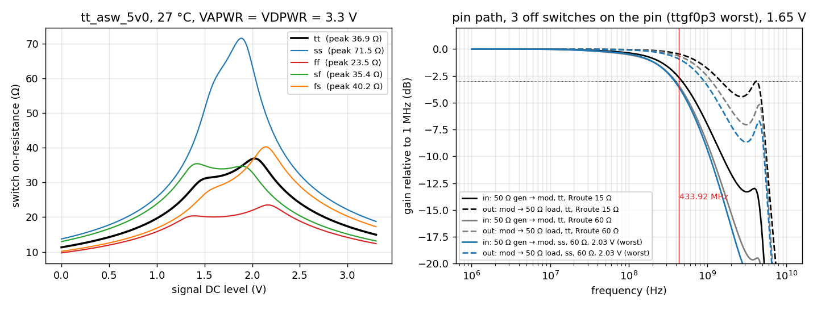
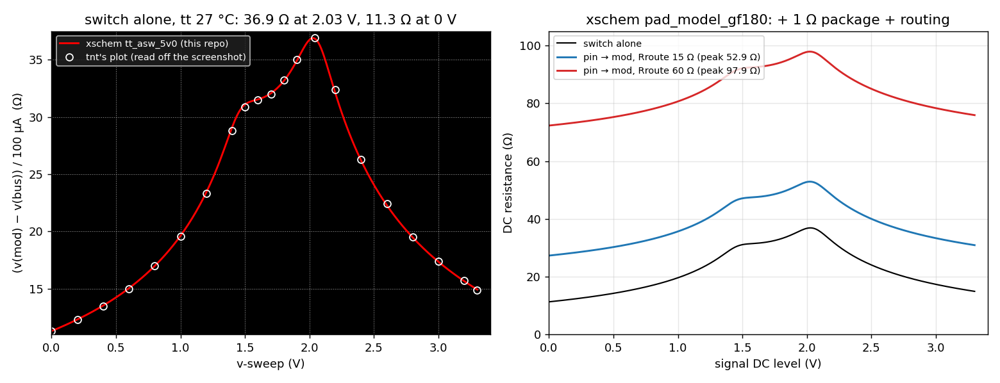

# GF180 analog pin model (`pad_model_gf180`)

[](https://claude.ai)

A SPICE model of one Tiny Tapeout GF180 (ttgf) analog pin, from the board pin to a project's `ua[]` port. It is
the GF180 version of tnt's sky130 `pad_model` (in
[tt08-analog-r2r-dac-3v3](https://github.com/mattvenn/tt08-analog-r2r-dac-3v3/blob/main/xschem/pad_model.zip)).

Files:
- `sim/pad/pad_model_gf180.spice` (the model) and `sim/pad/tt_asw_5v0.spice` (the analog switch);
- `sim/pad/tb_rdson.spice`, `sim/pad/tb_pad.spice`, `sim/pad/run.py`, `sim/pad/plot.py`, `sim/pad/check_xsch.py`;
- xschem, generated by `xschem/gen/pad_model.py`:
  [pad_model_gf180](https://xschem-viewer.com/?file=https://github.com/mattvenn/gf-433-oscillator/blob/main/xschem/pad_model_gf180.sch),
  [tt_asw_5v0](https://xschem-viewer.com/?file=https://github.com/mattvenn/gf-433-oscillator/blob/main/xschem/tt_asw_5v0.sch),
  [lv2hv](https://xschem-viewer.com/?file=https://github.com/mattvenn/gf-433-oscillator/blob/main/xschem/lv2hv.sch).

## What is in it

```
pin --Cpcb-- R1 -- L1 -- pad --(ESD diodes + Cpad)-- Rroute (pi, Croute) -- bus
bus -- tt_asw_5v0 (on) -- mod (Cmod)
bus -- n_off x tt_asw_5v0 (off; their project side is tied to VGND by the switch's own M3)
```

| Element | Value | Source |
|---|---|---|
| Cpcb, R1, L1 | 2 pF, 1 Ω, 1 nH | kept from the sky130 model (board, package, bond wire) |
| ESD diodes | 4 × `diode_nd2ps_06v0` to DVSS, 4 × `diode_pd2nw_06v0` to DVDD, 150 µm², 106 µm each | PDK netlist `gf180mcu_fd_io__asig_5p0` (the pad TT uses, through `tt_ckt_ana`) |
| Cpad | 1.29 pF | magic 8.3.642 flat C extraction of the `asig_5p0` GDS: 0.63 pF to DVDD, 0.49 pF to DVSS, 0.15 pF to VSS, 0.02 pF to VDD |
| Rroute | 15–60 Ω, default 40 Ω | tnt: pad-to-switch routing, depends on where the project is placed |
| Croute | 0.2 pF | **assumed**, not extracted |
| Switch | `tt_asw_5v0`: nfet_05v0 217/0.6 µm, pfet_05v0 592/0.5 µm, 3.3 V → 5 V level shifter | tt-multiplexer `asw/gf180mcuD` schematic (Sylvain Munaut) |
| n_off | 0–3, default 3 | other projects' switches on the same chip pin. TT spreads the analog projects over the chip's pins and places a switch only where a project uses the pin. ttgf0p3, the only GF shuttle with analog projects so far (TT index API), has 16 analog projects on 22 chip pins, 1–4 per pin. Sky130 shuttles have 3–11 per pin. Open shuttles on 2026-11-09 (project `info.yaml` files in the TinyTapeout shuttle repos): ttgf26c (ours, closes 2026-12-07) has 4 analog projects out of 10 using 10 `ua` pins, 12 with ours; ttgf26d has none of 36; ttsky26d has 8 of 168 using 25 pins over sky130's 12. So 3 is a conservative bound for ttgf26c and 0–1 is likely |
| Cmod | 250 fF | kept from the sky130 model (project-side route) |

Parameters: `rroute`, `croute`, `n_off`, `vsup` (DVDD, VAPWR and VDPWR inside the subcircuit, 3.3 V).
The switch's nf = 7 / nf = 16 devices are written as unit fingers with `m`, because one instance with nf falls
outside the ngspice model bins; the junction areas are the schematic's totals.

## Results (27 °C, 3.3 V)



**Fig. 1.** Left: switch on-resistance against the signal's DC level, 100 µA forced (tnt's `tb_rdson`). The tt curve
peaks at 36.9 Ω at 2.03 V and is 11.3 Ω at 0 V, the same as tnt's simulation (which he reports matches his silicon
measurement). The ss corner peaks at 71.5 Ω. Right: the pin path at 1.65 V with 3 off switches. With 15 Ω of routing
at tt, a 50 Ω generator into a high-impedance project input is −2.7 dB at 433.92 MHz (−3 dB at 470 MHz); a project
driving a 50 Ω instrument is −0.5 dB relative to DC (−3 dB at 1.46 GHz). The bump near 4 GHz is the 1 nH bond wire
resonating with the pad C, well above anything we use.



**Fig. 2.** Left: tnt's `tb_rdson` sweep run on the xschem netlist (`xschem/tt_asw_5v0.sch`), drawn on his plot's
axes. The circles are read by eye off his ngspice screenshot (about ±0.2 Ω); the curve passes through all 21, with the
same 36.9 Ω peak at 2.03 V and 11.3 Ω at 0 V. Right: the same sweep from the board pin to mod through the whole xschem
`pad_model_gf180` (n_off = 3): it adds the 1 Ω package resistor and the routing, peaking at 52.9 Ω (15 Ω routing) and
97.9 Ω (60 Ω routing). Script: `sim/pad/plot_tnt.py`, testbench `sim/pad/tb_pad_rdc.spice`.

| 1.65 V, n_off = 3 | tt, Rroute 15 Ω | tt, Rroute 60 Ω | ss, 60 Ω, 2.03 V | tt, 15 Ω, n_off = 0 |
|---|---|---|---|---|
| DC resistance pin → mod | 47.8 Ω | 92.8 Ω | 120.7 Ω | 47.8 Ω |
| In (50 Ω gen → mod), at 433.92 MHz / −3 dB point | −2.7 dB / 470 MHz | −3.5 dB / 389 MHz | −3.6 dB / 378 MHz | −2.0 dB / 582 MHz |
| Out (mod → 50 Ω), at 433.92 MHz / −3 dB point | −0.5 dB / 1.46 GHz | −0.7 dB / 1.11 GHz | −0.9 dB / 896 MHz | −0.4 dB / 1.83 GHz |
| Out, absolute at 433.92 MHz (includes the R divider into 50 Ω) | −6.3 dB | −9.8 dB | −11.6 dB | −6.2 dB |
| \|Z\| at mod, pin on 50 Ω, 433.92 MHz | 76 Ω | 103 Ω | 126 Ω | 81 Ω |
| C at mod, pin open (1 MHz) | 7.7 pF | 7.7 pF | 7.6 pF | 6.5 pF |

- **Most of the capacitance is outside the switches.** Of the 7.7 pF: Cpcb 2 pF, Cpad 1.29 pF, the ESD diodes, the
  routes and the on switch make 6.5 pF; each off switch adds about 0.39 pF. With the sky130-style 15 off switches it
  would be 12.1 pF, which is why the shuttle's pin sharing matters.
- **An internal node put on a pin sees about 7–8 pF.** Buffer anything fast before it goes to a `ua` pin.
- **The routing resistance and the switch's mid-rail peak set the DC loss into 50 Ω:** 6.2 dB at best (15 Ω, tt) and
  11.6 dB at worst (60 Ω, ss, 2.03 V). Bias a 50 Ω output near 0.5 V or 3 V, where the switch is about 15 Ω, if it
  matters.
- **Driving out is easier than driving in.** Out, the project's driver charges the bus C through the switch only;
  in, the 50 Ω generator and the routing both sit in series with the large pad-side C.

## Limits
- Schematic switch only; tnt's layout extraction of the switch is not in the repo (`mag/` is git-ignored).
- Croute is an assumption. Cpcb, R1, L1 and Cmod are the sky130 values. n_off depends on the shuttle's pin plan,
  which isn't known for ttgf26c yet; 0–3 is from ttgf0p3.
- VAPWR is 3.3 V here, as in tnt's testbench. The ttgf multiplexer config lists a 5 V power gate for VAPWR; a 5 V
  VAPWR would lower the switch R.
- tt process corner only for the AC table, plus one worst case; temperature 27 °C only.

## Rerun
```
tools/osic-mac python3 sim/pad/run.py tb_rdson tt          # and ss ff sf fs
tools/osic-mac python3 sim/pad/run.py tb_pad tt VCM=1.65 RROUTE=15 NOFF=3   # and 60 / NOFF=0
tools/osic-mac python3 sim/pad/run.py tb_pad ss VCM=2.03 RROUTE=60 NOFF=3
tools/osic-mac python3 sim/pad/plot.py
python3 xschem/gen/pad_model.py && python3 sim/pad/check_xsch.py              # schematics, then the check
```

## Schematic check (`sim/pad/check_xsch.py`, `build/pad/check_xsch.txt`)
The three sheets are netlisted headless and simulated with the same testbenches as the hand SPICE model.
- **tb_rdson (2 measures) and tb_pad (9 measures) agree within 1e-4:** CHECK OK.
- **Mutation:** one transmission-gate nmos finger 31 → 30 µm in a copy of the xschem netlist moves the Rdson peak
  from 36.89 to 37.00 Ω, so the check fails, as it should.
- The first run of this check found a real error in the hand SPICE model: the pmos drain and source were swapped
  relative to tnt's schematic, which put the larger (9-diffusion) junction on mod instead of bus. Fixed; the
  numbers above are after the fix.
