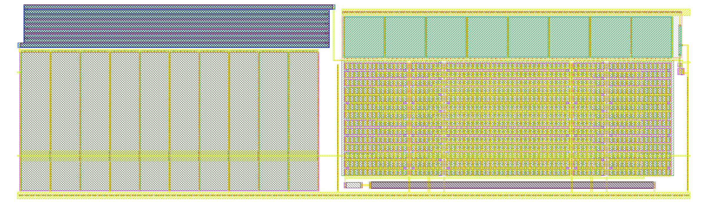

# Constant-gm reference + RC filter layout (cgm_ref)

This page covers the layout of the constant-gm (constant transconductance) bias reference and its vbn RC low-pass
filter for the Zero to ASIC Course 433 MHz oscillator. The circuit is `xschem/cgm_ref.sch` (the reference elements
of `sim/vco/vco_bias.py` `netlist()`; why it looks like this: `docs/bias_tuning_results.md`). The layout comes from a
generator, `layout/gen/cgm_ref.py`, which writes `layout/cgm_ref.gds` (top cell `cgm_ref`).

**Fig. 1.** The cgm_ref layout, 238.8 × 69.4 µm. Left: the 20 pF filter capacitor CF (10 vertical fingers) with
the 1 MΩ poly resistor RF folded above it. Right: the 14 × 70 nfet array (MN1 + MN2), the MP mirror on top and the
bias resistors (RBW, RBN) at the bottom. Extracted C on vbnf: 104 fF besides CF.

## Floorplan
- **Size:** bbox 0…238.75 × −2.70…66.70 µm (16 570 µm²). It uses the same y origin as `layout/ring_core_v3.gds`
  and abuts the core's right edge (core x = 67.19 µm is cgm_ref x = 0).
- **Pins** (all M2):
  - `vbnf` at the left edge, y = 42.665 µm: it meets the core's `vbn` (DAC gate) pin;
  - `vctrl` at y = 12.935 µm, an M2 feed-through from the left edge (the core's `vctrl` pin) to a pin on the right
    edge, with no device on it;
  - `vbn` (unfiltered, for monitoring) on the right edge, y = 46.205 µm;
  - `VSS`: the bottom rail, y −2.4…0 (M1 + M2, p+ tap), the same y as the core's VSS rail, along the whole cell;
  - `VDD`: the rail at y 62.88…65.28 over the array side only. It can't line up with the core's VDD rail
    (y 43.155…45.555): the MN array and the MP row stack between VSS and VDD and need about 62 µm.
  - The core's VSS and VDD M2 rails stop 0.98 µm short of its edge, so the rails are joined at the top level.
- **Column A (filter, x 0…112):**
  - CF: nfet_03v3 gate cap, 10 fingers of W 49.14 / L 10 µm, S/D columns into the VSS rail, gate strap (= vbnf)
    on top. The same structure as the core's vg decap.
  - RF: ppolyf_u_1k, 1 µm wide, a 9-strip horizontal serpentine (strips 105.75 µm, pitch 1.7 µm). The vbnf terminal
    is bottom left (straight down into the CF strap); the vbn terminal is top right, with an M2 drop to the vbn strap.
  - vbnf leaves on M2 along the left edge, over CF's first VSS S/D column.
  - vctrl crosses CF over a 4 µm VSS M1 shield, which is tied to the CF S/D columns.
- **Column B (array, x 113…234):**
  - **MN1 / MN2:** one row per series stage (14 rows, stage 0 at the top). Each row holds stage k of *both*
    devices in five groups along x: B14 A7 B28 A7 B14 (A = MN1, 14 units; B = MN2, 56 units). The pattern is mirror
    symmetric, so the MN1 and MN2 centroids of every stage sit on the same vertical line (common centroid in x;
    in y both devices share the row).
  - The gate poly runs vertically through all 14 rows (every gate is vbn). There is a poly dummy at each array edge,
    at the finger pitch.
  - Between rows k−1 and k, an M1 bar per group joins the S/D regions of node k of both rows: the series-parallel
    array has no other wiring. The MN1 bars of one gap are joined by an M2 track above the bar, the MN2 bars by one
    below.
  - The top bars are vbn (MN1, M1 into the gate strap) and net1 (MN2, M2 up to the MP gate strap). The bottom bars
    are VSS (MN1, M1 straps down into the rail) and net3 (MN2, an M2 track to RBW).
  - p+ tap strips with VSS M1 straps sit in the four group breaks and at the left edge. These are needed for DF.14
    (every n-diffusion within 20 µm of a substrate tap).
  - **MP1 / MP2:** 8 fingers of W 14 / L 14 µm in one row, P1 P1 P2 P2 P2 P2 P1 P1 (common centroid), with a
    shared gate strap (net1) underneath.
  - **RBW + RBN** (under the array, on the VSS rail): the n-well resistor (2 × 5.025 µm, n+ tapped n-well terminals,
    as the PDK's `nwell` cell) then the n+ diffusion resistor (2 × 100 µm), RBN's far end into the VSS rail.
- **Column C (start-up, x 234…239):** MS3 and MS2 under the straps; MS1 (0.5 / 10 µm, drawn with L along y) in the
  MP n-well. net2 goes from MS1 to the MS3 gate on M3, the only M3 in the cell. A VSS M1 strap with a p+ tap runs
  down the right side.
- No Metal4 or Metal5.

## The n-well resistor in GDS
magic's gf180mcuD tech writes every resistor with the RES_MK marker (110/5) except the n-well resistor: `rnw` is
not in its `allres` alias, so the GDS would hold RBW as plain n-well. Its `cifinput` has no `rnw` rule either.
- The generator adds RES_MK over the RBW body after magic writes the GDS. The PDK's KLayout LVS deck derives the
  n-well resistor as NWELL & RES_MK.
- `check_ref.sh` and `pex_ref.sh` repaint `rnw` on NWELL & RES_MK after `gds read`. The boxes are taken from the
  GDS with KLayout, not from the generator.
- Without the repaint, RBW extracts as a short (net3 = net4) and LVS fails, as it did on the first run.

## Checks (`layout/gen/check_ref.sh`)
| Check | Result |
|---|---|
| magic DRC (full) | count 0 |
| KLayout DRC (feol + beol, 176 decks, 768 rules run) | count 0 |
| antenna (magic, flattened) | 0 violations; 10 feedback entries: the CF fingers (S = D = VSS) |
| LVS (netgen) vs the xschem netlist | Circuits match uniquely, no property errors |
| RBW (nwell) size | 2 / 5.025 µm against 2 / 5.023 µm: +0.04 % L |
| RBN (nplus_u) size | 2 / 100 µm, exact |
| RF (ppolyf_u_1k) size | 1 / 970.23 µm, exact |

- The LVS source is the xschem netlist, with two documented edits:
  - `vctrl` is appended to the `.subckt` ports, because the feed-through is a labelled port with no device; without
    it netgen fails pin matching;
  - XRBW r_length is snapped to the 5 nm grid (5.023 → 5.025 µm). 5.023 µm can't be drawn, and netgen compares
    n-well lengths with zero tolerance.
- The resistor size check compares against the unsnapped source, with a 1 % tolerance on length. netgen
  black-boxes the PDK resistors, so their sizes are checked here.
- **Mutations** (each must fail):
  - XMN2s5 m 56 → 55 (one MN2 unit): fails, property errors;
  - XMS3 source vbn → net1: fails, netlists do not match;
  - XRBN r_length 100 → 90 µm: fails the size check (+11 %).

## Extraction (`layout/gen/pex_ref.sh`, magic 8.3.642)
- `c` → `layout/pex/cgm_ref_c.spice`; `rc` → `cgm_ref_rc.spice` → `rcfix.py` → `cgm_ref_rcx.spice`. The subckt is
  `cgm_ref VDD VSS vbn vbnf vctrl`.
- The RC fix corrected 4 nets, and every net's total C matches the C-only extraction within 0.01 %.

| Net | Total parasitic C (fF) | Main parts (fF) |
|---|---|---|
| vbn | 466 | VSS 190, net1 53, 13 each to the MN array's internal stack nodes (gate poly under the M1 bars) |
| vbnf | 104 | VSS 101, vctrl 3.0 (CF itself, 20 pF, is a device, not included) |
| vctrl | 34 | VSS 13, MN array internal nodes about 18, vbnf 3.0 |

- vctrl–vbnf was 6.5 fF before the M1 shield over CF; it is now 3.0 fF, or 1.5 × 10⁻⁴ of CF.
- vbn is a DC node: its 466 fF adds to the 20 pF filter node only through RF.

## Simulation (`sim/ref/ref_pex.py`, results in `sim/ref/results.md`)
Settings: code 9, vctrl 1.65 V, VDD 3.3 V. f(a0) is measured at mid-swing over the last 0.48 µs of 1.2 µs.
- The reference's supply is a separate source, vddr, in every case, so I(vddr) = I(MP1) + I(MP2) + I(MS1) is
  measured the same way on the schematic and on the layout.
- The schematic runs also give I(MN1) = Iref.
- The extracted reference in this table is the C-only `cgm_ref_c.spice`. The array's 992 unit nfets (the
  schematic has 31 instances with m) make each run about 15 minutes.
- The RC reference (`cgm_ref_rcx.spice`) at tt 27 °C gives 425.59 MHz, vbn 1.2319 V and I(vddr) 70.14 µA, the
  same as the C-only reference within 0.005 % in f. The reference's wiring R doesn't matter: it only sets DC bias.

| Config | Corner, T | vbn (V) | Iref = I(MN1) (µA) | I(vddr) (µA) | f(a0) (MHz) |
|---|---|---|---|---|---|
| schematic core + schematic reference | tt 27 °C | 1.2320 | 33.37 | 70.23 | 433.49 |
| extracted core + schematic reference | tt 27 °C | 1.2320 | 33.37 | 70.23 | 425.74 |
| extracted core + **extracted reference** | tt 27 °C | 1.2319 | (33.36)¹ | 70.21 | 425.61 |
| extracted core + schematic reference | ss 27 °C | 1.3841 | 35.44 | 73.80 | 389.62 |
| extracted core + **extracted reference** | ss 27 °C | 1.3840 | – | 73.77 | 389.50 |
| extracted core + schematic reference | ff 27 °C | 1.0829 | 31.44 | 67.04 | 470.35 |
| extracted core + **extracted reference** | ff 27 °C | 1.0828 | – | 67.02 | 470.22 |

¹ Scaled from I(vddr): the layout has no separate MN1 node to probe.

- **The extracted reference costs −0.03 % of f** at every corner (−0.12 to −0.13 MHz). vbn moves by −0.1 mV and
  the reference current by −0.04 %.
- The extracted core's −1.8 % against the schematic is unchanged (as in `docs/rc_extraction_fix.md`).
- vbnf sits 2.5–3 mV above vbn in every configuration, schematic included. This is the ring's switching coupling
  into the DAC gates, rectified on the 1 MΩ / 20 pF node; it is not a layout effect.

**Tempco** (tt, f at 20 / 27 / 35 °C, slope relative to f at 27 °C):

| Config | f20 / f27 / f35 (MHz) | Tempco |
|---|---|---|
| schematic core + schematic reference | 432.978 / 433.488 / 433.654 | +104 ppm/°C |
| extracted core + schematic reference | 425.136 / 425.735 / 426.009 | +137 ppm/°C |
| extracted core + extracted reference | 425.011 / 425.610 / 425.883 | +137 ppm/°C |

The drawn n-well length (5.025 µm against 5.023 µm) leaves the tempco unchanged within the measurement: the layout
reference gives the same slope as the schematic reference on the same core. The +137 against +104 ppm/°C comes from
the extracted core, not from the reference.

**Power-on** (reference + filter alone, all nodes at 0 V, VDD ramped 0 → 3.3 V in 10 µs, 600 µs):

| Corner (27 °C) | vbnf end, schematic / extracted (V) | Time to within 1 %, schematic / extracted (µs) |
|---|---|---|
| tt | 1.2320 / 1.2318 | 90.2 / 90.8 |
| ss | 1.3841 / 1.3839 | 87.8 / 88.5 |
| ff | 1.0828 / 1.0827 | 93.3 / 93.9 |

The extracted reference starts at every corner, and vbnf settles at the same time constant as the schematic (RF · CF
= 20 µs). It is flat to under 0.01 mV over the last 60 µs.

All run logs are free of "singular", "timestep too small" and "Transient op started". The extracted-reference
operating points needed true gmin stepping and then converged.

## Limits
- Simulated at 27 °C, with 20 / 35 °C for the drift only. ss / ff at 27 °C, VDD 3.3 V; sf / fs, 0 / 70 °C, VDD
  ±4.5 % and Monte Carlo (MC) on the extracted reference are not run yet. MC needs the unit devices as separate
  instances, which the layout netlist already has.
- The tempco and corner rows use the C-only reference extraction. The RC version was run at tt 27 °C only (same f
  within 0.005 %).
- The start-up check is the reference and filter alone, without the ring. The full-circuit start-up
  (`sim/pn/cfed_startup.py`) is not re-run on the extracted blocks.
- Top level: the VSS / VDD rails are not joined to the core's here, and the VDD rail is at a different height (see
  Floorplan). Metal4 power stripes or an M2 / M3 strap at the top level will join them.
- The RES_MK addition and the `rnw` repaint work around gaps in the PDK's magic tech file (2026.05 image). Not
  reported upstream yet.
