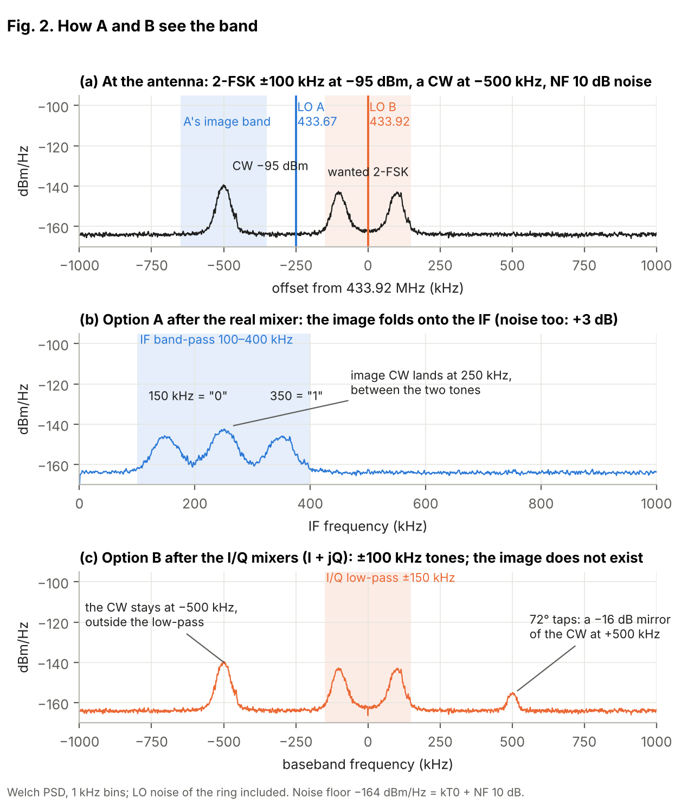
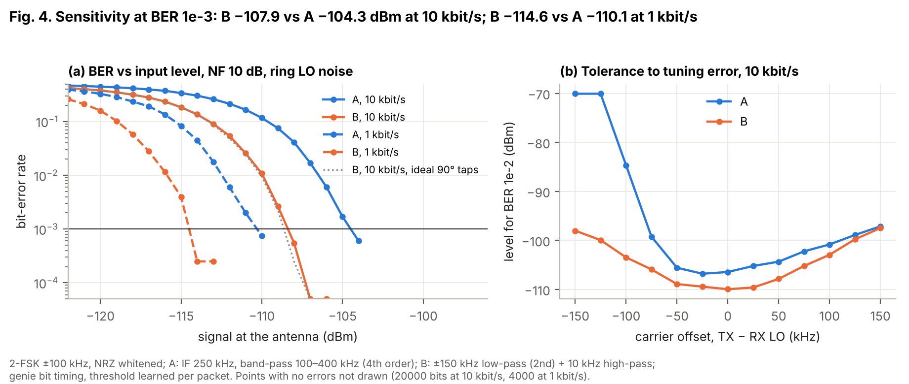
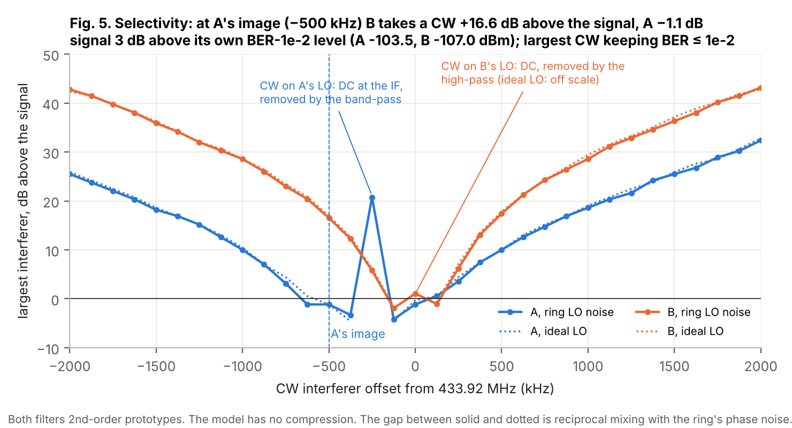
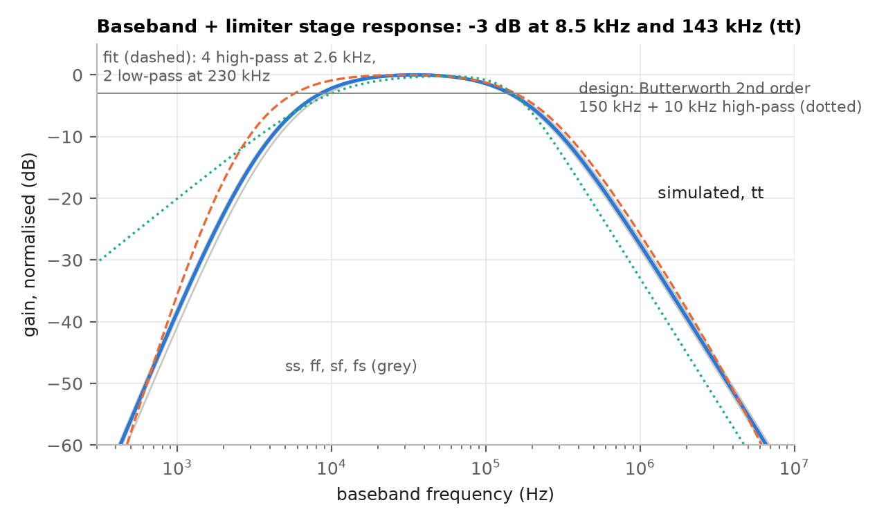
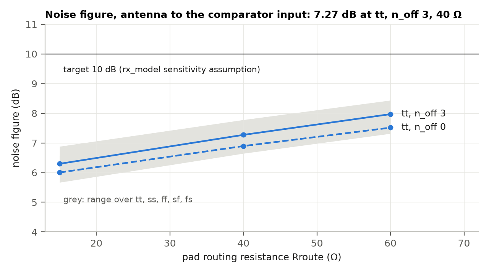
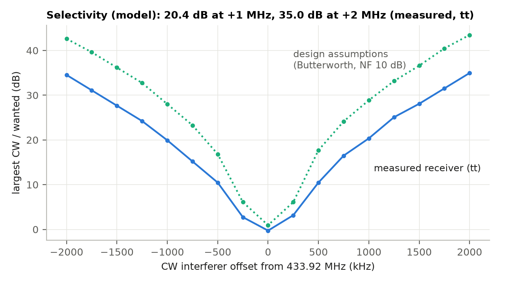

# Receiver (option B): block design and first-pass simulations

[](https://claude.com/claude-code)

This is the receiver for the 433.92 MHz FM radio toolkit on GF180MCU (Tiny Tapeout ttgf26c). It is a zero-IF
(intermediate frequency) receiver with I/Q (in-phase and quadrature) mixers fed by two taps of the VCO
(voltage-controlled oscillator) ring. A limiter per arm turns each baseband signal into one bit on uo[4] / uo[5]. The
RP2350's PIO (programmable I/O) then decodes the two bits as a quadrature counter, like a rotary encoder. This
document covers the first pass: each block sized and simulated at schematic level at 27 °C and 3.3 V, on the
typical (tt) and the process corners (ss, ff, sf, fs). Matt reviews the schematics and the numbers before any
layout.

**Summary (2026-11-13).** NF from the antenna to the comparator 7.27 dB at tt (5.7–8.4 dB over corners, pin
routing and other projects on the pin), about 7 mA, I/Q phase 71–74°, the 6-bit FSK test decoded with no errors at
−95 and −70 dBm, 1 dB compression at −23.5 dBm. With these numbers the model gives −110.4 dBm sensitivity at BER 1e-3
and 10 kbit/s (target −105). Open questions for the review are listed at the end.

Brief: `docs/handoff_rx_schematic.md`. Netlisters and benches: `sim/rx/` (one per block). Results: `sim/rx/results/`.

## Why option B

The behavioural model (`sim/rx/rx_model.py`) compared a low-IF receiver with one real mixer (A) with this zero-IF
I/Q receiver (B). B won on every count: −107.9 against −104.3 dBm sensitivity at 10 kbit/s and a bit-error rate
(BER) of 1e-3 with a 10 dB noise figure (NF), no image, and about 10 dB more selectivity out to ±2 MHz. The ring's
phase noise and the 72° tap spacing (a 5-stage ring has no 90° node) cost nothing measurable, because with 1-bit
limiters only the direction of rotation matters.



**Fig. 1.** Baseband spectra of options A and B from the model (`sim/rx/rx_plots.py`).



**Fig. 2.** BER against input level from the model: B reaches 1e-3 at −107.9 dBm at 10 kbit/s with NF 10 dB.



**Fig. 3.** Largest continuous-wave (CW) interferer against offset from the model: at A's image (−500 kHz) B
tolerates a CW 16.6 dB above the wanted signal.

## The circuit

```
ua pin ─ pad ─┐                              ┌─ stage 2 (I) ─ I mixer ─ rx_bb (3 stages, LPF 150 kHz) ─ rx_lim ─► q_i (uo[4])
              ├─ LNA stage 1 (amp_dp port) ──┤
ua pin ─ pad ─┘   pin self-biased at vcm     └─ stage 2 (Q) ─ Q mixer ─ rx_bb ─────────────────────────── rx_lim ─► q_q (uo[5])
lsdiv `ls` (a0) ──────────────────────────────── rx_lobuf ─► lo_i / lob_i
ring a2 ─ rx_lsq (a copy of lsdiv's level shifter + its load) ─ rx_lobuf ─► lo_q / lob_q
rx_bias: constant-gm reference (nb) for every tail; rx_en gates everything
```

| Block | What it is | Netlister |
|---|---|---|
| rx_bias | constant-gm (beta-multiplier) reference, unit 25 µA, en / enb | `sim/rx/rx_bias.py` |
| rx_lna | stage 1: the OOK receiver's `amp_dp` ported (NMOS pair, 24 × 10 / 0.28 µm, 800 Ω loads, 2.8 mA); stage 2: one pair per arm (6 × 10 / 0.28 µm, 1.6 kΩ, 1 mA) | `sim/rx/rx_lna.py` |
| rx_lo | the Q tap level shifter (rx_lsq) and two LO buffers (rx_lobuf: NAND gate, splitter, two gated arms) | `sim/rx/rx_lo.py` |
| rx_mix | passive double-balanced mixer, four transmission gates (N 8 / P 16 µm), 0.5 pF hold caps | `sim/rx/rx_mix.py` |
| rx_bb | three differential stages: a DC-coupled low-noise stage, then two AC-coupled stages whose load caps make the low-pass | `sim/rx/rx_bb.py` |
| rx_lim | an AC-coupled limiting stage and a comparator with internal hysteresis, full-swing output | `sim/rx/rx_lim.py` |
| rx_top | all of the above, plus a 4.9 pF supply decap | `sim/rx/rx_top.py` |

## Phase A: block sizing

### Bias: a constant-gm reference (rx_bias)

The first version biased every tail from a resistor reference ((VDD − Vgs) / R). The baseband and limiter gain
then spread by 6 dB from ss to ff (69.1 to 75.3 dB), and with the LNA's spread the noise at the comparator moved
by 8 dB. No fixed hysteresis can be 0.25–0.5 × a noise level that moves that much. A beta-multiplier reference
(K = 4, Rb 5.2 kΩ, start-up as in the VCO's reference) sets gm ∝ 1 / Rb, so every stage gain gm × RL becomes a
resistor ratio. The baseband and limiter spread fell to 2.1 dB and the unit current is 25.8–27.8 µA over the five
corners. With rx_en = 0 the reference and every mirror draw less than 0.1 nA.

### LNA (A2)

**Port.** Stage 1 is `amp_dp` from the OOK receiver (`github.com/mattvenn/ook-asic-radio`), re-sized for the GF
pin: nfet_03v3 at L 0.28 µm instead of nfet_01v8 at 0.15 µm, ppolyf_u (350 Ω/sq) loads instead of res_high_po,
nfet gate caps instead of MIM. The pin, not the LNA, sets the noise floor: the dipole's 36.5 Ω per side, the TT
switch and routing (26–97 Ω) and 7.7 pF to ground form a low-pass at about 240 MHz. Over a sweep of 2.8–4.6 mA and
8–24 fingers the NF moved only from 9.2 to 6.7 dB, so 2.8 mA is enough.

**Input option.** (a) The pin held near 0 V through 50 kΩ, where the switch is about 15 Ω, and AC-coupled into
the gates through 4 pF. (b) The pin self-biased at the pair's vcm (1.37 V) through the gate resistors, with no
coupling cap. Option (b) is 0.5–0.7 dB better in NF and 2–4 dB better in gain at every corner. The coupling cap's
divider with the gate capacitance and its bottom-plate capacitance on the pin cost more than the lower switch
resistance gains. **The design uses (b).**

**Second stage (I/Q split).** With both mixers on one LNA output, the antenna-to-baseband gain fell from
+10.1 dB (one mixer) to +3.9 dB and the baseband I/Q phase from 72° to 61°. Each mixer's hold caps share charge
with the other's through the LNA's 800 Ω output while their switches overlap: with 50 % duty LOs 72° apart, the I
and Q switches are on together for 30 % of each cycle. Smaller hold caps did not cure it (6.0 dB at 0.25 pF).
A cascode current split into separate I and Q loads did remove the interaction, but it cost 1.7 dB of NF: each
cascode is degenerated only by the other one's 1 / gm, so half its noise reaches its output. The fix that holds
is a second stage per arm (the "at most one amp_dpc-style stage" the brief allows), both driven from stage 1's
outputs. Each mixer then has its own driver. The baseband I/Q phase is 72.7–73.1° (the LO's own 72°), and the NF
cost is 0.14 dB. It also raises the gain in front of the mixers to 25–27 dB, so the baseband noise matters less.

Table I. LNA, the dipole EMF (73 Ω differential) to one arm's output, pad model on both pins (`sim/rx/rx_lna.py
bench`, 150 fF per output for the mixer).

| corner | n_off | Rroute (Ω) | I (mA) | gain, EMF to one arm (dB) | NF (dB) | gain at 3 fLO (dB) | VDD to output, CM (dB) |
|---|---|---|---|---|---|---|---|
| tt | 0 | 40 | 4.89 | 26.7 | 6.81 | 11.0 | -1.4 |
| tt | 3 | 40 | 4.89 | 26.0 | 7.18 | 9.0 | -1.4 |
| ss | 0 | 40 | 5.01 | 25.9 | 7.25 | 9.6 | -1.5 |
| ss | 3 | 40 | 5.01 | 25.2 | 7.65 | 7.7 | -1.5 |
| ff | 0 | 40 | 4.82 | 27.2 | 6.58 | 12.0 | -1.3 |
| ff | 3 | 40 | 4.82 | 26.5 | 6.93 | 10.0 | -1.3 |
| sf | 0 | 40 | 5.06 | 26.4 | 7.15 | 10.1 | -1.5 |
| sf | 3 | 40 | 5.06 | 25.6 | 7.54 | 8.2 | -1.5 |
| fs | 0 | 40 | 4.75 | 26.9 | 6.59 | 11.5 | -1.3 |
| fs | 3 | 40 | 4.75 | 26.1 | 6.95 | 9.6 | -1.3 |

Routing 15 and 60 Ω and the other columns for all 30 cases: `sim/rx/results/lna/final.json`. Over all of them the NF is 5.6–8.4 dB and the gain 24.4–27.9 dB.

### LO taps (A1)

**Problem.** The first Q tap was a fresh copy of the `ls_ac` schematic on a2. At tt the LO I/Q phase came out at
7.6°, not 72°. The ring itself was right (a2 lags a0 by 72.5°). lsdiv's extracted level shifter, however, delays
by 119° at 434 MHz and the new one by 55°. The extracted one has 1.4 fF on INV1's gate node (the schematic stand-in
is 0.4 fF), so it sees a smaller swing through the 2 fF Cc, and it drives the ÷4 and the TX tap.

**Fix.** The Q tap (rx_lsq) is a copy of lsdiv's level shifter with the same load: `ls_ac` + the first TSPC
(true single-phase clock) divider stage `tspc_t1` (its output unused) + the TX tap inverter. The phase then
depends only on the ring and on how well the two copies match in layout, so **the layout must copy lsdiv's LS
cell**. In the bench the Q copy is the extracted lsdiv itself (`layout/pex/lsdiv_c.spice`), on a2 or a3. Both
LO buffers are gated by rx_en: a NAND on the input, the TX driver's splitter, and a NAND-gated arm of 3 inverters
per phase, so with rx_en = 0 every mixer switch is off.

Table II. The ring (extracted core, schematic reference) with the extracted lsdiv on a0, the TX splitter on `ls`, the
Q tap copy on a2 / a3, both LO buffers and both mixers' switch gates (`sim/rx/rx_lo.py ring`, 27 °C, vctrl 1.65 V,
f at mid-swing over the last 0.4 µs of 1 µs).

| corner | code | f, no RX (MHz) | f, Q tap on a2 (MHz) | shift | I/Q phase a2 / a3 (deg) | duty lo_i / lob_i / lo_q | rx_en 1 -> 0, Q tap gated (kHz) | rx_en 1 -> 0, Q tap kept on (kHz) | LO path current on / off (mA) |
|---|---|---|---|---|---|---|---|---|---|
| tt | 8 | 396.91 | 389.69 | -1.82 % | +72.1 / -73.2 | 49.5 / 51.4 / 49.7 % | +552 | -0.42 | 1.10 / 0.21 |
| tt | 9 | 417.16 | 409.60 | -1.81 % | +72.2 / -73.1 | 49.6 / 51.3 / 49.8 % | +567 | -0.39 | 1.16 / 0.21 |
| tt | 10 | 437.13 | 429.23 | -1.81 % | +72.3 / -73.0 | 49.8 / 51.1 / 49.9 % | +581 | -0.53 | 1.21 / 0.22 |
| ss | 10 | 400.54 | 393.50 | -1.76 % | +72.6 / -73.8 | 51.9 / 49.2 / 52.1 % | +459 | -7.17 | 1.08 / 0.18 |
| ss | 11 | 418.53 | 411.18 | -1.76 % | +72.7 / -71.4 | 52.1 / 49.1 / 52.3 % | +479 | +0.20 | 1.13 / 0.19 |
| ss | 12 | 435.91 | 428.31 | -1.74 % | +74.1 / -72.4 | 52.3 / 49.0 / 52.4 % | +444 | +4.16 | 1.18 / 0.20 |
| ff | 6 | 393.95 | 386.55 | -1.88 % | +71.1 / -74.3 | 47.6 / 53.0 / 47.8 % | +662 | -0.38 | 1.15 / 0.24 |
| ff | 7 | 416.93 | 409.12 | -1.87 % | +72.0 / -73.5 | 47.7 / 52.9 / 47.9 % | +688 | -0.53 | 1.21 / 0.25 |
| ff | 8 | 438.79 | 430.59 | -1.87 % | +72.0 / -73.4 | 47.9 / 52.8 / 48.0 % | +714 | -0.19 | 1.27 / 0.26 |
| sf | 8 | 396.88 | 389.56 | -1.84 % | +72.4 / -73.1 | 51.8 / 49.5 / 51.8 % | +693 | -0.27 | 1.11 / 0.21 |
| sf | 9 | 417.76 | 410.09 | -1.84 % | +72.5 / -73.0 | 51.9 / 49.4 / 52.0 % | +710 | -0.66 | 1.17 / 0.22 |
| sf | 10 | 438.34 | 430.31 | -1.83 % | +73.6 / -72.9 | 52.1 / 49.3 / 52.1 % | +727 | -0.32 | 1.22 / 0.23 |
| fs | 9 | 410.21 | 402.82 | -1.80 % | +72.1 / -74.2 | 48.1 / 52.5 / 48.3 % | +469 | -0.60 | 1.13 / 0.21 |
| fs | 10 | 429.52 | 421.84 | -1.79 % | +73.2 / -73.2 | 48.2 / 52.4 / 48.4 % | +443 | -0.62 | 1.18 / 0.22 |
| fs | 11 | 448.27 | 440.22 | -1.79 % | +72.3 / -73.1 | 48.4 / 52.2 / 48.6 % | +496 | -0.98 | 1.23 / 0.22 |

- **I/Q phase.** 71–74° on a2 and −72 to −74° on a3 over the five corners (target 72 ± 25°). a2 and a3 are
  mirror images, so the choice is free for the layout.
- **Duty.** 47.6–52.4 % at the mixer switches; lo and lob overlap for 0.5–1.4 % of a cycle.
- **Ring shift.** The Q tap costs −1.74 to −1.88 % of f, about one code; 433.92 MHz still falls between the codes
  listed at every corner (the fine DAC's range is more than 1.3 codes).
- **Start-up** (`sim/rx/rx_startup.py`, tt, codes 0 and 31, VDD ramped in 10 µs, 12 µs run): the ring with both taps
  runs in the fundamental mode (a0 → a2 phase 0.197 of a period) from 4.8 µs, the same as without the RX tap, and
  lsq toggles.
- **rx_en and the ring: a conflict to decide at the review.** If rx_en switches the Q copy's supply off, INV1 no
  longer loads Cc with its Miller-multiplied gate, and the ring moves by +424 to +714 kHz (14–23 LSB of the fine
  DAC; 'gated' column). Keeping the Q copy powered and gating only the LO buffers holds the ring within 7 kHz
  (0.23 LSB; 'kept on' column), but then the copy draws 0.18–0.26 mA with rx_en = 0, against the 10 µA target. The
  brief's two targets can't both be met by this tap. **The schematic keeps the copy on** (rx_lo's `qenb` tied to
  VSS in rx_top), because a ring shift of more than 1 LSB is one of the brief's stop conditions and the off current
  is not. Gating it is one wire: `qenb` to `enb`. Then the RP2350 servo, which already tunes absolute f, would
  re-tune after each TX/RX switch.
- Three runs needed `option rshunt=1e12` (one also `gmin=1e-10`) to find their operating point; each pair in the
  'kept on' column was then run with the same option.

### Mixers (A3)

Each mixer is four transmission gates (N 8 µm, P 16 µm). The RF nodes sit at the LNA output's DC (about 2.5 V),
where an NMOS alone has little overdrive. 0.5 pF hold caps per side face a high-impedance baseband (stage 1's
gates). No DC flows through the switches, so they add no flicker noise. In band the mixer presents a high
impedance to the LNA, so the LNA's voltage gain holds; far from the LO its caps shunt the LNA output (an N-path
filter).

Table III. Antenna EMF to baseband with the full LNA, a tone 2 MHz above 433.92 MHz at −50 dBm (`sim/rx/rx_mix.py
bench`, 3 µs, the last 2 µs analysed). "ideal": ideal LO squares (50 ps edges); "buffers": ideal level-shifter
outputs through the rx_lobuf buffers.

| corner | LO | gain, EMF to baseband I / Q (dB) | of which the LNA (dB) | baseband I/Q phase (deg) | LO at the baseband, diff (dBV) | 2 fLO at the baseband, CM (dBV) |
|---|---|---|---|---|---|---|
| tt | ideal | 22.5 / 22.6 | 22.3 | 72.9 | -130 | -57 |
| ss | ideal | 21.2 / 21.3 | 21.2 | 73.0 | -132 | -57 |
| ff | ideal | 23.4 / 23.5 | 23.0 | 72.7 | -129 | -57 |
| tt | buffers | 23.1 / 23.3 | 22.9 | 72.9 | -144 | -46 |
| ss | buffers | 22.7 / 22.8 | 22.7 | 73.1 | -134 | -44 |
| ff | buffers | 23.4 / 23.5 | 23.0 | 72.8 | -143 | -47 |
| sf | buffers | 22.9 / 23.0 | 22.6 | 73.0 | -147 | -44 |
| fs | buffers | 23.3 / 23.4 | 23.2 | 72.8 | -144 | -47 |

The conversion from the LNA output to the baseband is −0.3 to +0.4 dB (a sampling mixer into a high-impedance
load). The baseband I/Q phase follows the LO's 72° within 1°, so the I/Q cross-loading is gone. LO feedthrough at
the baseband is below −129 dBV differential: the circuit is symmetric, so feedthrough and LO leakage to the antenna
are set by mismatch, which these runs don't include (to check with Monte Carlo after layout).

**Mixer noise.** ngspice has no periodic noise analysis, so the mixer's noise is bounded as a resistor-switch
network: two switches in series of at most 200 Ω each give 2.6 nV/√Hz at the baseband, against about 46 nV/√Hz of
front-end noise there (+0.01 dB). The LNA noise folded from 3 fLO and 5 fLO (weights 1/9 and 1/25) is below
0.05 dB, since the LNA's gain at 1.3 GHz is about 17 dB below its gain at 434 MHz.

### Baseband (A4)

**Stage 1** is DC-coupled to the mixer: the baseband nodes carry the LNA's DC (2.5 V), and the gates are the
high-impedance load the passive mixer needs. It is an NMOS pair (16 × 20 / 1 µm, large for flicker noise, 200 µA,
10 kΩ loads, gain about 15 dB), so the mixer's DC offset sees only this stage's gain.

**Stages 2 and 3** are AC-coupled and low-current (4 µA per side, 200 kΩ loads) with 4 pF load caps. Their two
poles near 230 kHz make a second-order low-pass with −3 dB at 137–150 kHz (two real poles, Q 0.5; a Butterworth
needs an active biquad).

**The AC coupling** went through three versions:
1. nfet gate caps with MOS-bipolar pseudo-resistors: the caps' S/D junction leakage sat on the high-impedance gate
   node and fought the pseudo-resistor, so the next stage biased off (0.56 V instead of 1.30 V);
2. pfet gate caps (gate on the high-impedance node, so only oxide there) with pseudo-resistors: the bias was right,
   but after a 10 mV offset step at the mixer the chain stayed saturated for more than 150 µs, because the
   pseudo-resistors are far above 1 GΩ near zero volts;
3. the same, plus a subthreshold pfet in parallel whose gate comes from a replica pfet diode carrying about 50 nA
   (mirrored from nb by a long nfet). It is about 60 MΩ for small signals, so each coupling is a defined high-pass
   that tracks process through the replica. The pseudo-resistor stays for large steps.

The total high-pass of all four couplings (two in rx_bb, two in rx_lim) is 8.3–9.4 kHz (target ≤ 10 kHz).

Table IV. Baseband and limiter stage, per arm (`sim/rx/rx_bb.py bench`: 500 Ω source at the mixer's DC, `.ac` /
`.noise`; `sim/rx/rx_lim.py hyst`: a slow ±50 mV triangle on the comparator alone).

| corner | rx_bb gain (dB) | + limiter stage (dB) | -3 dB low / high (kHz) | input noise 10 kHz / 100 kHz (nV/√Hz) | current per arm (µA) | comparator hysteresis (mV) |
|---|---|---|---|---|---|---|
| tt | 64.5 | 69.2 | 8.5 / 143 | 31 / 6.8 | 371 | ±36.1 |
| ss | 63.7 | 68.1 | 9.3 / 150 | 38 / 7.3 | 376 | ±33.9 |
| ff | 65.3 | 70.2 | 8.3 / 137 | 29 / 6.5 | 369 | ±36.1 |
| sf | 64.5 | 69.2 | 8.7 / 146 | 31 / 6.9 | 382 | ±34.2 |
| fs | 64.5 | 69.2 | 8.5 / 140 | 33 / 6.8 | 362 | ±36.9 |

**Offsets.** A static offset up to 50 mV at the mixer output (100× a sensitivity-level signal) is blocked: q keeps a
50.0 % duty on a 100 kHz test tone. **A step** in the offset is not: after a 10 mV step the chain recovers in
0.5–0.9 ms, and after 50 mV it has not recovered after 1 ms. The coupling resistors carry only about 1 nA when
pushed out of their linear range, so they slew. So rx_en should rise 1–2 ms before a packet is expected, and a large
blocker that switches on can blank the receiver for about a millisecond. A faster coupling (a larger replica
current with longer resistors) is an open item.

### Limiter and comparator (A4)

The limiter stage (one pair, 25 µA tail, 10 kΩ loads, about 9 dB) feeds, through a second AC coupling, a
comparator with internal hysteresis: an NMOS pair into PMOS diode loads with cross-coupled PMOS (k = 1.7 sets the
hysteresis), a self-biased output stage and two inverters, so q is full swing. The hysteresis is ±33.9 to ±36.9 mV
over the corners with an offset below 0.03 mV (a symmetric netlist).

### Noise budget

ngspice can't run `.noise` through a switching mixer, so the chain NF is assembled from the block results in
`sim/rx/rx_budget.py`. It combines:
- the pin + LNA NF from `.noise` at 433.92 MHz;
- the mixer conversion from the transient (real LO buffers), with the noise of both sidebands folded onto the
  baseband;
- the baseband and limiter input noise from `.noise`, averaged over 10–150 kHz;
- the switch resistance bound.

Table V. Noise figure from the antenna to the comparator, and the hysteresis against the noise at the comparator
input (target 0.25–0.5, the model's `HYST`).

| corner | n_off | Rroute (Ω) | NF pin+LNA (dB) | NF to the comparator (dB) | BB adds (dB) | noise at the comparator (mV rms) | hysteresis (mV) | hyst / noise |
|---|---|---|---|---|---|---|---|---|
| ff | 0 | 40 | 6.58 | 6.65 | 0.06 | 123 | 36.1 | 0.29 |
| ff | 3 | 40 | 6.93 | 7.00 | 0.07 | 118 | 36.1 | 0.31 |
| fs | 0 | 40 | 6.59 | 6.68 | 0.09 | 102 | 36.9 | 0.36 |
| fs | 3 | 40 | 6.95 | 7.04 | 0.09 | 98 | 36.9 | 0.38 |
| sf | 0 | 40 | 7.15 | 7.23 | 0.08 | 106 | 34.2 | 0.32 |
| sf | 3 | 40 | 7.54 | 7.63 | 0.08 | 102 | 34.2 | 0.33 |
| ss | 0 | 40 | 7.25 | 7.37 | 0.12 | 87 | 33.9 | 0.39 |
| ss | 3 | 40 | 7.65 | 7.78 | 0.13 | 84 | 33.9 | 0.40 |
| tt | 0 | 40 | 6.81 | 6.89 | 0.08 | 104 | 36.1 | 0.35 |
| tt | 3 | 40 | 7.18 | 7.27 | 0.09 | 100 | 36.1 | 0.36 |

All 30 cases (routing 15 / 40 / 60 Ω): `sim/rx/results/budget.md`.

The NF to the comparator is 5.7–8.4 dB over every corner, n_off and routing case, 7.27 dB at tt with n_off 3 and
40 Ω (target ≤ 10 dB). The baseband and limiter add 0.06–0.13 dB (target ≤ 1 dB). The hysteresis is 0.29–0.41 ×
the noise rms at the comparator.

### Current (tt, 3.3 V, rx_en = 1)

| Block | Current (mA) |
|---|---|
| LNA (stage 1 + two stage 2) | 4.89 |
| LO path (Q tap copy, two buffers, the mixers' gates) | about 1.2 |
| rx_bb, two arms | 0.74 |
| rx_lim, two arms | about 0.1 |
| rx_bias | about 0.06 |
| **Total** | **about 7.0** (target ≤ 10) |

## Phase B: schematics

Each block is an xschem sheet generated from Python (`xschem/gen/rx_*.py`). Every device is looked up in the sim
netlist (`sim/rx/rx_top.py`), so the drawn sizes can't drift from the simulated ones. The sheets are drawn with wires;
only ports and supplies are labelled. Links are in `docs/schematics.md`, previews in `docs/img/xschem/rx_*.png`.

| Sheet | Devices | Contents |
|---|---|---|
| rx_top | 323 (flat) | the blocks below and the 4.9 pF supply decap; rx_lo's `qenb` tied to VSS |
| rx_bias | 14 | beta-multiplier reference, start-up, enable |
| rx_lna, rx_lna2 | 21 (with 2 × 5) | stage 1 (amp_dp port), vcm divider, the two second stages |
| rx_lo, rx_lsq, rx_lobuf | 101 | Q tap copy (`ls_ac` + `tspc_t1` reused from lsdiv), two LO buffers |
| rx_mix | 10 | four transmission gates and the hold caps |
| rx_bb | 41 | three stages, two AC couplings, vb / vgr bias |
| rx_lim | 42 | two AC couplings, the limiter stage, the comparator and output inverters |

**Check** (`xschem/gen/check_rx.py`, step 3e of `xschem/gen/check.py`). For every sheet, netgen compares the xschem
netlist with the sim subckt, and a device-by-device size diff catches what netgen can't see in the PDK resistors.
All 10 cells pass. Four deliberate mutations each fail as they must:
1) rx_lna M1 width −10 % (netgen and sizes);
2) rx_mix S1n gate lo → lob (netgen);
3) rx_bb coupling resistor length +20 % (sizes);
4) rx_top `qenb` VSS → enb (netgen).
The full `check.py`, including the existing VCO checks, passes.

**vco_top** now has the port `a2`, the ring node for the Q tap, as the brief asks. The ring, DAC, reference and
lsdiv circuits are unchanged. The vco_top layout doesn't have the pin yet, so `layout/gen/check_top.sh` will report
the extra port until the layout catches up after the review.


## Phase C: chain runs

ngspice has no periodic noise analysis, so the chain NF from the antenna to each limiter input comes from the
assembled budget (Table V). The bounding corners from phase A are ss (worst NF, lowest gain) and ff (highest gain,
lowest hysteresis ratio); the budget covers all five corners. The transient runs below are at tt.
Bench: `sim/rx/rx_chain.py`, driver `sim/rx/run_chain.sh`, results `sim/rx/results/chain/`.

**Ideal LO in the chain benches.** The first pass used pulse sources for the ideal LO. After about 6600 LO periods
two sources' breakpoints nearly coincided, and every run stopped at 15.26 µs ("timestep too small"). The sources
are now smooth squares (1.65 × (1 + tanh(20 sin ωt)), edges about 55 ps, 50 % duty). The conversion gain is the same
(22.80 against 22.81 dB).

### FSK decoding (ideal LO, tt)

2-FSK at ±100 kHz, 50 kbit/s, continuous phase: one settling bit, then 6 data bits. The comparator outputs q_i and
q_q are sampled at 8 MHz and turned into signed quadrant steps per bit with `rx_model.steps_b`, as the PIO would.

Table VI. Quadrant steps per bit from the circuit and from the model on the same bits (noiseless).

| Antenna level | Circuit, steps per bit | Model, steps per bit | Bit errors | Comparator glitches (< 1 µs) |
|---|---|---|---|---|
| −95 dBm | −8, +7, −7, −8, +7, +8 | +8, −7, +7, +8, −7, −8 | 0 of 6 | 0 |
| −70 dBm | −8, +7, −7, −8, +7, +8 | +8, −7, +7, +8, −7, −8 | 0 of 6 | 0 |

The step counts match the model's exactly in size; the sign is inverted (the decoder learns it from the preamble,
as the model assumes). The receiver draws 5.5 mA in these runs, which have no LO buffers; with them it is about
6.7 mA.

### Noise and comparator chatter (tt)

ngspice has no device noise in `.tran`, and the VACASK route would need the pad model's diodes and the poly
resistors ported, so this run lumps all the noise at the antenna: a white `trnoise` source with the receiver's
budget NF (7.3 dB, tt, n_off 3). The level is −105 dBm, about 5 dB above the model's sensitivity, for 3 bits.
Result: 0 bit errors and **no comparator glitches** (no pulse shorter than 1 µs on q_i or q_q). The step counts
were −9 and +7. This run is short (2 data bits), so it shows the hysteresis stops chatter on real-level noise, not a BER.

### Linearity and blocking (ideal LO, tt)

**Compression.** With a tone 2 MHz above the LO, the gain from the antenna to the mixer output is 22.81 dB up to
−40 dBm, 22.66 dB at −30 dBm, 22.26 dB at −25 dBm and 20.77 dB at −20 dBm. The **input 1 dB compression point is
about −23.5 dBm** (target ≥ −45 dBm). The baseband saturates much earlier, by design: it is the limiter.

**Blocking.** The wanted is a tone 150 kHz above the LO at −70 dBm; a CW blocker at +1 or +2 MHz is raised in
10 dB steps. The criterion is the amplitude ratio of wanted to blocker at the baseband output (the limiter's
input): a 1-bit limiter is captured by the larger of the two. A full BER count with a blocker would need a much
longer run.

| Blocker offset | wanted / blocker at the baseband output, blocker at −70 / −50 / −40 / −30 / −20 dBm | Blocker level at 0 dB (interpolated) |
|---|---|---|
| +1 MHz | +27.8 / −2.5 / −11.6 / −18.0 / −21.1 dB | about −52 dBm, 18 dB above the wanted |
| +2 MHz | +39.5 / +10.5 / +1.3 / −6.0 / −9.7 dB | about −38 dBm, 32 dB above the wanted |

The model with the measured filter gives 20.4 and 35.0 dB at +1 and +2 MHz (Fig. 6, near sensitivity), within
3 dB of these. Fig. 5 of the original model needs a CW up to about −64 dBm to pass linearly; −52 dBm at 1 MHz
covers that.

### The real LO (ring + taps, tt)

The ring (extracted core, schematic reference, code 9, vctrl 1.65 V) with lsdiv on a0, the TX splitter, and the
whole rx_top on `ls` and a2, behind the pads, with a −70 dBm tone, for 25 µs. Both level shifters are schematics with
lsdiv's parasitic stand-ins. A first run used the extracted lsdiv for I and the schematic copy for Q, and gave 7°:
the same delay mismatch as in A1, so the two copies must match in layout.

| Measured (5–25 µs) | Value |
|---|---|
| LO I/Q phase at the mixer switches | 73.0° |
| LO duty, lo_i / lo_q | 50.6 / 50.8 % |
| Ring frequency with the receiver on it | 413.31 MHz (code 9, vctrl 1.65 V; drifting −0.7 MHz over the 20 µs) |
| Baseband I/Q phase (tone 1.34 MHz from the LO) | 64° |
| LO leakage to the antenna (the 73 Ω dipole) | −108.7 dBm |

**Limit.** The decode test through the real LO did not happen. The tone was placed 100 kHz above the ring frequency
measured in a 2 µs run, but the ring was still settling there (its reference filter has a 138 µs start-up), so over
the 5–25 µs window the tone sat 1.34 MHz from the LO. That is outside the baseband passband, so the comparators did not toggle. A
run with the reference pre-settled (vbnf in the initial conditions) and the tone placed from it is the next step. The LO
leakage here comes from the receiver's own asymmetry in this bench; mismatch will add to it.

### rx_en

With rx_en = 0 the whole receiver draws 2–3 nA (operating point, all corners), except the Q tap copy, which
rx_top keeps on: 0.18–0.26 mA with the ring running (Table II). The ring moves by at most 7 kHz (0.23 LSB) between
rx_en 0 and 1 with the copy kept on. Gating it instead moves the ring by +443 to +727 kHz. These are the A1 runs at
the two rx_en states; no separate toggling transient was run.


## Phase D: back into the model

`sim/rx/rx_model_meas.py` runs `rx_model.py` with the measured receiver in place of the design assumptions:
- the baseband response fitted as 4 first-order high-passes at 2.6 kHz and 2 low-passes at 230 kHz (Fig. 4; within
  1.3 dB of the simulated tt response from 3 kHz to 3 MHz);
- the NF to the comparator from Table V;
- the measured baseband I/Q phase, 72.9°;
- the hysteresis ratio from Table V.



**Fig. 4.** Baseband and limiter-stage response at the five corners: −3 dB at 8.5 kHz and 143 kHz at tt. The fit
used in the model is dashed, and the design's Butterworth assumption is dotted.



**Fig. 5.** NF from the antenna to the comparator input against the pad routing resistance: 7.27 dB at tt,
n_off 3, 40 Ω; 5.7–8.4 dB over every corner.

Table VII. Sensitivity at BER 1e-3, 10 kbit/s, from the model (`sim/rx/results/meas_model.json`).

| Case | NF (dB) | Filter, I/Q, hysteresis | Sensitivity (dBm) |
|---|---|---|---|
| design assumptions | 10.0 | Butterworth 2nd order 150 kHz + 10 kHz HPF, 72°, 0.5 | −108.6 |
| measured, tt n_off 3 40 Ω | 7.27 | measured | **−110.4** |
| measured, worst corner | 8.44 | measured, lowest hysteresis ratio | −109.1 |

The target was ≤ −105 dBm; the receiver beats it by 4–5 dB, mostly from the lower NF.



**Fig. 6.** Selectivity from the model with the measured receiver: a CW 20.4 dB above the wanted is tolerated at
+1 MHz and 35.0 dB at +2 MHz, against 28.9 and 43.5 dB with the design's Butterworth. The two real poles (Q 0.5)
roll off later than a Butterworth past 300 kHz, which costs about 8 dB here. A sharper filter is the knob (below).

## Open questions for the review

1. **rx_en and the Q tap.** Keep the Q tap copy always on (the ring doesn't move, 0.18–0.26 mA when the RX is
   off) or gate it with rx_en (no off current, but the ring jumps 14–23 fine-DAC LSB and the RP2350 re-tunes after
   each TX/RX switch)? The schematic keeps it on; the other choice is one wire.
2. **rx_en wiring.** An SPI register bit in tx_fine or uio[4]. rx_en should rise 1–2 ms before a packet: the AC
   couplings take about 0.9 ms to recover from a 10 mV offset step.
3. **Supply: VAPWR or VDPWR.** The LNA's output follows VDD as common mode (−1.4 dB at 25 MHz, Table I); the
   differential output is set by matching, which the schematic doesn't model. The TX's 12.6 mA isn't on at the same
   time (half duplex), and the ring and lsdiv are already on VDPWR.
4. **Filter order.** Two real poles (Q 0.5) cost about 8 dB of selectivity at ±1–2 MHz against a 2nd-order
   Butterworth. A third pole (one more RC stage) or an active biquad would recover it, at about 2000 µm² more per
   arm in MOS caps.
5. **Area (first floorplan input).** Device area (gate and resistor area, before layout overhead):

   | Block | Device area (µm²) |
   |---|---|
   | rx_bias | 333 |
   | rx_lna | 1150 |
   | rx_lo (Q tap copy, two buffers) | 721 |
   | rx_mix × 2 | 545 |
   | rx_bb × 2 | 14335 (of which the 4 pF low-pass caps 7900) |
   | rx_lim × 2 | 2230 |
   | supply decap | 1200 |
   | **Total** | **about 20500** |

   With a layout factor of 2–3 that is 40,000–60,000 µm², two to three TT tiles. Higher load resistors (smaller
   caps for the same poles) are the first place to save area.
6. **Not done in this pass:** temperature, VDD and Monte Carlo (mismatch: LO leakage to the antenna, comparator
   offset against the hysteresis, I/Q gain), extraction, and a BER count with a blocker. The vco_top layout needs
   the new a2 pin, and the Q tap copy must be a copy of lsdiv's level-shifter layout.

