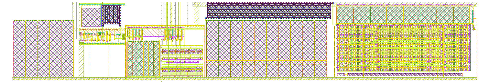
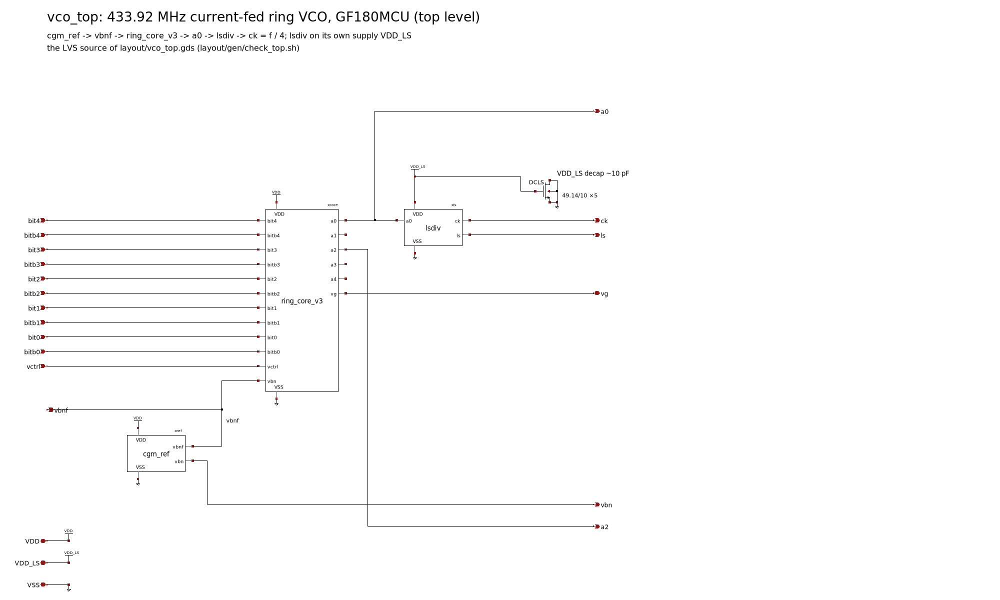
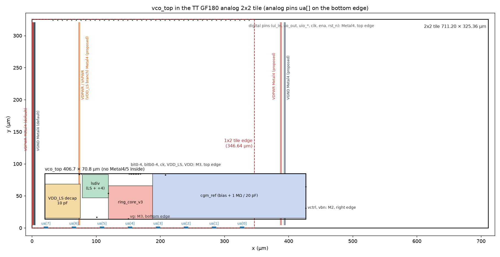

# VCO top level (vco_top)

This page covers the top level of the Zero to ASIC Course 433 MHz oscillator: the three finished blocks (ring core,
bias reference, level shifter and divider) and a 10 pF supply decoupling capacitor (decap), placed in one cell,
`vco_top`. The layout comes from a generator, `layout/gen/vco_top.py`, which writes `layout/vco_top.gds`. The
schematic is `xschem/vco_top.sch` (`xschem/gen/vco_top.py`), and it is the layout versus schematic (LVS) source.

**Fig. 1.** The vco_top layout, 407.7 × 70.8 µm. From the left: the VDD_LS decap, the level shifter and ÷4 (lsdiv,
raised so its a0 pin meets the ring's), the ring core, and the bias reference with its 1 MΩ / 20 pF filter.

**Fig. 2.** The vco_top schematic: the LVS source of Fig. 1.

## Floorplan
- **Size:** bbox −100.74 … 306.94 × −4.00 … 66.80 µm, 407.7 × 70.8 µm (28 862 µm²). The core grew 1.0 µm in x on
  2026-11-12 (the PMOS vg decap, `docs/ring_layout_v3.md`); `CORE_DX` in `layout/gen/vco_top.py` carries it. All blocks share the core's y
  origin (the bottom VSS rail, y −2.4 … 0).
- **Placement** (block origin in vco_top; the block GDS cells are instances, unchanged):
  - `ring_core` at (0, 0);
  - `cgm_ref` at (68.19, 0): it abuts the core's right edge, so its `vbnf` pin meets the core's `vbn` (DAC gate)
    pin and its `vctrl` feed-through meets the core's `vctrl` pin;
  - `lsdiv` at (−42.39, 31.455): its a0 M2 spine (right edge, y 4.715) touches the core's a0 M2 tap (left edge,
    y 36.17). **There is no a0 wire**: the extracted a0 total is 5.83 fF, the sum of the two blocks' own a0 C
    (core 3.20 fF, lsdiv 1.99 fF Cc + 0.63 fF);
  - `decap_ls` at (−100.74, 0): 5 nfet_03v3 gate-cap fingers of W 49.14 / L 10 µm (2457 µm², about 10.0 pF at
    4.07 fF/µm²), gate VDD_LS, source / drain / bulk VSS, the finger of the reference's CF.
- **Supplies:**
  - **VDD** (ring + reference): the core's VDD rail (y 43.2 … 45.6) goes up an M2 drop (x 58 … 62) to an M3
    strap along the top edge (y 62.88 … 66.80), which runs over the reference's filter to its VDD rail
    (y 62.88 … 65.28; 244 via2s, placed between its via1s).
  - **VDD_LS** (lsdiv only): a separate net. An M2 strap joins lsdiv's VDD rail to the decap's gate strap, and an
    M2 spine with an M3 pad brings it to the top edge. The extracted VDD-to-VDD_LS coupling is 0.03 fF.
  - **VSS:** one bottom rail (M1 + M2 + p+ tap) from the decap, under lsdiv, to the core and on to the reference;
    an M3 strap over all of it (with a gap at the core's vg pin) for the Metal4 VGND via3s at tile level.
    lsdiv's left M3 VSS strap is extended down into that rail (4 µm wide under lsdiv), so its switching current
    returns straight to the bottom rail rather than through the core's substrate-tap ring.
  - Two p+ tap columns stand under lsdiv. Without them the empty area there (45 × 24 µm) fails the KLayout rule
    DCF.1a (no gap of 20 µm or more between active areas without dummy fill).
- **Pins** (labels in `vco_top`): bit0–4, bitb0–4, ck, VDD and VDD_LS on M3 at the top edge; vg on M3 at the bottom
  edge (the core's pin); vctrl and vbn (the unfiltered bias, a monitor) on M2 at the right edge (the reference's
  pins); VSS on M2 / M3 along the bottom; a0 on M2 at the lsdiv / core junction (see Limits).
- **No Metal4 or Metal5** in the macro (checked on the GDS): Metal4 is Tiny Tapeout's power-stripe layer.

## Tile fit
Tile facts, from `tt-support-tools` (main branch, `tech/gf180mcuD/`, read 2026-11-08):
- `tile_sizes.yaml`: 1x2 = 346.64 × 325.36 µm, 2x2 = 711.20 × 325.36 µm;
- `def/analog/tt_analog_2x2.def`: the analog pins ua[0…7] are Metal4 pads (6 × 2 µm) on the **bottom** edge, at
  x = 327.32 … 21.56 µm; the digital pins are on the top edge, between x = 32.8 and 338.5 µm;
- `def/analog/magic_init_project.tcl`: the designer draws the power stripes, vertical Metal4 from y 5 to
  320.36 µm, at least 0.8 µm wide (template default: VDPWR at x 1 µm and VGND at x 4 µm, 2 µm wide).

**vco_top does not fit a 1x2 tile; it needs the 2x2.** The width is set by the a0 abutment and the reference's
abutment: lsdiv + core + reference alone are 40.49 + 70.09 + 238.75 = 349.33 µm, 2.7 µm more than the 1x2 tile's
whole width, before the decap (55 µm) and any margin. The height (70.8 µm) uses 22 % of the tile. In the 2x2 tile
the macro uses 57 % of the width and leaves about 240 µm of height free for the transmitter and receiver blocks.

**Fig. 3.** vco_top in the 2x2 analog tile, 407.7 × 70.8 µm placed 20 µm from the left edge and 14 µm above the ua
pads. The red dashed line is the 1x2 tile's right edge. Proposed Metal4 stripes: VDPWR and VGND over the reference
(they land on the VDD M3 strap at the top edge and the VSS M3 strap at the bottom edge) and a separate VDD_LS
branch over the decap's M3 pad.

**Stripe clearance:** the macro has no Metal4, so a stripe can cross it anywhere; via3s land on the M3 straps
(VDD along the top edge from x 57.5 µm to the right edge, VSS along the bottom edge, VDD_LS on its pad). The
VDD_LS branch can come from VDPWR as its own stripe (a star at the power grid), or from VAPWR with the `_pgvaa`
template.

## Checks (`layout/gen/check_top.sh`)
| Check | Result |
|---|---|
| Metal4 / via3 / Metal5 / via4 in the GDS | none |
| magic DRC (full, hierarchical) | count 0 |
| KLayout DRC (feol + beol, 176 decks, 768 rules run) | count 0 |
| Antenna (magic, flattened) | 0 violations; 22 feedback entries: the gate-cap fingers with S = D tied (core vg decap 6, on VDD; CF 10, decap 5, lsdiv C1 1, on VSS) |
| LVS (netgen), flattened layout vs the xschem `vco_top` netlist | `Final result: Circuits match uniquely.`, no property errors; 18 of 18 pins match |
| Resistor sizes (4 devices) | RBW 2 / 5.025 µm (source 5.023, +0.04 % L), RBN 2 / 100, RF 1 / 970.23, R1 1 / 159.12 µm: pass |
| Mutation: DCLS m 5 → 4 | LVS fails (property errors), as expected |
| Mutation: lsdiv supply VDD_LS → VDD | LVS fails (top-level pin matching), as expected |
| Mutation: R1 length 159.125 → 140 µm | resistor check fails (+13.7 %), as expected |

- **LVS source edits** (as the block checks): lsdiv's Cc line removed (drawn as metal fingers, extracted as
  parasitic C), and RBW's length snapped to the 5 nm grid (5.023 → 5.025 µm). The reference check's `vctrl` port
  edit is not needed here: the layout is flattened, and the vctrl feed-through is part of the top-level vctrl net.
- **Flattening:** `flatten -dotoplabels` keeps only vco_top's own labels. Each block has its own `VDD` label, and
  magic joins nets that carry the same label name, which would short VDD_LS to VDD in the extraction. The supply
  mutation above shows that the check sees such a short.
- **The n-well resistor:** magic's gf180mcuD tech can't read RBW back from GDS, so `check_top.sh` and `pex_top.sh`
  repaint `rnw` in cell `cgm_ref` from NWELL & RES_MK after `gds read` (as `check_ref.sh`).
- **The DRC decks fire:** on earlier versions of this layout KLayout reported V2.1 (0.28 µm via2 cuts, the rule is
  0.26 µm), DCF.1a (the empty area under lsdiv) and CO.1, and magic reported a tap contact overlapping the core's
  across the cell boundary. All are fixed in the committed generator.

## Extraction (`layout/gen/pex_top.sh`, magic 8.3.642)
- `c` → `layout/pex/vco_top_c.spice` (1111 devices, coupling C kept); `rc` → `vco_top_rc.spice` → `rcfix.py` →
  `vco_top_rcx.spice` (17 nets corrected; every net's total C matches the C-only extraction).
- Three monitor labels (ls, q1, vbnf) are added in the extraction session only, at the blocks' own label points,
  so the simulations can probe those internal nets. The GDS is not changed.

| Net | Total parasitic C (fF) | Block-level value |
|---|---|---|
| a0 | 5.83 (lsdiv Cc 1.99, VDD 1.59, VSS 1.05) | core 3.20 + lsdiv 2.62 = 5.82 |
| ck | 4.72 | – |
| ls / q1 | 7.68 / 5.70 | 7.7 / 5.7 (lsdiv) |
| vbnf | 162 | reference 104 + the core's DAC gate wiring 56 |
| vbn | 466 | 466 (reference) |
| VDD to VDD_LS | 0.03 | – |

## Simulation (`sim/top/top_pex.py`, results in `sim/top/results.md`)
One deck holds the whole extracted top: core, reference, filter, level shifter and divider, and the VDD_LS decap,
all from layout. The ck load is the same as in the block simulations (a 20 fF wire and one standard-cell D
flip-flop clock pin). Settings: 27 °C, code 9, vctrl 1.65 V, VDD = VDD_LS = 3.3 V, 1.2 µs, measured over the last
40 %; f(a0) at mid-swing. Every log ends in "ngspice done", with no "singular" or "Transient op started".

**Table I.** The extracted top against the block-level results at the same point.

| Netlist, corner | f(a0) (MHz) | vs core + ref¹ | vs core + LS² | f(a0) / f(ck) | LS duty (block²) | ck duty | P(VDD) (mW) | P(VDD_LS) (mW) (block²) |
|---|---|---|---|---|---|---|---|---|
| C-only, tt | **418.02** | −1.78 % | +0.03 % | 4.0000 | 47.9 % (47.9 %) | 49.2 % | 0.451 | 0.707 (0.703) |
| C-only, ss | **382.70** | −1.75 % | +0.01 % | 4.0000 | 49.7 % (49.8 %) | 49.1 % | 0.473 | 0.581 (0.578) |
| C-only, ff | **461.75** | −1.80 % | +0.07 % | 4.0000 | 46.5 % (46.5 %) | 49.2 % | 0.432 | 0.895 (0.891) |
| RC (rcx), tt | **417.86** | −1.82 % | −0.01 % | 4.0000 | 48.0 % (47.9 %) | 49.2 % | 0.451 | 0.706 (0.703) |

¹ Extracted core + extracted reference, no level shifter (`sim/ref/results.md`: tt 425.61, ss 389.50, ff 470.22 MHz).
² Extracted core (rcx) + extracted level shifter, schematic reference (`sim/lsdiv/results/remap.csv`: tt 417.89,
ss 382.67, ff 461.42 MHz).

- **The assembled top matches the block-level results within 0.07 %** at every corner. The −1.8 % against the
  core + reference column is the level shifter's a0 load, as in `docs/lsdiv_layout.md`; the abutment adds none.
- P(VDD) is the ring plus the reference (the reference alone draws 70 µA, 0.23 mW, at tt). P(VDD_LS) is the level
  shifter, ÷4 and clock buffer, 0.5 % above the block-level figure.
- The RC netlist moves f by −0.04 % against the C-only one: wire resistance doesn't matter here.

**Power-on, tt, partial** (`top_pex.py startup --tstop 13e-6`; VDD, VDD_LS and the flip-flop supply ramp 0 → 3.3 V
in 10 µs, all nodes at 0 V at t = 0):
- the ring starts at VDD of about 0.8 V (2 µs) and keeps running; ck toggles from VDD of about 1.5 V, and
  f(a0) / f(ck) is 4.0 in every 1 µs window from then on;
- at 13 µs f(a0) is 30 MHz and vbnf is 0.53 V (final 1.23 V): the 1 MΩ / 20 pF filter (20 µs) is still charging
  the DAC gates, so the ring runs slowly but in the fundamental mode (a higher mode would be faster, not slower).
  The run took 18 minutes; the full settling to 433.92 MHz (about 100 µs, `docs/ref_layout.md`) was not run.

## Limits, at the time of writing
- **a0 is not routed to an edge.** The a0 pin is a label at the lsdiv / core junction, inside the macro: each fF
  on a0 costs about 1 % of f, so a wire to the cell edge (probably 10–20 fF) would cost 10–20 %. The future
  transmitter driver needs a tap that doesn't load a0, for example a buffered output inside lsdiv or a driver
  abutted at the junction. To be decided with the TX design.
- **Tile:** the macro needs a 2x2 tile. A 1x2 would need about 2 µm less from the blocks' combined width plus room
  for the decap and routing, which means a block change; none was made.
- The start-up run stops at 13 µs (above). Not run on the top: sf / fs, 0 / 70 °C, VDD ±4.5 %, Monte Carlo, other
  codes and vctrl values (these are in the block-level results).
- The Metal4 stripe positions in Fig. 3 are a proposal: the tile-level power grid, the ua pin routes and their R / C
  are not designed yet.
- The empty area under lsdiv holds only two substrate-tap columns (for DCF.1a); it could hold about 3 pF more decap.

## Files
- `layout/gen/vco_top.py` → `layout/vco_top.gds` (cells vco_top, ring_core, ring_inv, ring_inv_m, lsdiv, cgm_ref,
  decap_ls), `build/top/meta.json`, `docs/img/vco_top.png`
- `layout/gen/check_top.sh` → `build/check/vco_top/summary.txt`
- `layout/gen/pex_top.sh c|rc` → `layout/pex/vco_top_c.spice`, `vco_top_rc.spice`, `vco_top_rcx.spice`
- `xschem/gen/vco_top.py` → `xschem/vco_top.sch`, `.sym`, `docs/img/xschem/vco_top.png`
- `sim/top/top_pex.py` → `build/top_pex/`, `sim/top/results.md`, `results.json`; `sim/top/tile_fig.py` →
  `docs/img/vco_top_tile.png`
