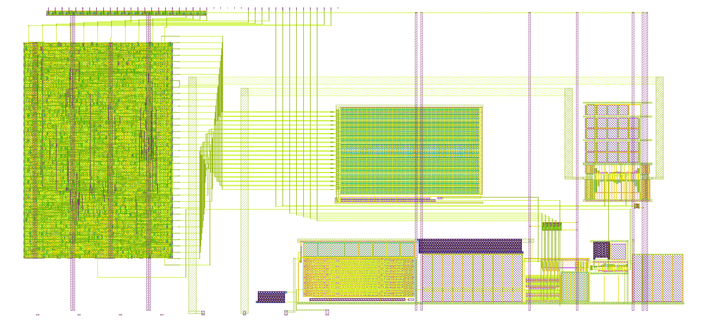

# Tiny Tapeout wrapper (tt_um_mattvenn_gf433_vco)

This page covers the Tiny Tapeout (TT) wrapper of the Zero to ASIC Course 433 MHz oscillator: the `vco_top` macro
(`docs/top_layout.md`) placed in the gf180mcuD analog 2x2 tile, with its power stripes, pin wiring and a few standard
cells. The layout comes from a generator, `layout/gen/tt_wrapper.py`, which writes `gds/tt_um_mattvenn_gf433_vco.gds`
and `lef/tt_um_mattvenn_gf433_vco.lef`. It passes the TT precheck and layout versus schematic (LVS).

**Fig. 1.** The wrapper, 711.20 × 325.36 µm. vco_top (407.7 × 70.8 µm, mirrored) sits at the bottom right, next to
the analog pads; the bit, ck and tie-low routes go up to the digital pins on the top edge.

## Floorplan
- **Template:** `tt_analog_2x2.def` from tt-support-tools (`tech/gf180mcuD/def/analog/`). Every pin is a Metal4
  rectangle: ua[0…7] (3 × 1 µm) on the bottom edge, the digital pins (0.3 × 1 µm) on the top edge. The wrapper
  draws the boundary and every pin exactly as the template definition (DEF) file gives them.
- **vco_top:** mirrored left to right, origin (602.94, 14.0) µm, bbox x 297.0 … 703.68, y 10.0 … 80.8 µm. The mirror
  puts the reference's edge, with the vctrl and vbn pins, on the left, next to ua[1] (x 283.64 µm) and ua[0]
  (x 327.32 µm). The block cells are copied in unchanged.
- **Analog routes:** vctrl goes from the macro edge on M2, down on M3 and under the macro (y 5 … 6 µm) to ua[0],
  about 55 µm of wire. vbn goes on M3 to ua[1], about 70 µm. Each ends in a Metal4 drop onto its pad.
- **Power:** 2 µm Metal4 stripes from y 5 to 320.36 µm (the template's span). VDPWR at x 420 and 540 µm lands on the
  macro's VDD M3 strap; VGND at x 426 and 590 µm lands on its VSS strap. VDD_LS has its own VDPWR stripe at
  x 649.14 µm on its M3 pad, so the level shifter's supply current doesn't share the ring's path. A 1.6 µm pair at
  x 85 / 87.6 µm feeds the tie-low row. An M2 bar along the top of the tile (y 319.4 µm) joins the VDPWR stripes
  near the pins.
- **Standard cells** (gf180mcu_fd_sc_mcu7t5v0):
  - five `inv_1` (bitb_i = not ui_in[i]) in one row at y 90.16 µm, right above the macro's bit pins, with fillties;
  - five `antenna` diode cells in the row above, one on each bit net (see Checks);
  - 23 `tiel` cells in a row at y 317.52 µm, one under each unused output pin, each with a filltie and fill.

## Pin map
**Table I.** Pins as built.

| Pin | Net | Route |
|---|---|---|
| ui_in[0…4] | bit0…4 (code bits) | Metal4 pin, via3, M3 down, M2 track (y 100 … 108 µm), the core's M3 bit riser |
| (internal) | bitb0…4 | `inv_1` from ui_in[i], M2 / M3 to the core's bitb risers |
| uo_out[0] | ck (f / 4) | the macro's ck riser, M2 track (y 112 µm), M3 up to the pin |
| ua[0] | vctrl (fine tune) | see Floorplan |
| ua[1] | vbn (bias monitor) | see Floorplan |
| uo_out[1…7], uio_out[0…7], uio_oe[0…7] | tied low | one `tiel` each, via stack to a Metal4 drop |
| ui_in[5…7], uio_in[0…7], clk, ena, rst_n, ua[2…7] | open | – |
| VDPWR / VGND | supplies | Metal4 stripes (VDD and VDD_LS on VDPWR, VSS on VGND) |

`src/project.v` is the template's port list with no logic (an analog project); the precheck only reads it for its
syntax and the power ports.

## Checks
**Table II.** TT precheck (tt-support-tools main, run locally on the submission layout the `gds` action builds, with
the CI's PDK: open_pdks e8daeda73ca8f5814dbc0b11d1d05802251a3750, KLayout 0.30.12).

| Check | Result |
|---|---|
| KLayout pin label overlapping drawing | pass |
| KLayout zero area | pass |
| KLayout Checks (top cell name, forbidden layers, prBoundary) | pass |
| Pin check | pass |
| Boundary check | pass |
| Power pin check | pass |
| Layer check | pass |
| Cell name check | pass |
| KLayout GF180MCU DRC (all, −density, −antenna) | pass, 0 violations |
| Antenna check | pass |
| Analog pin check | pass |
| Verilog syntax check | pass |

- **Antenna:** the first version failed the antenna check with 15 violations (rule ANT.16 / ANT.4): each bit line is
  about 280 µm of 0.38 µm M3 on a few µm² of gate. One `antenna` diode cell per bit net fixed all 15.
- **Our own DRC:** magic 8.3.642 (full, hierarchical) reports 0. KLayout with the image's older PDK deck (feol + beol,
  768 rules) reports 3 × DCF.1a, "no gap of 20 µm or more without dummy COMP fill", on the empty tile area. The CI
  PDK's deck has no DCF.1a rule, and TT adds fill after the precheck.

**LVS** (`layout/gen/check_tt.sh`, magic 8.3.642 + netgen 1.5.323, same PDK): the flattened wrapper against
`lvs/tt_um_mattvenn_gf433_vco.spice` gives `Final result: Circuits match uniquely.` with no property errors: 1167
transistors and resistors and 10 diodes, and 53 of 53 pins.
- **Source:** `lvs/make_source.py` builds it from the xschem vco_top netlist (with the edits `check_top.sh`
  documents: lsdiv's Cc removed, RBW length snapped 5.023 → 5.025 µm), the PDK's `inv_1` / `tiel` / `antenna` netlists
  and the TT top level. The generated netlist is committed, so the CI needs no xschem.
- **Resistor sizes** (netgen treats the PDK resistors as black boxes): all 4 match in model, width and length.
- **The n-well resistor's pins:** the mirror swaps RBW's two terminals in the extraction, and the PDK's netgen setup
  lists `nwell_1p5` but not `nwell` as a two-terminal resistor with swappable pins. The check adds that one
  `permute` for `nwell`; the resistor is symmetric, so nothing real is hidden.
- **Mutations** (each must fail, and does): ui_in[0] and ui_in[1] swapped at the inverters (pin matching fails); ck
  moved to uo_out[1] (pin matching fails); the VDD_LS decap m 5 → 4 (property errors).
- **CI:** `.github/workflows/lvs.yaml` runs the same script on every push: it installs the PDK with ciel, builds magic
  and netgen from their git tags (cached), and fails unless the summary ends in `CHECK OK`.

## Limits, at the time of writing
- ck drives uo_out[0] straight from the level shifter's output buffer, through about 700 µm of wire and then TT's
  output multiplexer. No buffer was added and the output at the pad hasn't been simulated.
- The tile's empty area (about 85 %) is left for the receiver and transmitter blocks.
- The VDPWR stripes join only through the M2 bar at the top of the tile and through TT's own power grid. VGND
  stripes join through the macro's VSS strap and the substrate.

## Files
- `layout/gen/tt_wrapper.py` → `gds/tt_um_mattvenn_gf433_vco.gds`, `lef/tt_um_mattvenn_gf433_vco.lef`,
  `build/tt/meta.json`, `docs/img/tt_wrapper.png`
- `lvs/make_source.py` → `lvs/tt_um_mattvenn_gf433_vco.spice`
- `layout/gen/check_tt.sh` → `build/check/tt/summary.txt`, `lvs.report`, `mut/*.report`
- `.github/workflows/lvs.yaml`
