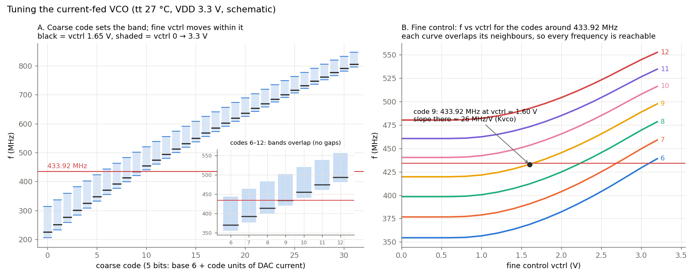
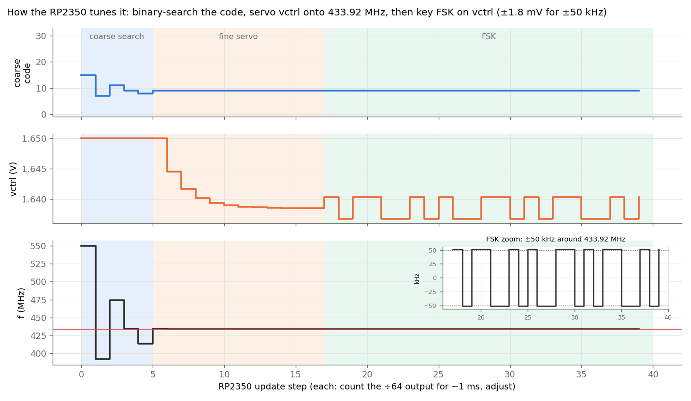

# Tuning the current-fed VCO

The oscillator is tuned in two ways. A 5-bit **coarse code** selects how many unit current sources the DAC switches
on. An analog **fine input**, vctrl, trims the current of one extra long device. The RP2350 on the demo board sets
both: it measures the divided output and adjusts. All figures are schematic simulations at tt, 27 °C, VDD 3.3 V
(`sim/vco/plot_tuning.py`).

**Fig. 1.** Frequency against the coarse code (left) and against vctrl for the codes around 433.92 MHz (right).
- **Left:** each code gives a band. The bar is vctrl = 1.65 V, and the shading is vctrl from 0 to 3.3 V. Neighbouring
  bands overlap (inset), so every frequency in the range can be reached.
- **Right:** the fine response is flat below about 1 V, because the fine NMOS is off below its threshold. Above that
  it follows the square law, so the tuning slope (Kvco) rises from 0 to about 50 MHz/V. At code 9, 433.92 MHz sits
  at vctrl ≈ 1.6 V, where Kvco ≈ 26–28 MHz/V.
- **Consequence for FSK:** the frequency deviation for a given vctrl step depends on the operating point. The RP2350
  should measure Kvco at the operating point before setting the FSK step.

**Fig. 2.** The tuning procedure, simulated from the curves in Fig. 1. Each step is one measurement of the ÷64 output
over about 1 ms, followed by an adjustment.
1. **Coarse search:** a binary search of the 5-bit code with vctrl at 1.65 V. Five steps reach code 9.
2. **Fine servo:** vctrl is moved in proportion to the frequency error and settles at about 1.639 V.
3. **FSK:** vctrl is keyed by ±1.8 mV for ±50 kHz of deviation. That needs about 11-bit resolution over 3.3 V,
   which is within reach of an RP2350 sigma-delta or PWM output through the on-chip RC filter.

In use, the servo keeps running between packets to track temperature drift.

**Limits of these figures:**
- The map reads about 1.3 % high against a fully settled ring (`docs/cfed_startup_results.md`).
- The extracted layout runs at about 0.98× the schematic frequency (`docs/rc_extraction_fix.md`; the earlier "0.87×"
  was an extraction artefact).
- The shapes and the way the two controls combine are unchanged.
