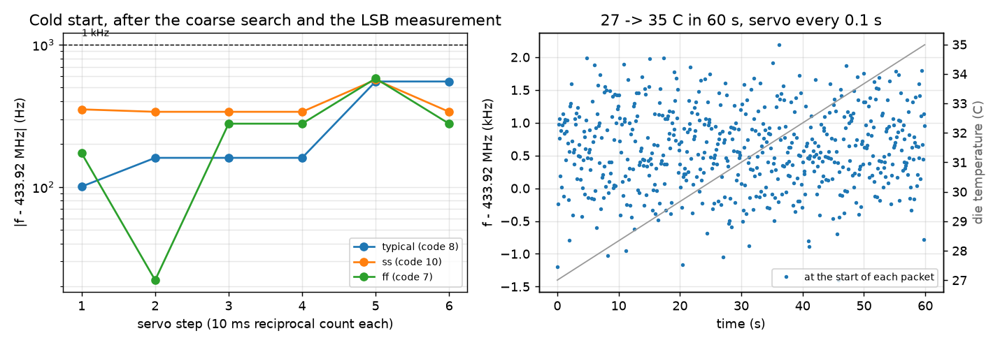

# Tuning the current-fed VCO

The oscillator is tuned in three ways. A 5-bit **coarse code** (ui[0..4]) selects how many unit current sources the
coarse digital-to-analogue converter (DAC) switches on, about 21 MHz per code. A 10-bit **medium DAC**, set over the
Serial Peripheral Interface (SPI), adds 0 to 1.6 coarse units of current in steps of 29-39 kHz. A first-order
**sigma-delta (ΣΔ)** modulator dithers one more 1-LSB cell, which gives 8 fractional bits (about 150 Hz). The
RP2350 on the demo board measures the divided output and sets all three. The medium DAC and the ΣΔ are described in
[tx_fine_tune.md](tx_fine_tune.md).

**vctrl is no longer the fine control.** It is pulled to VSS on the chip by 200 kΩ (`layout/vctrl_pd.gds`), so the
fine NMOS leg is off unless ua[0] is driven. There is no RC filter on vctrl on the chip; earlier versions of this
page said there was. ua[0] stays as a bench override: driving it from a stiff source still works as in Fig. 1
(right), against the 200 kΩ load.

The coarse-code figures below are schematic simulations at tt, 27 °C, VDD 3.3 V (`sim/vco/plot_tuning.py`).

**Fig. 1.** Frequency against the coarse code (left) and against vctrl for the codes around 433.92 MHz (right).
- **Left:** each code gives a band. The bar is vctrl = 1.65 V, and the shading is vctrl from 0 to 3.3 V. Neighbouring
  bands overlap (inset), so every frequency in the range can be reached.
- **Right:** the fine response is flat below about 1 V, because the fine NMOS is off below its threshold. Above that
  it follows the square law, so the tuning slope (Kvco) rises from 0 to about 50 MHz/V. At code 9, 433.92 MHz sits
  at vctrl ≈ 1.6 V, where Kvco ≈ 26–28 MHz/V.
- **Consequence for FSK:** the frequency deviation for a given vctrl step depends on the operating point. The RP2350
  should measure Kvco at the operating point before setting the FSK step.

**Fig. 2.** The tuning sequence in the RP2350 model (`sim/tune/rp2350_model.py`), using the medium DAC's f(word) at
tt / ss / ff from the schematic. Left: the servo after the coarse search reaches 0.3-0.6 kHz of 433.92 MHz in two or
three 10 ms steps. Right: with the servo running every 0.1 s, a 27 → 35 °C warm-up in 60 s stays within 2.3 kHz at
the start of each packet.

The procedure:
1. **Reset:** the medium word is 512 (mid-scale), the ΣΔ is off and `ck` (uo[0]) is gated off.
2. **Coarse search:** the medium word is set to 0, and a binary search of the 5-bit code finds the largest code
   whose frequency is still below 433.92 MHz. That is five 1 ms measurements. The medium range is more than 1.3
   coarse steps, so the target is always reachable from that code.
3. **LSB:** the frequency is measured at words 256 and 768 (10 ms each); the slope is the LSB in hertz.
4. **Set:** word = 256 + (433.92 MHz − f(256)) / LSB. The integer part goes to MED_INT, and 256 × the fraction goes to
   MED_FRAC with CTRL.SD_EN set.
5. **Servo:** measure, then move the word by the error divided by the LSB. The error settles to about 0.3-0.6 kHz,
   which is the ring's own FM noise averaged over the 10 ms count.
6. **FSK:** FSK_DEV starts at 100 kHz / LSB. ui[7] = 1 and ui[7] = 0 are each counted, and FSK_DEV is rescaled until
   the two differ by 200 kHz (three rounds, 199 kHz in the model).

**Counting.** The RP2350 counts f / 16 on uo[1] (27.1 MHz, inside the GF pads' clean range of about 50 MHz,
`docs/platform.md`). A plain gated count over a gate T resolves 16 / T: 1.6 kHz at 10 ms. A reciprocal count (the
150 MHz system clock timing a whole number of f / 16 periods) resolves f × 6.67 ns / T: 290 Hz at 10 ms. Every count
is relative to the RP2350's crystal (±30 ppm, about ±13 kHz at 433.92 MHz), so two boards agree only to the sum of
their crystal errors unless the receiver corrects it.

In use, the servo runs between packets and is frozen during a packet. A 20 ms packet sees 139 Hz of drift at the
model's fastest warm-up (8 °C per minute).

**Limits of these figures:**
- The map reads about 1.3 % high against a fully settled ring (`docs/cfed_startup_results.md`).
- The extracted layout runs at about 0.98× the schematic frequency (`docs/rc_extraction_fix.md`; the earlier "0.87×"
  was an extraction artefact).
- The shapes and the way the coarse code and vctrl combine are unchanged.
- The RP2350 model is behavioural: white FM noise only (no flicker), a linear medium DAC and a +120 ppm/°C tempco.
  The extracted vco_top with the medium DAC gives LSBs of 27.4 (ss) … 35.7 (ff) kHz (`docs/tx_fine_tune.md`).
