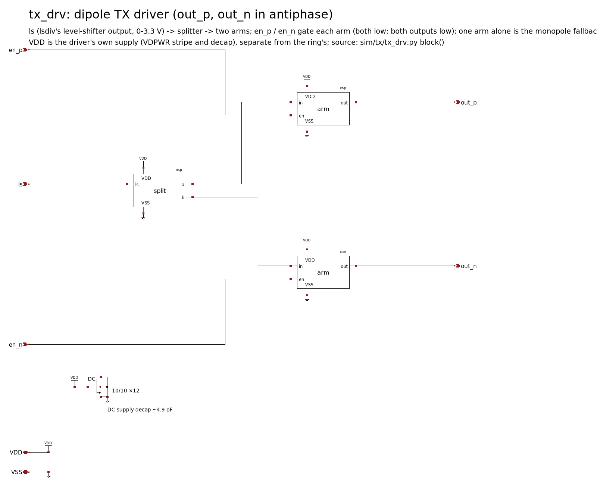
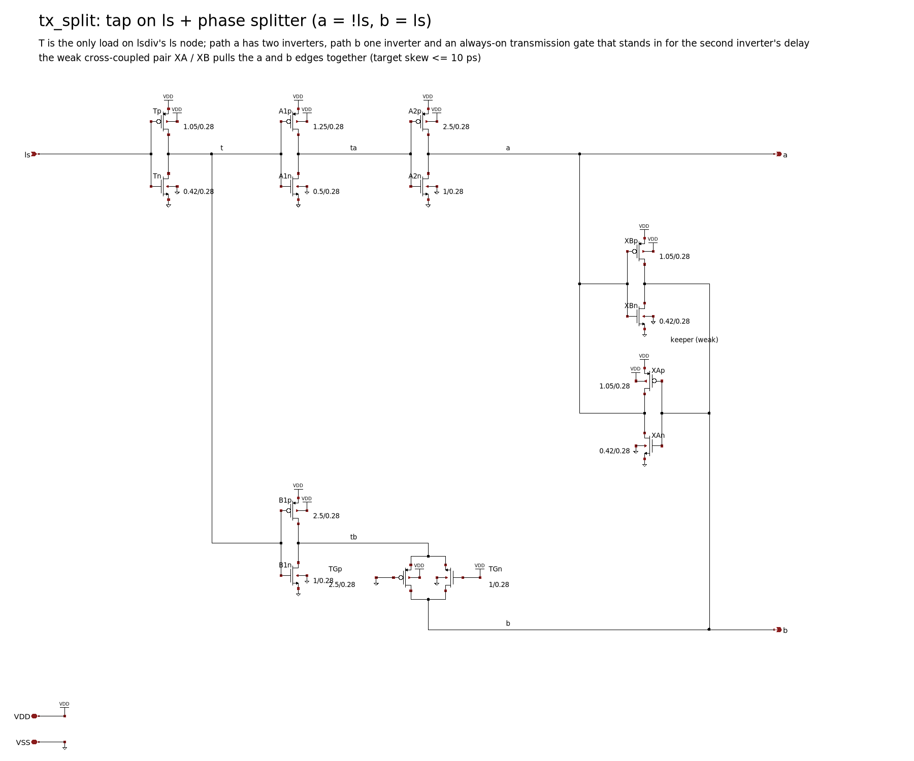
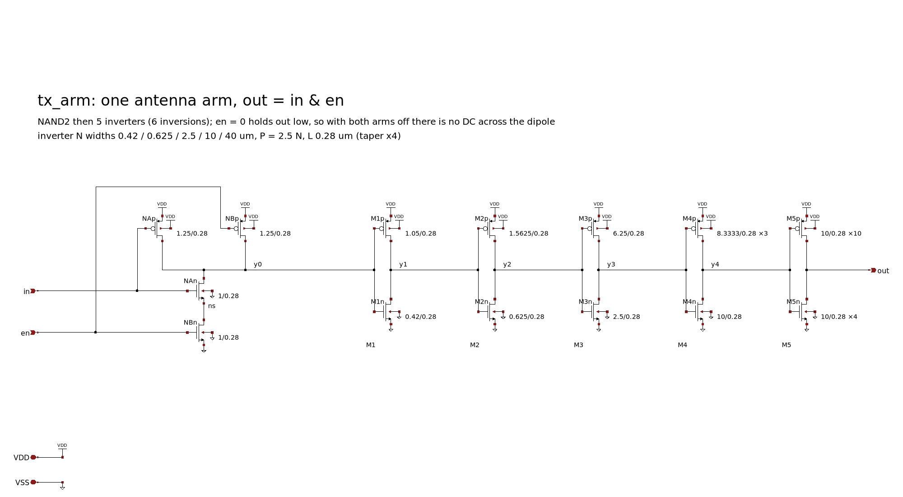
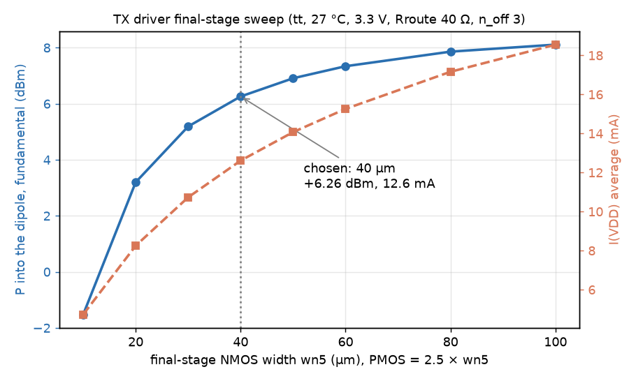
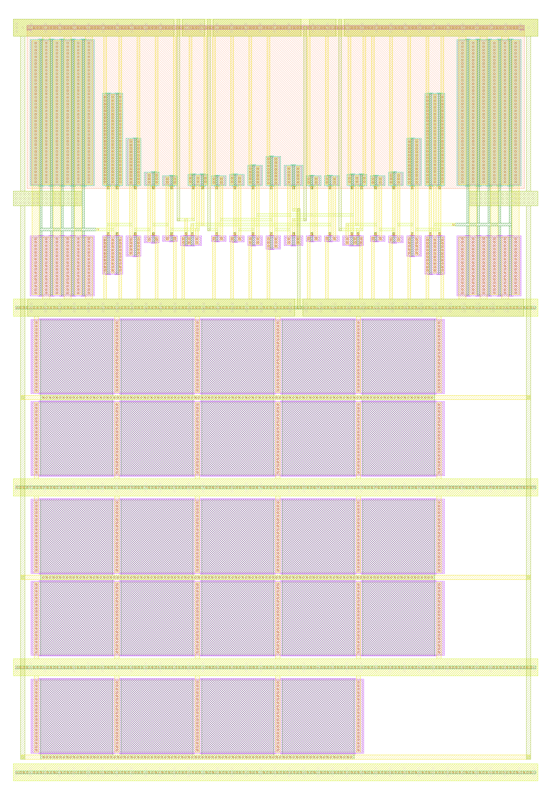
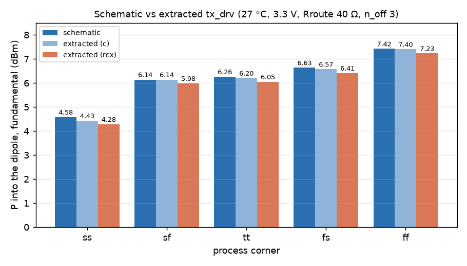
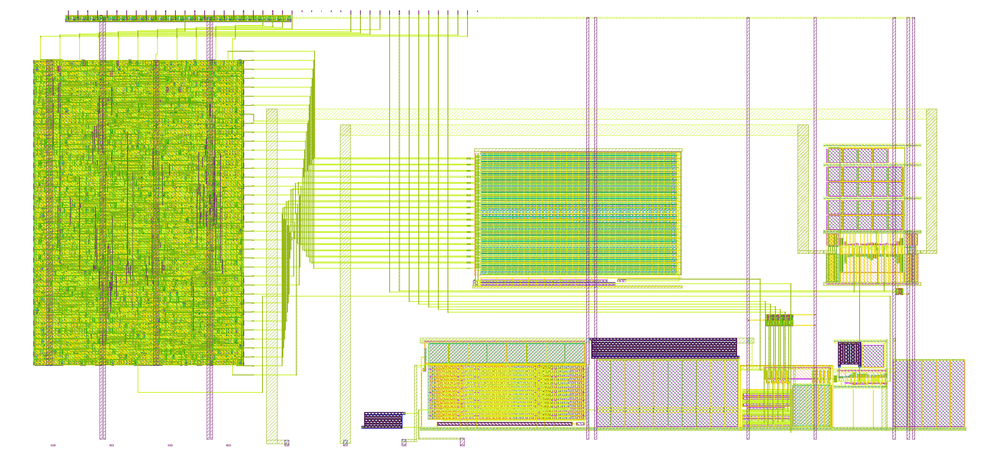

# Dipole TX driver (tx_drv)

The TX driver takes the 433.92 MHz signal from the voltage-controlled oscillator (VCO) and drives a dipole antenna
across two Tiny Tapeout analog pins, ua[2] and ua[3], in antiphase. Each side (arm) has its own enable, so the
transmitter can be keyed on and off from ui_in[5] and ui_in[6]. I ported it from the `tx_drv` in
[ook-asic-radio](https://github.com/mattvenn/ook-asic-radio) (a NAND2 enable and a ×4 inverter taper) onto the
3.3 V devices of GF180MCU. The new part is a phase splitter that makes the antiphase from the level shifter (LS)
output inside lsdiv.

Files:
- circuit (the source of truth): `sim/tx/tx_drv.py`, sizes in `S`;
- block bench: `sim/tx/tb_tx_drv.py`, results in `sim/tx/results/block_sch.txt` and `block_pex.txt`;
- bench on the real source: `sim/tx/tb_tx_top.py`, results in `sim/tx/results/top.md`;
- layout: `layout/gen/tx_drv.py` -> `layout/tx_drv.gds`, checks `layout/gen/check_tx.sh`, extraction
  `layout/gen/pex_tx.sh`; tile: `layout/gen/tt_wrapper.py`.

All numbers are from simulation at 27 °C and VDD 3.3 V, with each arm driving the GF180 pad model
([pad_model.md](pad_model.md)) into a dipole modelled as 73 Ω + 100 pF between the two board pins. P is the power
of the 433.92 MHz fundamental delivered to the 73 Ω. The driver supply comes through an assumed 1 Ω + 1 nH (see
Limits).

| Parameter | Value | Notes |
|---|---|---|
| P into the dipole, fundamental | **+6.26 dBm** (schematic), **+6.05 dBm** (extracted) | tt, Rroute 40 Ω, n_off 3 |
| ... over corners, Rroute 15-60 Ω, n_off 0/3 | +3.73 to +9.25 dBm | ss / 60 Ω / 3 off to ff / 15 Ω / 0 off (schematic) |
| ... on the extracted vco_top (code 9) | +4.81 to +7.32 dBm | ss to ff, own supply branch |
| Supply current I(VDD), average / rms | 12.7 / 13.9 mA | tt; 9.7 to 16.2 mA average over all the cases above |
| Output duty, out_p / out_n | 50.5 / 49.2 % (ideal input) | passes the LS duty through: out_p 54.0 % at ff on vco_top |
| Phase error (fundamental, out_p - out_n - 180°) | +0.05° (tt) | within ±0.5° over corners; ≤ 0.8° extracted |
| Off state (en_p = en_n = 0) | outputs at 0 V, 0.11 mA | -83 dBm into the dipole (extracted), no DC across it |
| Area | 73.0 × 105.9 µm (7731 µm²) | including about 9.8 pF of decap |

**Table I.** Key specifications of the TX driver.

## Circuit
Schematics (xschem, see [schematics.md](schematics.md)):
[tx_drv](https://xschem-viewer.com/?file=https://github.com/mattvenn/gf-433-oscillator/blob/main/xschem/tx_drv.sch),
[tx_split](https://xschem-viewer.com/?file=https://github.com/mattvenn/gf-433-oscillator/blob/main/xschem/tx_split.sch),
[tx_arm](https://xschem-viewer.com/?file=https://github.com/mattvenn/gf-433-oscillator/blob/main/xschem/tx_arm.sch).

**Fig. 1.** The tx_drv top sheet: the phase splitter, the two arms and the supply decap.

**Tap.** The driver takes its input from lsdiv's `ls` node (0 to 3.3 V, before the ÷4), not from the ring. A
single small inverter T (N 0.42 µm, P 1.05 µm, L 0.28 µm) is the only load on that node, so the ring and the
divider see the same thing whether the driver is on or off.

**Phase splitter.** From t = !ls there are two paths: a = A2(A1(t)) through two inverters, and b = TG(B1(t))
through one inverter and an always-on transmission gate (TG) that stands in for the second inverter's delay. A weak
cross-coupled inverter pair (XA / XB, N 0.42 µm) pulls the two edges together.

**Fig. 2.** The phase splitter. B1 (N 1.5 µm) is tuned so a and b cross with a fundamental phase error of +0.05° at
tt.

**Arms.** Each arm is out = in & en: a NAND2 (the signal on the NMOS next to the output, the faster input), then 5
inverters tapering ×4 up to the output stage, N 40 µm / P 100 µm. That is 6 inversions, so out_p follows a and
out_n follows b. With en low the NAND output is high and the output is held low, so with both arms off there is no
DC across the dipole.

**Fig. 3.** One arm: NAND2 enable and the ×4 taper, ending in a 5-finger N 40 / P 100 µm inverter.

**Decap.** 24 nfet_03v3 gate capacitors of 10 × 10 µm (about 9.8 pF), gate to VDD, source, drain and body to VSS,
on the driver's own supply.

## Sizing
**The final stage is set by a knee, not by the driver.** I swept the output NMOS width wn5 (PMOS 2.5 × wn5) at tt
with Rroute 40 Ω and 3 off switches on the bus (Fig. 4). Going from 10 to 20 µm buys +4.7 dB, 20 to 40 µm another
+3.1 dB, but 40 to 100 µm only +1.9 dB for 47 % more current (12.6 to 18.6 mA) and a supply ripple that grows from
183 to 583 mV. Above about 40 µm the driver's on-resistance is small next to the rest of the path - the analog
switch, Rroute and the pad - so that path sets the power, not the driver. Rroute alone moves P by 2.7 dB at tt
(+7.92 dBm at 15 Ω, +5.26 dBm at 60 Ω), more than doubling wn5 does. I chose 40 µm.

**Fig. 4.** P into the dipole (fundamental) and average supply current against the final-stage NMOS width, tt,
Rroute 40 Ω, n_off 3. At the chosen 40 µm: +6.26 dBm for 12.6 mA.

**B1 sets the phase.** The b path (inverter + TG) is a little slower or faster than the a path depending on B1's
width. At tt, B1 N = 1.0 µm gives a phase error of +2.31°, 1.5 µm gives +0.05° and 2.0 µm gives -1.26°. The TG's
NMOS width (1.0 to 2.0 µm) moves it by at most 0.5°, so I kept it at 1.0 µm. P does not change (+6.25 to
+6.26 dBm), because a couple of degrees of phase error costs almost nothing in power; the point is a clean
differential signal on the dipole.

**Decap.** With the assumed 1 Ω + 1 nH supply, the ripple on the driver's VDD is an LC resonance of that assumed
L: from about 4.9 to 39 pF it goes up and down with the decap value rather than falling (87 to 181 mV at
1 Ω + 1 nH, 46 to 110 mV at 0.5 Ω + 0.5 nH), and P stays within 0.05 dB in every case. I kept 24 units (about
9.8 pF); at 1 Ω + 1 nH that value happens to give the highest ripple of the four, 181 mV.

**Electromigration (EM).** The stage-5 transistors carry 8.0 mA rms (5.8 mA average) per arm at tt and 10.3 mA rms
(7.3 mA average) at the worst case, ff with Rroute 15 Ω. The layout sizes the output straps and bar for that worst
case at the GF180MCU 85 °C limit of 2.09 mA/µm per metal layer and 0.58 mA per via.

## On the real source
The block bench uses an ideal square wave on `ls`. To check the real case I drove the schematic driver from the
extracted vco_top (code 9, vctrl 1.65 V) and compared against the same top level without the driver
(`sim/tx/results/top.md`):

- **The tap does not disturb the ring.** With the driver off or on its own supply branch, f(a0) moves by +0.01 to
  +0.07 % and the period jitter stays at 0.10 to 0.12 ps rms, as without the driver. With the extracted core
  (rcx, tt) the shift is -0.01 %.
- **A shared supply does.** With the ring, the LS and the driver all behind one 1 Ω + 1 nH, the driver's current
  pulls f by -0.04 % (ss), -0.05 % (tt) and -0.29 % (ff), and the jitter rises to 1.26 ps rms at ff. So the driver
  gets its own VDPWR stripe in the tile, joined to the others only at the pin edge.
- **The LS duty passes through.** out_p = !ls, so the LS duty of 46.5 % at ff becomes 54.0 % on out_p (47.3 % on
  out_n). The fundamental power is barely affected (+7.32 dBm).
- **Supply.** At VDD -4.5 % / +4.5 % (3.15 / 3.45 V), P is +5.59 / +7.00 dBm at tt.
- **Behind Tiny Tapeout's power switch.** Every tile's VDPWR comes through a power gate
  ([tt-multiplexer pg/gf180mcuD](https://github.com/TinyTapeout/tt-multiplexer/tree/main/pg/gf180mcuD)); for a 2×2
  tile that is `tt_pg_3v3_hp_2`, one pfet_03v3 of W 3357.5 µm, L 0.28 µm. I simulated its on-resistance at 1.18 (ff)
  to 1.48 Ω (ss), 1.32 Ω at tt, flat from 1 to 30 mA. It is common to the ring, the LS and the driver, so the driver's
  own stripe only separates the routing inside the tile. With the switch modelled (ideal chip VDPWR before it), the
  tile's supply ripple is 12 to 15 mV and switching the driver on moves the ring by +0.03 to +0.05 % (+110 to
  +210 kHz) with no change in jitter (0.20 to 0.29 ps rms either way). The 1 nH in the shared case above is what
  made it -0.29 %: inside the tile there is no such inductance. In FM use the vctrl servo absorbs the offset; for
  on-off keying the loop has to settle after each key-on.

## Layout and checks
The layout is one flat cell from `layout/gen/tx_drv.py`, in the same style as lsdiv (it reuses lsdiv's strip and
channel router). A logic band - VSS rail, N row, a Metal2 routing channel, P row, VDD rail - sits over the decap.
The columns run M5n | arm n | splitter | arm p | M5p. Each output stage is drawn like a textbook inverter: 5 poly
gates run from the N row across the channel to the P row, the drains are 1 µm Metal1 straps, and they meet on a
2 µm Metal2 + Metal3 bar that runs to the out pin at the block edge (out_n left, out_p right). There is no Metal4 or
Metal5 in the block: the rails carry Metal3 for the VDPWR Metal4 stripe at the top level.

**Fig. 5.** The tx_drv layout, 73.0 × 105.9 µm. The logic band with the two output stages at its ends sits over the
about 9.8 pF decap.

| Check (`layout/gen/check_tx.sh`) | Result |
|---|---|
| magic design rule check (DRC), full | 0 |
| KLayout DRC (feol + beol, 768 rules) | 0 |
| Antenna | 0 violations; 24 feedback entries, the decap gates with S = D = VSS |
| Layout versus schematic (LVS) vs the xschem netlist | circuits match uniquely |
| Mutations | 3 broken copies, all caught |

**Table II.** Layout checks for tx_drv.

## Extracted vs schematic
I extracted the block with magic 8.3.642 (`layout/gen/pex_tx.sh`) and ran the rcx netlist from `rcfix.py`
(see [rc_extraction_fix.md](rc_extraction_fix.md)). The out_p and out_n wiring is 20.6 fF each. On the same bench
the extracted block gives 0.2 to 0.3 dB less power than the schematic at every corner, the phase error stays
within 0.8°, the duty within 47.7 to 53.4 %, and the off state still holds both outputs at 0 V (Fig. 6). The ls to
out_p delay grows from 768 to 1207 ps at tt, which does not matter for a continuous carrier.

**Fig. 6.** P into the dipole (fundamental) per process corner, schematic vs extracted (c and rcx), Rroute 40 Ω,
n_off 3. At tt: +6.26 dBm schematic, +6.05 dBm rcx.

## Tile integration
In the Tiny Tapeout 2×2 analog tile (`layout/gen/tt_wrapper.py`), tx_drv is mirrored in y and placed right above
lsdiv (x 597 to 670 µm, y 120 to 226 µm), so vco_top's `ls` riser goes straight up into it. out_n and out_p leave
both edges on 8 µm wide Metal2 / Metal3 routes, up beside the block, over it and down to ua[2] and ua[3], about
750 µm each, clear of the ring and the reference. en_p and en_n come from ui_in[5] and ui_in[6], with an antenna
diode each. The driver has its own VGND and VDPWR Metal4 stripes (x 659.65 and 663.65 µm), joined to the other
VDPWR stripes only by the star bar at the top of the tile.

**Fig. 7.** The 2×2 tile with vco_top along the bottom and tx_drv above lsdiv on the right, routed to ua[2] and
ua[3].

The tile LVS matches (1253 devices, 14 diodes, 53 pins) and catches 5 mutations, including the TX outputs swapped
and the TX enables swapped. KLayout DRC on the tile flags only the density and fill rules that the precheck
excludes. The Tiny Tapeout precheck in continuous integration (CI) passes on this tile (commit 6503f1c, the `gds`
workflow: gds, precheck and viewer jobs), and so does the CI LVS workflow.

## Limits and open items
- **VDPWR before the power switch is unknown.** The block benches assume 1 Ω + 1 nH; the top-level runs with TT's
  power switch (1.2 to 1.5 Ω) take an ideal chip VDPWR before it. The bond wires and the chip-wide grid, shared with
  every project, are not modelled. VDPWR is always 3.3 V on ttgf ([platform.md](platform.md)).
- **Harmonics.** The drive is close to a square wave. At tt the dipole's 73 Ω sees the 3rd harmonic at -14.1 dBc and
  the 5th at -23.3 dBc (on chip: -11.5 / -18.3 dBc; the even ones cancel, -41 dBc). The pad path filters only a few
  dB, and a real half-wave dipole is near resonance again at 3f, so a bench demo is fine but meeting the 433 MHz
  band's spurious limits (about -36 dBm) would need a board filter or slower, shaped edges.
- **Pin current: over the limit at ff with low routing R.** The `ua` pins are limited to 10 mA rms (tnt, via Matt,
  2026-11-11). The pin carries the dipole current, √(P / 73 Ω) from the block sims (`sim/tx/results/block_sch.txt`,
  section 4): 7.8-8.1 mA rms at tt with 40 Ω of routing, 5.8-9.9 mA at ss / sf / fs, 9.2-9.5 mA at tt with 15 Ω, and
  **10.8-11.1 mA at ff with 15 Ω**, over the limit. The pad and board C add a little on top. Narrowing the final stage
  from 40 to about 34 µm would bring the worst case under 10 mA for about 1 dB less output; not done yet (Matt's
  call). The ttgf26c pin plan, and so how many other projects share each of our pins, isn't known until tapeout:
  it depends on the other analog projects then. The output power is therefore given over n_off 0-3.
- **The decap value is not justified by analysis.** The sims show it does not change P, and the ripple depends
  mostly on the assumed L, so about 9.8 pF is a placeholder until the grid impedance is known.
- **0 / 70 °C.** At tt the f shifts (+4.37 / -5.40 %) are the ring's own temperature coefficient. The jitter there
  (0.86 / 0.71 ps rms) is most likely the bias not having settled in the 1.2 µs run, not the driver; I have not
  confirmed this.
- **Not in the sims.** The about 750 µm tile routes from tx_drv to ua[2] / ua[3] are not in the benches above,
  which start at the block's out pins.
- **Sign-off not done.** Full process, voltage and temperature (PVT) corners plus Monte Carlo on the extracted
  tile have not been run at the time of writing.

## Pins shared with the fine-tuning path (2026-11-10)
The TX enables stay on ui_in[5] / ui_in[6] and the dipole on ua[2] / ua[3]. The on-chip fine tuning
(`docs/tx_fine_tune.md`) adds ui_in[7] (FSK data), uio[0..3] (SPI: SCLK, MOSI, CS_n in, MISO out), uo_out[0] (`ck`,
now gated and off after reset, because 4 × ck = 433.92 MHz is an on-channel spur) and uo_out[1..3] (f / 16, f / 64,
f / 1024). ua[4] / ua[5] stay free for the RX.
