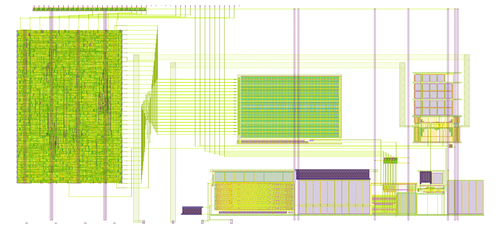
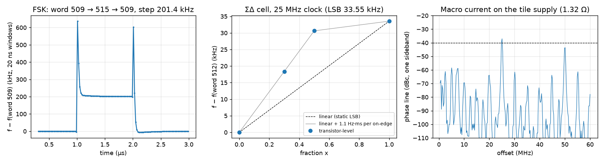
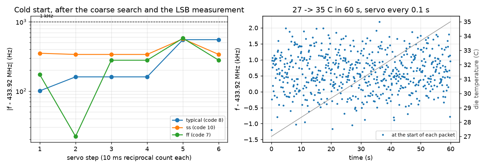

# On-chip fine tuning and FSK for the 433.92 MHz TX

This page describes the fine-tuning path that replaces the board-driven `vctrl`: a 10-bit medium current
digital-to-analogue converter (DAC) on the ring's `vg` node, a first-order sigma-delta (ΣΔ) modulator that dithers
one extra DAC cell for sub-LSB resolution, frequency-shift keying (FSK) as a digital offset on the DAC word, and a
small digital macro with a Serial Peripheral Interface (SPI) register and a ÷16 / ÷64 / ÷1024 divider. With it the
chip needs nothing on the board except the dipole. The brief is `docs/handoff_tx_fine_tune.md`; the decisions
behind it (2026-11-10) are in `STATUS.md`.

All numbers are at 27 °C and VDD 3.3 V unless a corner is named (corner policy, `docs/handoff_autonomy.md`).

## Summary

| Item | Target | Result | Source |
|---|---|---|---|
| ΣΔ order, clock | simplest that meets the spurs | first order, 8 fractional bits, clocked by the TT `clk` (10-50 MHz) | `sim/tune/sd_model.py` |
| ΣΔ worst spur, 10 kHz-30 MHz, all 255 fractions | ≤ −40 dBc | −54.0 dBc at 25 MHz, −46.0 dBc at 10 MHz (LSB 50 kHz) | Fig. 1 |
| ΣΔ-added FM, 1-100 kHz | ≤ 2 kHz rms | 0.28 kHz rms worst (fraction 1/256, 10 MHz or 25 MHz clock) | Fig. 1 |
| Resolution with ΣΔ | ≤ 1 kHz | LSB / 256 = 115-150 Hz | |
| Medium DAC range | ≥ 1.3 × the largest coarse step | 1.58-1.59 × at tt / ss / ff / sf / fs | Table II |
| Medium DAC LSB | ≤ 50 kHz | 29.4 kHz (ss) … 38.5 kHz (ff) | Table II |
| Monotonic (Monte Carlo, N = 200) | DNL > −1 LSB in ≥ 99 % | 200 / 200 at tt, ss and ff (worst −0.76 LSB, ff) | Table III |
| rms FM, 1-10 kHz, reference path | ≤ 15 kHz (whole VCO) | 8.20 → 8.62 kHz at mid-scale, 9.08 kHz at full scale (tt) | Table IV |
| Medium DAC on the extracted vco_top | LSB ≤ 50 kHz, range ≥ 1.3 steps | LSB 27.4 (ss) / 31.1 (tt) / 35.7 (ff) kHz, range 27.8-36.5 MHz | Table V |
| ΣΔ spurs, transistor level | ≤ −40 dBc | −58.7 dBc (fraction 77, model −60.1), −65.2 dBc (fraction ½) | Fig. 3 |
| FSK, ±3 LSB | ±100 kHz | 201.4 kHz step; settles to 2 % in 180-260 ns | Fig. 3 |
| Digital supply coupling | ≤ −40 dBc | **−37.0 dBc at 25 MHz: fails by 3 dB** with the estimated macro current | Fig. 3 |
| Macro timing | 10-50 MHz clk, ~108 MHz ck | 50 MHz at tt 3.3 V (+1.5 ns); about 41 MHz at ss 125 °C 3.0 V | `macro/tx_fine` |
| Tile checks | LVS, DRC, antenna, CI | LVS match (7/7 mutations caught), magic DRC 0, antenna 0, KLayout only DCF.1a (fill); TT precheck passes in CI | |
| Tuning from cold, RP2350 model | about 1 kHz | 0.3-0.6 kHz at tt / ss / ff; FSK spread 199 kHz | Fig. 4 |

## The ΣΔ modulator

**Problem.** The ring's coarse step is about 21 MHz and the medium DAC's LSB is 30-40 kHz, but both ends of a
link should be tunable to about 1 kHz. A static DAC that fine would need about 15 bits. Dithering the last bit with
a ΣΔ modulator gets the resolution from time instead: the DAC toggles between two words, and the VCO's phase
integrates the toggling into the average frequency.

**Model.** The frequency error is LSB × (y[n] − x), with y[n] the modulator output and x the fractional input, held
for one clock. The phase is its integral. Every modulator in the model (first order, MASH 1-1) is periodic in
256 or 65536 clocks for 8-bit accumulators, so a rectangular window of that length gives exact spectral lines with
no leakage. One sideband of a small phase modulation is |φ_k| below the carrier, with φ_k the phase line (half the
sinusoid's peak), and the hold adds a sinc(f / f_clk) factor. The ring's own response (the `vg` node's
RC) is left out, so the numbers are an upper bound.

**Why first order is enough.** A first-order accumulator's residue is always under one LSB × one clock, so the
phase error stays below 2π × LSB / f_clk: 2π × 50 kHz / 25 MHz = 0.0126 rad. A signal bounded like that has no
sinusoidal component above (2 / π) × 0.0126 = 0.008 rad peak, about −48 dBc in one sideband, whatever the
fraction. The sweep finds −54.0 dBc (fraction 1/256, a 97.7 kHz sawtooth). Fraction ½ is −60 dBc at 12.5 MHz.
The handoff's quick laptop model gave −50 dBc there; the 10 dB difference is the single-sideband convention (6 dB)
and the hold's sinc at f_clk / 2 (3.9 dB).

*Fig. 1. Worst spur from 10 kHz to 30 MHz (left) and the ΣΔ-added FM from 1 to 100 kHz (right) for every 8-bit
fraction, LSB 50 kHz, 25 MHz clock. First order: −54.0 dBc and 0.28 kHz rms at worst.*

MASH 1-1 lowers the worst spur only to −51.9 dBc (its multi-level output toggles two LSBs) and needs a 4-level
DAC input, so it gains nothing here. With 12 fractional bits, the extra fractions near 0, 1/5, 1/4, 1/3, ½ and
2/3 are no worse (−54.0 dBc, 0.20 kHz rms), but they add spurs down to 6 kHz. Eight bits already give LSB / 256
≈ 150 Hz.

*Table I. First-order ΣΔ, worst over all 255 fractions (`sd_model.py grid`).*

| LSB | clk 10 MHz | 12.5 MHz | 25 MHz | 50 MHz |
|---|---|---|---|---|
| 25 kHz | −52.0 dBc, 0.28 kHz | −54.0, 0.28 | −60.0, 0.14 | −66.0, 0.00 |
| 35 kHz | −49.1, 0.39 | −51.1, 0.39 | −57.1, 0.19 | −63.1, 0.00 |
| 50 kHz | −46.0, 0.55 | −48.0, 0.55 | −54.0, 0.28 | −60.0, 0.00 |
| 70 kHz | −43.1, 0.77 | −45.0, 0.77 | −51.1, 0.39 | −57.1, 0.00 |

(rms FM 1-100 kHz; at 50 MHz the lowest line, f_clk / 256 = 195 kHz, is above the band.) The design's LSB is
29-39 kHz, so a TT clock anywhere from 10 to 50 MHz meets −40 dBc with at least 6 dB to spare.

**The ΣΔ drives its own cell.** The ΣΔ output adds a separate 1-LSB cell; it doesn't carry into the 10-bit word.
So only one small cell toggles at the clock rate, and the 31 segments and 5 binary bits move only on a register
write or an FSK edge. The cell's mismatch to the LSB (0.93-1.07 in Monte Carlo) only scales the fractional
resolution by a few per cent, which the servo calibrates out by counting.

## The medium DAC

**Where it goes.** The ring is current-fed: plain inverters between VDD and a shared node `vg`, and the coarse DAC
sinks the ring current from `vg` to VSS. One coarse unit (nfet 1.2 / 5.33 µm on `vbnf`) carries Iu = 4.20 µA at tt
(3.96 ff … 4.46 µA ss) and is one coarse step, 19.1-25.4 MHz at the codes that reach 433.92 MHz. An ideal sink of
1.0 Iu on `vg` moves f by 18.8 (ss) … 24.4 MHz (ff), so the medium DAC is simply another sink on `vg`, sized in
units of Iu. Range ≥ 1.3 × the largest step (ff, 25.4 MHz) needs at least 1.36 Iu; the design uses 1.6 Iu for margin
on the gain chain.

**Circuit** (`sim/tune/mdac_sim.py`, `mdac_netlist()`).
1) Bias: two coarse units on `vbnf` sink 2 Iu from a diode of 128 PMOS units, so each PMOS unit carries
   I_L = Iu / 64 = 66 nA. The LSB tracks the coarse step over process and temperature, because both come from the
   constant-gm reference.
2) Array: PMOS units (W / L 1 / 4 µm, gate `pb`) in 31 unary segments of 32 units (word[9:5], thermometer-coded),
   binary groups of 16 / 8 / 4 / 2 / 1 units (word[4:0]), one ΣΔ cell (1 unit) and 32 always-on units. Each group's
   drain is steered by a PMOS pair, either to the output diode or to a matched dump diode, so a cell's current never
   stops and the bias line sees no load step when bits change.
3) Output mirror: the array current flows into a diode of 30 coarse units (`mo`), and 3 coarse units with gate
   `mo` sink from `vg`. I_out = (word + sd + 32) × I_L × 3 / 30, and full scale is 1023 / 64 × 3 / 30 = 1.60 Iu.
   The 32 always-on units keep the diode biased at word 0 (+0.05 Iu, a fixed offset).
4) `vctrl` is pulled to VSS by 200 kΩ of `ppolyf_u_1k`, so the fine NMOS leg is off by default and adds no supply
   sensitivity; ua[0] can still override it on the bench.

**Why a current gain.** The output current per LSB is only 6.6 nA. A unit sized for that current directly would
sit in deep weak inversion, where the current mismatch is about 30 × σVt. With the 10:1 current gain of the output
mirror, the 66 nA units run in moderate inversion (gm / Id about 12 V⁻¹), and a 1 × 4 µm PMOS unit has a σ of
about 2.9 % (σVt 2.3 mV, σβ 1.0 %, from the PDK's mismatch model). The output mirror's own mismatch is a common gain
error: it changes the LSB in hertz, not the monotonicity.

**Why 5 unary + 5 binary.** The only step that can go negative is a major carry, where one 32-unit segment replaces
the 31 units of the binary groups. Its σ is about 2.9 % × √63 = 0.23 LSB, so a −1 LSB step is more than 4σ away.
Six binary bits would double the units in that difference and put it near 3σ, at about the 99 % limit.

*Table II. Medium DAC on the schematic ring, at each corner's 433.92 MHz code, `vctrl` pulled down
(`mdac_sim.py fword`).*

| Corner | Code | f(word 0) MHz | f(word 1023) MHz | Range MHz | Coarse step MHz | Range / step | LSB kHz |
|---|---|---|---|---|---|---|---|
| tt | 9 | 441.16 | 475.34 | 34.19 | 21.55 | 1.59 | 33.4 |
| ss | 11 | 446.94 | 477.04 | 30.10 | 19.09 | 1.58 | 29.4 |
| ff | 7 | 432.38 | 471.72 | 39.34 | 24.68 | 1.59 | 38.5 |
| sf | 9 | 443.67 | 478.88 | 35.21 | 22.18 | 1.59 | 34.4 |
| fs | 10 | 451.46 | 483.83 | 32.37 | 20.42 | 1.59 | 31.6 |

The range is over 1.3 coarse steps everywhere, so the coarse + medium settings overlap with no gaps, and
433.92 MHz stays reachable at every corner (the schematic map's 433.92 codes move down by about one with the
medium DAC at mid-scale). The swing at `vg` and the ring nodes is unchanged (tt 1.81-3.43 V).

*Table III. Monotonicity, Monte Carlo (mismatch only, every PMOS / NMOS unit its own instance, N = 200 per corner,
`mdac_sim.py mc`; DC output current for all 1024 words, `vg` held at the corner's operating point).*

| Corner | DNL > −1 LSB | Worst DNL | 1st percentile of the per-sample minimum | LSB (output) | ΣΔ cell / LSB |
|---|---|---|---|---|---|
| tt | 200 / 200 | −0.721 | −0.700 | 6.52-6.81 nA | 0.928-1.071 |
| ss | 200 / 200 | −0.682 | −0.662 | 6.90-7.19 nA | 0.932-1.068 |
| ff | 200 / 200 | −0.763 | −0.738 | 6.17-6.46 nA | 0.924-1.075 |

*Table IV. rms FM from the reference and DAC current noise (`mdac_sim.py noise`: `.noise` of the coarse DAC's and
the medium DAC's drain currents with `vg` held, times K_I = df/dI from the ideal sink; 1-10 kHz).*

| Corner | Coarse path only | + medium, word 0 | word 512 | word 1023 |
|---|---|---|---|---|
| tt (code 9) | 8.20 kHz | 8.22 | 8.62 | 9.08 |
| ss (code 11) | 8.03 | 8.05 | 8.40 | 8.80 |
| ff (code 7) | 8.36 | 8.38 | 8.84 | 9.40 |

The medium DAC adds its own noise (1.2 kHz rms alone at mid-scale) and correlated `vbnf` noise, about +5 % at mid-scale
and +11 % at full scale. Its noise rises with the word, so the servo should keep the coarse code that puts 433.92
MHz nearest mid-scale. The ring's own (ISF) noise is not in this table; the whole-VCO number is a phase C job.

**Start-up.** The DAC loads `vbnf` only through the gates of two coarse units (about 0.05 pF on the 20 pF filter),
and at most adds 1.65 Iu to `vg`. That is less than the fine leg at `vctrl` = 3.3 V on top of code 31, which the
2026-11-08 map already covers. Ring start-up at code 0 (the weakest case) is unchanged, since the DAC only adds current.

**Power.** The array runs at (1024 + 32) × 66 nA = 70 µA plus 8.4 µA of bias, about 0.26 mW from VDPWR, against
12.6 mA for the TX driver.

## The digital macro (`src/tx_fine.v`, `macro/tx_fine`)

**What it does.** The macro is one LibreLane-hardened block (170 × 260 µm, Metal1-4, gf180mcuD 7-track cells at
3.3 V) with two clock domains:
- `clk` (the TT project clock, 25 MHz recommended): the SPI register, the FSK offset, the ΣΔ and the 37 DAC control
  lines (31 thermometer segments, 5 binary bits, the ΣΔ cell), registered and active low (0 V turns a cell on);
- `ck` (f / 4, about 108 MHz, from the VCO's divider): a ripple divider giving f / 16 (27.1 MHz), f / 64 (6.78 MHz)
  and f / 1024 (424 kHz) on uo[1..3], and `ck` itself on uo[0] through a glitch-free gate that is off after reset.
  4 × ck = 433.92 MHz, so a toggling `ck` pin would be an on-channel spur.

*Table VI. Register map. SPI mode 0, MSB first, 16-bit frames while CS_n is low: [15] 1 = read / 0 = write,
[14:12] address, [11:0] data. SCLK must stay below clk / 8.*

| Address | Name | Bits | Reset | Use |
|---|---|---|---|---|
| 0 | MED_INT | [9:0] | 512 | medium DAC word |
| 1 | MED_FRAC | [7:0] | 0 | ΣΔ fraction (LSB / 256) |
| 2 | FSK_DEV | [11:0] | 0 | FSK deviation, 4.8 fixed point in LSBs |
| 3 | CTRL | [0] SD_EN, [1] CK_EN, [2] FSK_EN, [3] FSK_INV | 0 | |
| 4 | EFF_INT | [9:0] | read only | the integer word the DAC sees (after FSK and saturation) |
| 7 | ID | [11:0] | 0x433 | read only |

The effective word is {MED_INT, MED_FRAC} ± FSK_DEV (+ when ui[7] = 1, unless FSK_INV), saturated to 0 … 1023.996. It is
registered, then decoded, so the adder and the decoder sit in separate clock cycles.

**Evidence.**
- Five cocotb tests (`test/`, `make` and `make GL=1`): reset values, write and readback, the ΣΔ bitstream bit for
  bit against `sim/tune/sd_model.py`, the FSK offset and saturation, and the divider ratios and `ck` gate. They pass
  on the RTL and on the hardened netlist. Three RTL mutations (a wrong carry bit, a wrong divider tap, a shifted
  FSK_DEV write) each fail a test.
- LibreLane: magic and KLayout DRC, LVS and antenna are clean. At tt 3.3 V the 50 MHz `clk` and the 140 MHz `ck`
  constraint both close (+1.5 ns). At the 3.3 V libraries' slow corner (ss, 125 °C, 3.0 V) the `clk` domain closes
  at about 41 MHz. That corner is far from the room-temperature operating point, so 25 MHz has a wide margin.

## Layout and tile integration

*Fig. 2. The 2x2 tile: the digital macro (left strip), the medium DAC above vco_top (x 335-492 µm, y 118-222 µm), the
vctrl pull-down left of vco_top, and the 37 control lines through a Metal3 jog channel between the two TX risers.*

- **Medium DAC** (`layout/gen/mdac.py`, 156.8 × 104.2 µm): 40 PMOS rows of 32 fingers (1 / 4 µm) in mirrored
  pairs. Each pair shares a poly gate bar (`pb`) and an n+ tap rail. The segments are placed symmetrically about
  the binary rows, so a linear gradient cancels pairwise. Unused fingers in the binary rows are dummies with both
  ends on VDD. A steering pair per row is on the left, with Metal3 `mo` / `md` buses. The output mirror (30 + 3
  coarse units) and the bias device are below. The generator asserts that each group's unit count equals the
  simulated circuit's.
- **vco_top** brings `vg` and `vbnf` up to its top edge on Metal3 risers. Its own checks still pass
  (`check_top.sh`).
- **Tile** (`layout/gen/tt_wrapper.py`): the macro's VDD / VSS strap pairs at x 56.5 and 136.5 µm are extended to
  become the tile's stripes there. The control lines' jog columns are ordered so that no two Metal2 runs overlap.
  Each line also gets a short Metal3 hop just before the DAC: the long Metal2 run is then not connected to the
  switch gate when Metal2 is etched (antenna).
- **Checks:** block DRC / LVS / antenna clean for mdac and vctrl_pd, with three mutations caught in mdac. The
  xschem schematic `xschem/mdac.sch` matches both the layout source and the simulated circuit (`check.py`, with an
  SD-cell mutation). Tile LVS matches with 7 of 7 mutations caught, including the SPI pins swapped and two DAC lines
  swapped. Tile magic DRC 0, antenna 0, KLayout only DCF.1a (dummy fill). The TT precheck passes in CI.
- **A bug the cross-check found:** the layout first drew the ΣΔ cell as a 32-unit segment (`"sd".startswith("s")`),
  and every LVS passed because the LVS source came from the same code. The schematic-against-simulation comparison
  caught it.

## Transistor-level checks (`sim/tune/phase_c.py`)

The medium DAC was put on the extracted vco_top (RC, magic 8.3.642, `rcfix.py`) for f against the word. The other
benches use the schematic ring with the reference and the DAC. In those transients `vbnf` is held at its DC value.
The 1 MΩ / 20 pF filter node otherwise drifts by about 0.1 mV/µs, which is about 2 nA of integration error on a
20 ms node. That drift moves f by tens of kHz per µs, which hides LSB-sized effects.

*Table V. Medium DAC on the extracted vco_top (27 °C).*

| Corner | Code | f(word 0) | f(word 512) | f(word 1023) | LSB (full scale / 1023) | LSB at 512 → 513 |
|---|---|---|---|---|---|---|
| tt | 9 | 404.88 MHz | 420.99 | 436.71 | 31.12 kHz | 31.12 kHz |
| ss | 11 | 411.40 | 425.58 | 439.45 | 27.42 | 27.43 |
| ff | 7 | 396.59 | 415.11 | 433.11 | 35.70 | 35.68 |

The extracted LSB is 0.93× the schematic value, close to the ring's own extracted factor. At ff, code 7 tops out at
433.11 MHz, so 433.92 MHz is reached from code 8. The range (more than 1.3 steps) ensures one of the two codes
covers it.

*Fig. 3. Left: FSK by ±3 LSB (word 509 ↔ 515), a 201.4 kHz step that settles in 180-260 ns; this pair crosses the
major carry at 512, and each edge has a 40 ns spike of about +600 kHz. Middle: mean frequency against the ΣΔ
fraction, 8.3 kHz (fraction 77) and 13.9 kHz (fraction ½) above the static LSB line. Right: the phase spectrum
with the macro's estimated current on the tile supply, −37.0 dBc at 25 MHz.*

- **ΣΔ.** The spurs match the model: −58.7 dBc at 7.59 MHz for fraction 77 (model −60.1 dBc) and −65.2 dBc for
  fraction ½. The mean frequency is not linear in the fraction. Each turn-on of the ΣΔ cell injects charge from
  its drain node (about 0.9 V swing) into `mo`: about 1.1 Hz·ms per edge. The excess therefore follows the edge
  rate, which is largest at fraction ½. The curve stays monotonic and continuous across word boundaries, so the
  counting servo absorbs it. A dummy switch or slower edges on that one cell would remove it.
- **Charge injection.** At the major carry 511 → 512 (16 cells switch): `mo` peaks 30 mV (ss 35 mV), `vg` 1.5 mV,
  and `vbnf` 0.07 mV in the run without the hold. The step is +33.3 kHz, so it stays monotonic. With the ΣΔ toggling,
  `mo` ripples 2.8 mV p-p.
- **FSK.** The step is the expected 6 LSB (201.4 kHz). The 40 ns spike at a major carry is about 0.1 rad of phase
  per edge. The RP2350 can avoid it by keeping the FSK pair on one side of a multiple of 32.
- **Digital supply coupling: this fails the target.** The model is the ring's VDD through the 1.32 Ω power switch
  with 9.8 pF of decap, plus the macro's current. That current is estimated from LibreLane's tt power report scaled
  to 25 / 108 MHz: 0.6 mA DC, a 1 ns, 24 mA-peak pulse on each `clk` edge, and a 0.4 ns pulse on each `ck` edge. VDD
  moves 34 mV p-p, and the phase line at 25 MHz is −37.0 dBc (−43 dBc at 50 MHz), 3 dB over the −40 dBc target. More
  decap does not help at this source impedance: the volt-seconds per edge are set by charge × 1.32 Ω. The fix is
  less charge per edge. Clock-gating the roughly 140 flops that hold static values (the register, the effective
  word, the decoded lines) leaves about 20 flops on every edge, which should be worth about 15 dB. That is an RTL
  change, with no floorplan or supply change. The current waveform is an estimate, not an extraction.
- **FM noise** with the DAC is Table IV (`.noise`, schematic): +5 % at mid-scale.

## RP2350 tuning model (`sim/tune/rp2350_model.py`)

*Fig. 4. Left: the frequency error after the coarse search and the LSB measurement, 0.3-0.6 kHz after two or three
10 ms reciprocal counts at tt / ss / ff. Right: a 27 → 35 °C warm-up in 60 s with the servo every 0.1 s, within
2.3 kHz at each packet start.*

The procedure and the counting methods are in [tuning.md](tuning.md). The model uses the schematic f(word), white FM
noise of 8 kHz rms (1-10 kHz), +120 ppm/°C and a +10 ppm RP2350 crystal. The residual error is the FM noise over a
10 ms count. A 1 s servo interval is too slow for the fastest warm-up (8.3 kHz); 0.1 s keeps it to 2.3 kHz. The
nonlinearity of the ΣΔ cell (Fig. 3, middle) is not in the model. The servo corrects it, but the first step lands
up to 0.4 LSB off.

## Limits and open items (at the time of writing)

- **Digital supply coupling** is 3 dB over the target with the estimated current. Clock gating in the macro is the
  proposed fix and has not been done. An extracted current waveform (from the macro's SPEF) would firm up the
  number.
- **The medium DAC is not extracted**; Table V uses the extracted ring with the schematic DAC. The DAC's own routing
  adds C on `mo` and on the control lines.
- **Monte Carlo** used the schematic DAC (unit instances), not the layout.
- **Corners:** 27 °C, VDD 3.3 V. The low-VDD (3.15 V) headroom check on the DAC cells was not run.
- **The ΣΔ cell's charge injection** (1.1 Hz·ms per edge) and the FSK major-carry spike are measured and explained,
  but not designed out.
- **Crystal error:** tuning is relative to each RP2350's crystal (±30 ppm, ±13 kHz), so two boards agree to the sum
  of their crystal errors unless the receiver corrects it.

