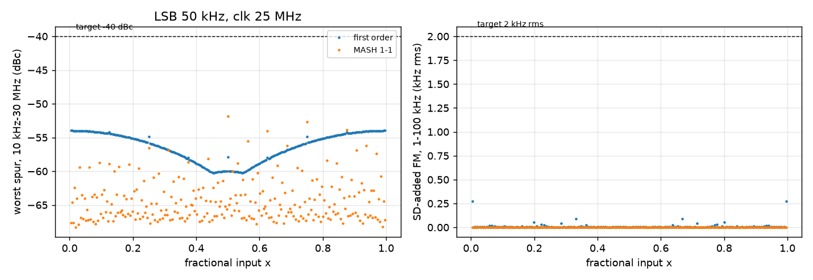

# On-chip fine tuning and FSK for the 433.92 MHz TX

This page describes the fine-tuning path that replaces the board-driven `vctrl`: a 10-bit medium current
digital-to-analogue converter (DAC) on the ring's `vg` node, a first-order sigma-delta (ΣΔ) modulator that dithers
one extra DAC cell for sub-LSB resolution, frequency-shift keying (FSK) as a digital offset on the DAC word, and a
small digital macro with a Serial Peripheral Interface (SPI) register and a ÷16 / ÷64 / ÷1024 divider. With it the
chip needs nothing on the board except the dipole. The brief is `docs/handoff_tx_fine_tune.md`; the decisions
behind it (2026-11-10) are in `STATUS.md`.

All numbers are at 27 °C and VDD 3.3 V unless a corner is named (corner policy, `docs/handoff_autonomy.md`).

## Summary (phase A: schematic)

| Item | Target | Result | Source |
|---|---|---|---|
| ΣΔ order, clock | simplest that meets the spurs | first order, 8 fractional bits, clocked by the TT `clk` (10-50 MHz) | `sim/tune/sd_model.py` |
| ΣΔ worst spur, 10 kHz-30 MHz, all 255 fractions | ≤ −40 dBc | −54.0 dBc at 25 MHz, −46.0 dBc at 10 MHz (LSB 50 kHz) | Fig. 1 |
| ΣΔ-added FM, 1-100 kHz | ≤ 2 kHz rms | 0.28 kHz rms worst (fraction 1/256, 10 MHz or 25 MHz clock) | Fig. 1 |
| Resolution with ΣΔ | ≤ 1 kHz | LSB / 256 = 115-150 Hz | |
| Medium DAC range | ≥ 1.3 × the largest coarse step | 1.58-1.59 × at tt / ss / ff / sf / fs | Table II |
| Medium DAC LSB | ≤ 50 kHz | 29.4 kHz (ss) … 38.5 kHz (ff) | Table II |
| Monotonic (Monte Carlo, N = 200) | DNL > −1 LSB in ≥ 99 % | 200 / 200 at tt, ss and ff (worst −0.76 LSB, ff) | Table III |
| rms FM, 1-10 kHz, reference path | ≤ 15 kHz (whole VCO) | 8.20 → 8.62 kHz at mid-scale, 9.08 kHz at full scale (tt) | Table IV |

## The ΣΔ modulator

**Problem.** The ring's coarse step is about 21 MHz and the medium DAC's LSB is 30-40 kHz, but both ends of a
link should be tunable to about 1 kHz. A static DAC that fine would need about 15 bits. Dithering the last bit with
a ΣΔ modulator gets the resolution from time instead: the DAC toggles between two words, and the VCO's phase
integrates the toggling into the average frequency.

**Model.** The frequency error is LSB × (y[n] − x), with y[n] the modulator output and x the fractional input, held
for one clock. The phase is its integral. Every modulator in the model (first order, MASH 1-1) is periodic in
256 or 65536 clocks for 8-bit accumulators, so a rectangular window of that length gives exact spectral lines with
no leakage. One sideband of a small phase modulation is |φ_k| below the carrier, with φ_k the phase line (half the
sinusoid's peak), and the hold adds a sinc(f / f_clk) factor. The ring's own response (the `vg` node's
RC) is left out, so the numbers are an upper bound.

**Why first order is enough.** A first-order accumulator's residue is always under one LSB × one clock, so the
phase error stays below 2π × LSB / f_clk: 2π × 50 kHz / 25 MHz = 0.0126 rad. A signal bounded like that has no
sinusoidal component above (2 / π) × 0.0126 = 0.008 rad peak, about −48 dBc in one sideband, whatever the
fraction. The sweep finds −54.0 dBc (fraction 1/256, a 97.7 kHz sawtooth). Fraction ½ is −60 dBc at 12.5 MHz.
The handoff's quick laptop model gave −50 dBc there; the 10 dB difference is the single-sideband convention (6 dB)
and the hold's sinc at f_clk / 2 (3.9 dB).

*Fig. 1. Worst spur from 10 kHz to 30 MHz (left) and the ΣΔ-added FM from 1 to 100 kHz (right) for every 8-bit
fraction, LSB 50 kHz, 25 MHz clock. First order: −54.0 dBc and 0.28 kHz rms at worst.*

MASH 1-1 lowers the worst spur only to −51.9 dBc (its multi-level output toggles two LSBs) and needs a 4-level
DAC input, so it gains nothing here. With 12 fractional bits, the extra fractions near 0, 1/5, 1/4, 1/3, ½ and
2/3 are no worse (−54.0 dBc, 0.20 kHz rms), but they add spurs down to 6 kHz. Eight bits already give LSB / 256
≈ 150 Hz.

*Table I. First-order ΣΔ, worst over all 255 fractions (`sd_model.py grid`).*

| LSB | clk 10 MHz | 12.5 MHz | 25 MHz | 50 MHz |
|---|---|---|---|---|
| 25 kHz | −52.0 dBc, 0.28 kHz | −54.0, 0.28 | −60.0, 0.14 | −66.0, 0.00 |
| 35 kHz | −49.1, 0.39 | −51.1, 0.39 | −57.1, 0.19 | −63.1, 0.00 |
| 50 kHz | −46.0, 0.55 | −48.0, 0.55 | −54.0, 0.28 | −60.0, 0.00 |
| 70 kHz | −43.1, 0.77 | −45.0, 0.77 | −51.1, 0.39 | −57.1, 0.00 |

(rms FM 1-100 kHz; at 50 MHz the lowest line, f_clk / 256 = 195 kHz, is above the band.) The design's LSB is
29-39 kHz, so a TT clock anywhere from 10 to 50 MHz meets −40 dBc with at least 6 dB to spare.

**The ΣΔ drives its own cell.** The ΣΔ output adds a separate 1-LSB cell; it doesn't carry into the 10-bit word.
So only one small cell toggles at the clock rate, and the 31 segments and 5 binary bits move only on a register
write or an FSK edge. The cell's mismatch to the LSB (0.93-1.07 in Monte Carlo) only scales the fractional
resolution by a few per cent, which the servo calibrates out by counting.

## The medium DAC

**Where it goes.** The ring is current-fed: plain inverters between VDD and a shared node `vg`, and the coarse DAC
sinks the ring current from `vg` to VSS. One coarse unit (nfet 1.2 / 5.33 µm on `vbnf`) carries Iu = 4.20 µA at tt
(3.96 ff … 4.46 µA ss) and is one coarse step, 19.1-25.4 MHz at the codes that reach 433.92 MHz. An ideal sink of
1.0 Iu on `vg` moves f by 18.8 (ss) … 24.4 MHz (ff), so the medium DAC is simply another sink on `vg`, sized in
units of Iu. Range ≥ 1.3 × the largest step (ff, 25.4 MHz) needs at least 1.36 Iu; the design uses 1.6 Iu for margin
on the gain chain.

**Circuit** (`sim/tune/mdac_sim.py`, `mdac_netlist()`).
1) Bias: two coarse units on `vbnf` sink 2 Iu from a diode of 128 PMOS units, so each PMOS unit carries
   I_L = Iu / 64 = 66 nA. The LSB tracks the coarse step over process and temperature, because both come from the
   constant-gm reference.
2) Array: PMOS units (W / L 1 / 4 µm, gate `pb`) in 31 unary segments of 32 units (word[9:5], thermometer-coded),
   binary groups of 16 / 8 / 4 / 2 / 1 units (word[4:0]), one ΣΔ cell (1 unit) and 32 always-on units. Each group's
   drain is steered by a PMOS pair, either to the output diode or to a matched dump diode, so a cell's current never
   stops and the bias line sees no load step when bits change.
3) Output mirror: the array current flows into a diode of 30 coarse units (`mo`), and 3 coarse units with gate
   `mo` sink from `vg`. I_out = (word + sd + 32) × I_L × 3 / 30, and full scale is 1023 / 64 × 3 / 30 = 1.60 Iu.
   The 32 always-on units keep the diode biased at word 0 (+0.05 Iu, a fixed offset).
4) `vctrl` is pulled to VSS by 200 kΩ of `ppolyf_u_1k`, so the fine NMOS leg is off by default and adds no supply
   sensitivity; ua[0] can still override it on the bench.

**Why a current gain.** The output current per LSB is only 6.6 nA. A unit sized for that current directly would
sit in deep weak inversion, where the current mismatch is about 30 × σVt. With the 10:1 current gain of the output
mirror, the 66 nA units run in moderate inversion (gm / Id about 12 V⁻¹), and a 1 × 4 µm PMOS unit has a σ of
about 2.9 % (σVt 2.3 mV, σβ 1.0 %, from the PDK's mismatch model). The output mirror's own mismatch is a common gain
error: it changes the LSB in hertz, not the monotonicity.

**Why 5 unary + 5 binary.** The only step that can go negative is a major carry, where one 32-unit segment replaces
the 31 units of the binary groups. Its σ is about 2.9 % × √63 = 0.23 LSB, so a −1 LSB step is more than 4σ away.
Six binary bits would double the units in that difference and put it near 3σ, at about the 99 % limit.

*Table II. Medium DAC on the schematic ring, at each corner's 433.92 MHz code, `vctrl` pulled down
(`mdac_sim.py fword`).*

| Corner | Code | f(word 0) MHz | f(word 1023) MHz | Range MHz | Coarse step MHz | Range / step | LSB kHz |
|---|---|---|---|---|---|---|---|
| tt | 9 | 441.16 | 475.34 | 34.19 | 21.55 | 1.59 | 33.4 |
| ss | 11 | 446.94 | 477.04 | 30.10 | 19.09 | 1.58 | 29.4 |
| ff | 7 | 432.38 | 471.72 | 39.34 | 24.68 | 1.59 | 38.5 |
| sf | 9 | 443.67 | 478.88 | 35.21 | 22.18 | 1.59 | 34.4 |
| fs | 10 | 451.46 | 483.83 | 32.37 | 20.42 | 1.59 | 31.6 |

The range is over 1.3 coarse steps everywhere, so the coarse + medium settings overlap with no gaps, and
433.92 MHz stays reachable at every corner (the schematic map's 433.92 codes move down by about one with the
medium DAC at mid-scale). The swing at `vg` and the ring nodes is unchanged (tt 1.81-3.43 V).

*Table III. Monotonicity, Monte Carlo (mismatch only, every PMOS / NMOS unit its own instance, N = 200 per corner,
`mdac_sim.py mc`; DC output current for all 1024 words, `vg` held at the corner's operating point).*

| Corner | DNL > −1 LSB | Worst DNL | 1st percentile of the per-sample minimum | LSB (output) | ΣΔ cell / LSB |
|---|---|---|---|---|---|
| tt | 200 / 200 | −0.721 | −0.700 | 6.52-6.81 nA | 0.928-1.071 |
| ss | 200 / 200 | −0.682 | −0.662 | 6.90-7.19 nA | 0.932-1.068 |
| ff | 200 / 200 | −0.763 | −0.738 | 6.17-6.46 nA | 0.924-1.075 |

*Table IV. rms FM from the reference and DAC current noise (`mdac_sim.py noise`: `.noise` of the coarse DAC's and
the medium DAC's drain currents with `vg` held, times K_I = df/dI from the ideal sink; 1-10 kHz).*

| Corner | Coarse path only | + medium, word 0 | word 512 | word 1023 |
|---|---|---|---|---|
| tt (code 9) | 8.20 kHz | 8.22 | 8.62 | 9.08 |
| ss (code 11) | 8.03 | 8.05 | 8.40 | 8.80 |
| ff (code 7) | 8.36 | 8.38 | 8.84 | 9.40 |

The medium DAC adds its own noise (1.2 kHz rms alone at mid-scale) and correlated `vbnf` noise, about +5 % at mid-scale
and +11 % at full scale. Its noise rises with the word, so the servo should keep the coarse code that puts 433.92
MHz nearest mid-scale. The ring's own (ISF) noise is not in this table; the whole-VCO number is a phase C job.

**Start-up.** The DAC loads `vbnf` only through the gates of two coarse units (about 0.05 pF on the 20 pF filter),
and at most adds 1.65 Iu to `vg`. That is less than the fine leg at `vctrl` = 3.3 V on top of code 31, which the
2026-11-08 map already covers. Ring start-up at code 0 (the weakest case) is unchanged, since the DAC only adds current.

**Power.** The array runs at (1024 + 32) × 66 nA = 70 µA plus 8.4 µA of bias, about 0.26 mW from VDPWR, against
12.6 mA for the TX driver.
