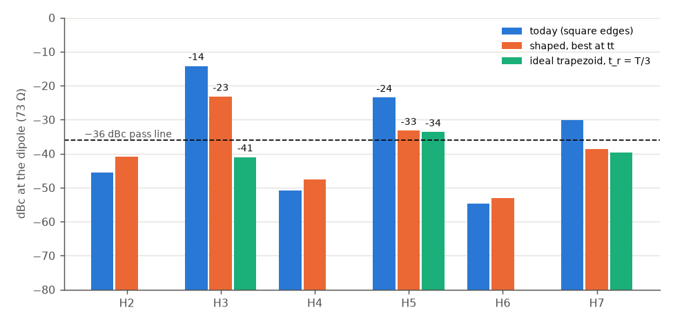
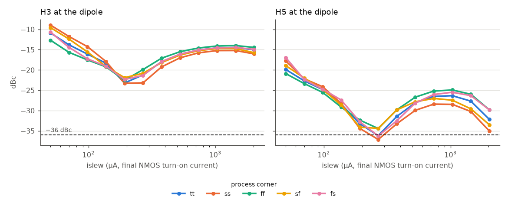
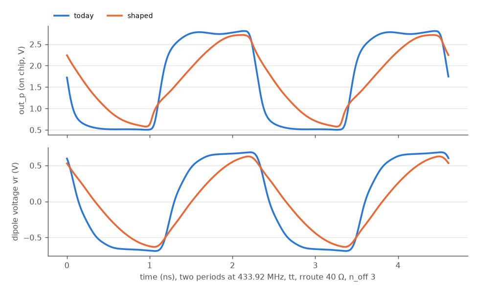

# TX harmonics: slew-controlled final stage (option 1)

**Decision (Matt, 2026-11-12): a board low-pass filter fixes the harmonics (H3 below −55 dBc at every corner, below). The on-chip study that led there follows.**

**Result (2026-11-12): option 1 does not pass, and cannot on its own.** A current-starved, break-before-make final
stage brings the 3rd harmonic at the dipole from −14.2 to −23.2 dBc and the 5th from −23.5 to −33.2 dBc at the
typical (tt) corner, for 2.4 dB of fundamental. The pass line is −36 dBc for both. Even an ideal linear trapezoid
through the same pad path only gets both harmonics to about −35 dBc, and only at one exact rise time. Adding
option 2 on top gives −26 to −32 dBc. A four-tap version of option 2 (below) nulls the 3rd, 5th and 7th together on paper, and
is the suggested next step.

This is a block-level simulation study of the TX driver (`docs/tx_driver.md`), set by
`docs/handoff_tx_harmonics.md`. It is not a layout change: with `shape=0` (the default) the netlist is byte-for-byte
the one on `main`.

## Problem
The driver drives the dipole with a near-square wave. At tt (27 °C, 3.3 V, 40 Ω pad routing, 3 other projects on
each pin), the 73 Ω dipole sees the 3rd harmonic (H3, 1.30 GHz) at −14.2 dBc and the 5th (H5, 2.17 GHz) at
−23.5 dBc. Over 5 process corners × routing 15 / 40 / 60 Ω × 0 / 3 other projects, H3 is −12.4…−15.5 dBc and H5
−19.9…−26.3 dBc. The European Telecommunications Standards Institute (ETSI) standard EN 300 220 limits spurious
emissions above 1 GHz to −30 dBm. At our fundamental of about +6 dBm that is about −36 dBc. There are no board
components except the dipoles, so the fix has to be on chip.

## Fix tried
A trapezoid's harmonics fall as sinc(n·π·t_r / T). A rise time of t_r = T/3 (0.77 ns) puts the H3 null at the
first zero and should cut H5 by roughly 15 dB. The study adds a `shape=1` switch to `sim/tx/tx_drv.py` that changes
only the last two stages of each arm:

1. **Break-before-make.** Stage 4 splits into two predrivers from y3. The final PMOS gate (`gp`) is pulled up hard
   (PMOS off fast) and pulled down by a current-starved leg (PMOS on slowly). The final NMOS gate (`gn`) is
   the mirror image. So only one output device conducts at a time, and the shaped edge is always the one turning on.
2. **Bias.** `tx_slew_bias` mirrors an ideal reference current into an NMOS diode (`vsn`) and a PMOS diode (`vsp`).
   The starved legs are 10 × the diodes. `islew` is the current that turns the final NMOS on, and `knp` the ratio of
   the final PMOS's turn-on current to it. The starved legs scale in width with current (as a trim's parallel legs
   would). `--off` still holds both outputs at 0 V.
3. **A Miller capacitor** (`cmil`, out to each final gate) was also tried, to make the output slew linear.

The bench (`sim/tx/tb_tx_drv.py`) now also reports H2–H7 of the dipole voltage, the pin current
(√(P / 73 Ω)) and the efficiency P_dip / (VDD × I_avg). The driver `sim/tx/run_harmonics.py` ran 425 transients in
under 3 minutes. The tables are in `sim/tx/results/harmonics.md`.

## Evidence

**Fig. 1.** Harmonics at the dipole at tt (rroute 40 Ω, n_off 3): today, the best shaped setting (islew 192 µA,
knp 2.5, no Miller C) and an ideal linear trapezoid with t_r = T/3. Shaped: H3 −23.2 and H5 −33.2 dBc at
+3.86 dBm (today +6.26 dBm). Ideal: H3 −41.0 but H5 −33.6 dBc.

**Even a perfect edge fails.** The bound (`sim/tx/ideal_trap.py`) drives the same pad model and dipole from ideal
linear trapezoids through 10 or 30 Ω (tt, ss and ff for the pad devices). H3 is below −36 dBc only in a window
0.02–0.03 T wide (about ±4 %), centred between 0.30 and 0.34 T depending on the corner and the source resistance.
In that window H5 is −29 to −34 dBc. H5 reaches −36 dBc only for t_r ≥ 0.36 T, where H3 has risen to −26 to
−34 dBc. The best single point (tt, 30 Ω, t_r = 0.35 T) gives H3 −34.6 and H5 −35.8 dBc. A trapezoid cannot null
H3 and H5 together, and the pad path filters too little to close the gap.

**Fig. 2.** H3 and H5 against the edge current islew at the 5 process corners (knp 2.5, no Miller C, rroute 40 Ω,
n_off 3). The H3 floor is −22 to −23 dBc at every corner, around 190–270 µA. H5 reaches −37.1 dBc only at ss.

**The real edge is not a ramp.** The best H3 is −23 dBc, not a null, at every corner. Fig. 3 shows why: the
shaped output jumps at the start of each edge, then curves into the top and takes almost the whole half period. The
final devices (100 / 40 µm) have a square-law current against gate voltage, and the output saturates as soon as
their on-resistance drops below the pad path and the dipole. So a linear gate ramp gives a curved output edge. The
Miller capacitor did not help (best H3 −21.7 dBc, at 50 fF).

**Fig. 3.** out_p and the dipole voltage at tt over two periods, today and shaped (islew 192 µA). The shaped edge
is curved and nearly 1 ns long, not the linear 0.77 ns ramp a trapezoid null needs.

**Corners and trim.** Each corner's own best islew is 192–376 µA (H3 −18.0 at fs to −23.2 dBc). A 2-bit trim
(×0.7 / ×1 / ×1.4 / ×2) moves the edge but not the H3 floor, so it buys nothing here. At the codes picked per
corner (Table D in the results), the outcome against the pass criteria:

| criterion | pass line | shaped, over 5 corners × 15–60 Ω × n_off 0 / 3 | today |
|---|---|---|---|
| H3 | ≤ −36 dBc | −15.9 … −25.3 dBc ✗ | −12.4 … −15.5 dBc |
| H5 | ≤ −36 dBc | −28.4 … −38.7 dBc ✗ | −19.9 … −26.3 dBc |
| fundamental, worst | ≥ +3 dBm | +2.29 dBm (ss, 60 Ω; also sf, 60 Ω) ✗ | +3.74 dBm |
| duty (out_p / out_n) | 48–52 % | sf 54.8–56.8 / 43.8–45.7 % ✗ | 48.8–52.1 % |
| even harmonics | ≤ −36 dBc | H2 −31.0 … −33.8 dBc at fs ✗ | H2 −32.0 … −33.5 at fs ✗ |
| pin current | ≤ 10 mA rms | 4.8–9.1 mA ✓ | up to 11.1 mA |
| `--off` | outputs low | 0.000 V ✓ (0.17 mA bias left on) | 0 V |

The sf duty error comes from the N/P skew: one `knp` cannot balance both edges there (fs holds 48–49 % only at
the ×2 code, which is picked for duty and costs 5 dB of H3), so a real trim would need separate N and P codes. Temperature (20 / 35 °C at tt) does not move the result (H3 −23.2 dBc at
both). At VDD 3.15 V and fs, H3 is −17.7 and H5 −32.1 dBc. The H2 at fs is not new: today's circuit already shows
−32.0 to −33.5 dBc there (`docs/tx_driver.md` quotes the tt value, −41 dBc).

**With option 2 on top (estimated, not simulated).** Two ring taps 72° apart scale harmonic n by |cos(n·36°)|: in
dBc, H3 and H7 fall 8.4 dB and H5 rises 1.8 dB, for 1.8 dB of fundamental. On the shaped results that gives
max(H3, H5) of −26.1 (fs) to −31.6 dBc (tt). On an ideal trapezoid set to the H5 null (t_r = 0.40 T), it gives
H3 −34.4 dBc. Both still fail.

## Decision: a board low-pass filter (2026-11-12)
Neither on-chip option reaches −36 dBc on both harmonics with margin, so the fix is a filter on the board, the one
exception to the "dipoles only" rule. Short experiments can still run without it.

**The filter.** A balanced 5th-order Butterworth low-pass in pi form (capacitor first), designed for the dipole's
73 Ω with a 550 MHz corner, between the two pins and the dipole. Each line has 4.7 pF to ground, 18 nH in series,
15 pF to ground, 18 nH, and 4.7 pF to ground (standard values; the exact design is 4.9 pF / 17.1 nH / 15.9 pF).
The capacitors go to ground rather than across the pair, so the common mode is filtered too. The first capacitor
sits in parallel with the pad's own capacitance. `sim/tx/board_lpf.py` puts it into the block bench.

**Evidence** (standard values, 5 corners × routing 15 / 60 Ω × 0 / 3 other projects, 27 °C, 3.3 V):

| final stage N | fundamental | H3 | H5 | pad current, worst | supply current |
|---|---|---|---|---|---|
| 40 µm (today) | +4.9 … +9.8 dBm | −54.4 … −56.5 dBc (pi, exact values) | ≤ −80 dBc | 13.8 mA rms ✗ (ff, 15 Ω) | 9.6–15.3 mA |
| 22 µm | +2.5 … +7.2 dBm | −55.7 … −60.1 dBc | ≤ −77 dBc | 9.9 mA rms | 6.9–10.5 mA |
| 20 µm | +2.0 … +6.6 dBm | −55.8 … −60.1 dBc | ≤ −77 dBc | 9.3 mA rms | 6.5–9.8 mA |

The pass line is −36 dBc, so the 3rd harmonic has about 20 dB of margin. The filter also transforms the load, so
the chip delivers more power than it does into the bare dipole (+8.6 against +6.3 dBm at tt, 15 Ω, 40 µm). That
pushes the pad current over the 10 mA rms limit, so the final stage should shrink to 20–22 µm (P 50–55 µm); the
worst-case fundamental then drops from +3.7 to +2.0–2.5 dBm (ss, 60 Ω, 3 other projects). Moving the corner
from 450 to 650 MHz takes H3 from −67 to −49 dBc at tt, so the usual ±5 % part tolerances cost only a few dB.

**Limits.** Ideal L and C (no self-resonance, no board parasitics); the dipole is a 73 Ω + 100 pF model, not its
real impedance at 3f and 5f; the pad current is through the pin model's output, and the 10 mA rms limit is per
`ua` pin (tnt).

## What bears on option 2
The 5-stage ring has taps every 36°. A segmented final stage that sums 4 consecutive taps with weights
1 : φ : φ : 1 (φ = 1.618) places zeros at H3, H5 and H7 together, because 2·cos 108° = −0.618 and the 4th
tap fills in H5. In an ideal sum this loses 1.8 dB of fundamental and nulls H3, H5 and H7 at every corner, since
the taps are fixed fractions of the period, not delays. H9 is left at the square wave's −19 dBc (3.9 GHz, where the
pad filters more). The limits are the weight accuracy (device matching and the on-resistance's nonlinearity in a
resistive sum), the load of four level-shifted taps on the current-fed ring, and the area. We expect weight errors of
a few percent to leave the harmonics around −30 to −40 dBc, but this has not been simulated.

## Limits
- Block level only: VDPWR comes through an assumed 1 Ω + 1 nH (the TT power grid and bond wire are not modelled).
  The pad path is `sim/pad/pad_model_gf180.spice`; the antenna's gain at 3f is not modelled.
- The bias reference is an ideal current, and it stays on when the driver is off (0.17 mA). The real one would come
  from the constant-gm reference (`vbn`) and be gated by the enables.
- The Miller capacitor is an ideal C. Option 2 and the four-tap sum are calculations, not simulations.
- Harmonics are from ngspice `fourier` over the last period (1000-point grid), 2 ps step, 8 periods after 40 ns.
  The baseline reproduces the earlier −14.1 / −23.3 dBc within 0.2 dB.

## Next steps
1. Don't take option 1 further on its own. If a cheap partial fix is wanted, the shaped stage at islew of about
   200 µA gives about 9 dB on H3 and H5, for 2–3 dB of fundamental and separate N / P trims.
2. Simulate the four-tap 1 : φ : φ : 1 sum (an extension of option 2) on the driver bench, with Monte Carlo on the
   weights, and check the ring's loading.
3. If any shaped stage is kept, it would need: an xschem sheet (`xschem/gen/tx_drv.py`) with the starved predrivers
   and the bias; the bias wired from `vbn` and gated by en_p / en_n; separate N and P trim bits in the `tx_fine`
   macro; and the layout and tile LVS updated.
4. Fix the fs even harmonics (H2 about −33 dBc today): the duty balance at the splitter or the arms at fs.
